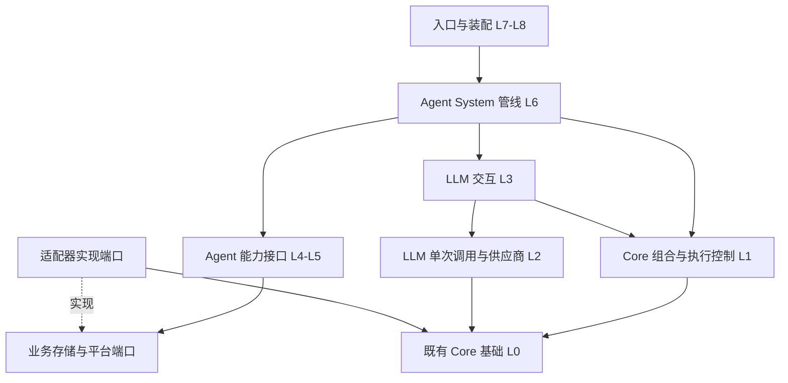

# 当前架构与行为规格

按本次修改按需读取；当前进度及恢复规则只看 [开发入口](4.5.0-agent.md)。原文中的历史百分比、恢复清单和完整重读约定不再作为当前指令。本文件承接原第 10.1–10.10 节行为合同；拟定接口表示职责，实际类名以源码为准。

## 10. 可执行架构：从 Core、LLM 到 Agent 与管理功能

本轮结论：需求在现有 Java/Spring/Task/Event/Database 基础上可以落地。新增通用组合与执行控制可以放入 Core，记忆、人格、Skill 和聊天语义留在 Agent。采用轻量 Entity–Component–System 思路组合能力，保留普通服务和接口来表达业务；不引入逐帧循环、全局可变 World 或第二套任务/数据库框架。

本节中的接口名为实现规划，尚不是已经新增的源码。接口需先通过其所在层的契约测试，再接入上一层，避免再次形成一个承包模型、会话、记忆、权限和发送的巨型 Runtime。

### 10.1 补充答复收敛结果

| 项目 | 采用的规格 |
| --- | --- |
| 命令工具 | 暴露受控的命令分发工具，进入原 `CommandDispatcher`；所有已注册命令均可参与匹配，不再要求另填命令白名单。原命令的启用、客户端、scope、参数、权限及状态限制继续执行。工具自身仍须在本轮可用工具集中，不能伪造调用者。 |
| Skill | 实现本地 `SKILL.md` 加载、元数据、按需选择/启停和可用示例；Skill 描述流程与工具需求，不授予权限，不自行执行文件中的任意代码。 |
| 多 Agent 与执行工具 | 支持创建多个独立 Agent 实例及服务层协作，不做聊天中的自动分派。文件/代码执行只提供明确的工具扩展接口，本版不内置任意宿主命令执行器。 |
| 知识库 | 根据 R04 的最新答复，本版提供知识源/分块/检索扩展接口；完整文档导入、PDF/网页及向量后端延期。当前必须可用的是 Agent 自有记忆与聊天历史检索。 |
| 自然语言任务 | 实现自然语言创建、查询、取消任务及聊天内可读展示；复用 Core Timer 执行，但任务定义、持久化、权限和管理属于独立 Agent 能力。 |
| 触发级别与开关 | 最低被动仅 @/引用机器人；中级加入明确称呼和同发起者最近 5 分钟续聊；主动级再加入定时/接话、冷却与静默规则。默认采用最低被动。scope 未注册 Agent 时，对话、工具、采集、摘要和自主/定时执行全部关闭。普通配置注册/注销及说明不可用原因的管理入口仍须可达，否则无法开启功能。 |
| 密钥、模型与故障 | 密钥只由 Spring application 配置/环境变量读入，不再经 `/cfg` 或其他聊天指令写入，也不写入普通组件、Prompt 或快照。provider/model 以本地 config 为准，不硬编码候选模型。Agent 配置读取失败、必需路由或凭据缺失时记录不含密钥的原因，关闭 Agent 执行，不影响其他机器人功能。 |
| 配置引用权限 | memoryNamespace 可由 OWNER 修改，非 DEBUG 也能绑定已有空间，按用户选择保留这种共享语义。correctionKey 不作为 `/cfg` 可写字段，改由 DEBUG 专属指令管理；记忆导出、修改、克隆和清空同样使用独立 DEBUG 指令。由此不必为本次需求全面重写通用 `/cfg` 字段权限框架。 |
| 记忆与用户画像 | 在每个 memoryNamespace 内按 TeaNeko UUID 单独维护用户画像；同空间仍可检索不同用户/群/人格的记录。更换空间后，不沿用旧空间的画像。允许普通用户明确请求新增事实，维护能力与新增事实分开授权。 |
| 人格补正 | 是用户互动对人物表达/性格细节的影响，独立于用户画像与个人事实学习；保留基础人格、补正应用和补正生成的独立边界。允许的补正候选仍受 I04 字段白名单和来源审计约束。 |
| 切换人格 | 采用 R09 的 B：只让当前 scope 绑定新的空补正 key，不清空其他 scope 共用的原 key；先完成备份，再原子切换引用并重建短期会话。长期记忆仍由 memoryNamespace 决定。 |
| 次数限制 | R11 的“底层 3 次”落实为通用 LLM 交互服务的模型请求预算，可由本地配置设默认值，服务调用可显式指定。本计划将其定义为一次交互中实际发出的模型请求总数，工具往返也消耗该额度；不把它解释成每个阶段自动重试 3 次。独立后台任务使用自己的交互预算，所有调用统一统计。 |
| reset 与 namespace 管理 | 按 R12，`/agent reset` 的最新含义是创建并切换到新的空记忆空间，不再只是删几条短期消息。创建记录保留发起 UUID、来源 scope/client 和时间；提供自己创建的空间列表与 setnamespace。将“限定五次”落实为每个创建者最多持有 5 个活动自建空间，默认共享空间不占该配额，可本地配置；达到上限时提示改用已有空间，不自动删除旧数据。真正 clear 仅 DEBUG。 |
| stop 与共享会话 | 沿用“请求级停止”边界：普通用户可取消自己触发的请求，不能借共享群会话取消他人的请求；群级停止/任务管理由 scope 管理者或 DEBUG 执行。更换 namespace 时建立新的会话代次，旧请求不能再向新上下文提交结果。 |

上表中的默认被动级别、namespace 活动数限额和请求级 stop 是为已有答复补齐的具体实现解释，均以独立配置/策略表达，避免固化在大段业务判断中。

### 10.2 从低层到高层的依赖顺序

下表“可依赖”表示编译依赖方向。上层定义自己的业务端口，适配器实现这些端口；LLM 与 Core 不反向导入 Agent/App 业务类型。

| 层级 | 责任 | 主要接口 / 类型 | 可依赖 |
| --- | --- | --- | --- |
| L0 现有 Core 基础 | TaskFuture、执行器、Timer、Event、数据库事务、缓存、FileConfig、日志及时间工具。 | 复用现有 `ITaskService`、`ITimerService`、`IEventService`、`IDatabaseService`。 | Java 与现有基础依赖。 |
| L1 Core 通用组合与控制 | 类型安全组件、实体快照、System 顺序、取消/截止时间、通用资源预算。 | `EntityId`、`ComponentKey<T>`、`ComponentView`、`EntitySnapshot`、`IEntitySystem`、`SystemPipeline`、`ExecutionControl`。 | Java 基础；通过适配器接 L0，不出现 LLM、人格或 scope 规则。 |
| L2 LLM 协议与单次调用 | 统一消息/图像、Options、Usage、基础工具协议、能力声明、模型路由和供应商映射。 | 现有 `ILLMModel`、`ILLMModelService`；新增 `ModelCapabilities`、`IDefaultModelResolver`、`ICredentialResolver` 及可信工具上下文协议。 | L0，必要时使用 L1 的通用执行数据；不依赖 Agent、平台消息或具体 ECS 业务实体。 |
| L3 LLM 交互与工具 | 模型/工具有限往返、实际调用计数、可信工具上下文、结果回填与终止。 | `ILLMInteractionService`、`LLMInteractionRequest/Result`、`IContextualToolExecutor`、`ToolInvocationContext`、`LLMCallLimits`。 | L0/L1 的执行控制及 L2；不读取人格、记忆或聊天配置。 |
| L4 Agent 定义与业务端口 | Agent 实例、会话/轮次身份、配置快照、记忆空间与补正引用、输出计划。 | `AgentDefinition`、`AgentHandle`、`IAgentFactory`、`IAgentRegistry`、`AgentRunRequest/Result`、各能力端口。 | L1/L2 的稳定类型；业务端口不暴露 JPA、WebClient、OneBot。 |
| L5 Agent 能力服务 | 记忆/画像、历史、人格补正、Skill、知识源接口、计划任务与管理策略。 | `IMemoryService`、`IUserProfileService`、`IConversationHistory`、`IPersonalityService`、`ISkillService`、`IKnowledgeSource`、`IAgentScheduleService`。 | L4 端口与所需低层协议；不相互读取对方 Repository 或组件内部状态。 |
| L6 Agent System 管线 | 组合能力、管理会话顺序、构造 Prompt、调用 LLM 交互、生成/提交结果。 | `IAgentService`、会话执行器、各 `IEntitySystem` 实现及 Agent 事件桥。 | L1、L3、L4/L5 接口。 |
| L7 适配与平台接入 | 数据库存储、Spring 配置、原生消息转入、命令桥接、Client/Sender/Response、任务卡片和平台回复。 | Repository/Config 适配器、`ICommandInvocationPort`、`IOutboundPort`、`ITaskPresentation` 等端口实现。 | 对应业务端口、App/Core；OneBot 专属实现只放在适配边界。 |
| L8 装配与启用 | 创建 Bean、选择适配器/策略、构造 Agent 实例、验证配置与启用状态。 | `_app_config` 中的 composition root、readiness/config 校验。 | 各层的显式接口和实现；不承载对话业务。 |

不允许的依赖示例：Core 导入 `AgentMemoryRecord`；LLM 模型服务导入 Agent 文件配置接口；记忆服务直接操作 OneBot sender；组件保存 Repository/Bean；平台接收器直接拼供应商 HTTP JSON。默认路由由 LLM 所属端口提供，当前文件布局的读取适配在装配层完成，不让文件路径决定代码耦合。

### 10.3 Core 的轻量 ECS 组合模型

#### 10.3.1 最小通用能力

拟在 `teanekocore/framework/composition` 放置数据与组合协议，在 `teanekocore/actuator/execution` 放置对现有 Task 的执行控制适配。新增目录不要求搬迁现有框架代码。

| 通用能力 | 最小职责 | 限制 |
| --- | --- | --- |
| `EntityId` | 稳定标识一个可组合对象。 | 不编码平台用户权限或数据库表名。 |
| `ComponentKey<T>` | 以稳定 key+类型访问组件；拒绝同 key 不同类型。 | 不使用散落的字符串强转或 `Map<String,Object>` 作为公共 API。 |
| `ComponentView` / `EntitySnapshot` | 向 System 提供只读、带 revision 的组件快照。 | 组件值采用不可变 record/防御性集合；不把任意 mutable Bean 当作快照。 |
| 实体写入与 `ComponentPatch` | 受控添加、替换、移除组件；按预期 revision 提交。 | 同一实体的提交由其拥有者串行处理；不把数据库事务假装成内存 patch。 |
| `IEntitySystem` | 声明输入、输出与前后依赖，执行单个明确步骤。 | 依赖服务由构造器注入，不从实体中查找服务。 |
| `SystemPipeline` | 编译顺序、校验缺失依赖/重复 ID/环、顺序执行并传播停止/失败。 | 按请求/事件运行，不建立逐帧 tick；无依赖的步骤也不自动并发写同一实体。 |
| `ExecutionControl` | 取消 token、截止时间、运行 ID/父子链路、通用预算计数。 | Core 只提供通用计数机制；“模型调用”“工具次数”的维度由 LLM 声明。 |
| 任务适配 | 复用现有执行器和 TaskFuture，在边界对接 JDK CompletionStage。 | 不另建线程池，不在管线步骤中递归等待同一会话队列。 |

管线只暴露继续、跳过、停止、失败等少量明确结果。缺少必需组件应报契约错误；可选能力只有在声明为 optional 时才跳过，不静默吞掉装配问题。System 的依赖关系在装配/配置改变时校验，不在每条消息上重新扫描整个 classpath。

#### 10.3.2 Agent 中如何使用实体

| 实体 | 生命周期与数据 | 写入边界 |
| --- | --- | --- |
| Agent 实例 | 定义 ID、实例 ID、模型选择、已启用能力与策略引用。 | 定义快照可共享；实例状态独立。`IAgentFactory.create(definition)` 创建新实例，不自动授予 scope 权限。 |
| Conversation | scope/client/agent 实例与会话代次、近期历史索引、摘要引用。 | 同会话邮箱串行提交；新 namespace/基础人格建立新代次。 |
| Turn | 当前发起者、输入、配置/权限快照、检索结果、Prompt、运行结果、发送计划。 | 单轮 System 有序写入；不能覆盖可信发起者和已解析的绑定引用。 |

长期记忆记录、namespace 注册表和计划任务仍由独立业务服务/Repository 管理，不强制把所有数据库行变成可变组件。相同基础人格的两个 Agent 可以组合不同工具、Skill、记忆空间和触发策略，无须为每种组合新增继承子类。

实体不保存密钥、Spring Bean、HTTP 客户端、JPA Session 或可随意取服务的容器。持久化使用显式 DTO/schema version，不直接序列化整个 Component 容器或 Java 类全限定名。

#### 10.3.3 Core 与既有事件的分工

System 表达顺序和数据依赖；Event 表达可观察/可取消的扩展节点。通过 Agent 事件适配器将 turn/model/tool 等节点接入 `IEventService`，不让两个系统各自重复执行同一步。事件取消要更新执行控制，事件结果替换后仍需重新验证预算、工具范围和可信身份。异步日志/监控监听器只能取得不可变快照，不能在步骤结束后任意改写当前轮。

### 10.4 LLM 底层接口与交互预算

| 层内接口 | 输入 / 输出 | 保持独立的职责 |
| --- | --- | --- |
| `ILLMModelService.call` | Prompt+有效模型选项 → 单次结果及 usage。 | 仍代表一次供应商请求，不偷偷加入 Agent 记忆、人格和工具循环。 |
| 模型能力与内容协议 | 模型相关 `ModelCapabilities`；文本/图片等统一 content。 | 能否读图取决于具体模型，mapper 负责协议转换，Agent 不检查供应商 JSON 字段。 |
| 默认路由端口 | 本地配置解析出的 provider/model。 | 实现可在装配层适配当前配置文件，LLM 不导入 Agent config。纯 LLM 测试可注入固定路由。 |
| 凭据解析端口 | provider 的配置引用 → 调用时所需认证。 | Spring application/环境变量提供密钥；仅传入请求认证边界，不复制进通用消息、组件或可导出的 options。 |
| `ILLMInteractionService` | 初始消息、工具定义、执行回调、`LLMCallLimits` 与执行控制 → 完整交互结果。 | 负责有限模型/工具往返、调用计数、tool ID 配对、透明 provider metadata 和终止原因。 |
| 工具定义/执行绑定 | schema 与可执行绑定分离；调用参数与可信上下文分离。 | 模型只产生业务参数，不能产生操作者、namespace、凭据或权限上下文。 |
| `IContextualToolExecutor` | tool call+显式上下文 → 可等待的工具结果。 | 通过兼容适配器支持旧 `ILLMToolExecutor.call(String)`；复杂业务可异步完成，不把 ThreadLocal 当作上下文传播方式。 |

预算的具体执行规则：

`LLMCallLimits` 保留原答复的默认组合：3 次模型请求、2 轮工具、6 次工具执行，分别可配置。显式降低模型次数时，可用工具轮数不能超过剩余模型往返能力；降低到 1 次时只做无工具收束，不暗中增加一次最终回答调用。

1. 默认最多 3 次实际模型请求，可本地配置，也允许服务函数明确指定；参数需为正值并受本次执行的总限额约束。
2. 每次请求前预占次数；失败后的再次请求同样计数。当前三个模型请求类已经设置 `retryCount=0`，继续避免 HTTP 层暗中再重试多次。
3. 工具回填后的下一次模型请求消耗同一预算。最后一次请求关闭工具并收束，不能因换 System/Skill 就重新获得 3 次。
4. 单次 HTTP 超时、工具超时和整轮截止时间分别存在，有效超时取剩余时间与阶段上限的较小值。现有 HTTP 注解超时为静态值，需要运行时执行策略适配才能遵守较短的剩余时间。
5. 独立后台摘要是独立交互，可传入更小上限且默认不开放工具；有自己的频率/积压限制，usage 统一汇总。为前台同一问题拆分的子步骤必须继承该轮总预算。
6. 模型/工具异常、空输出、截断、取消、超限分别返回明确结果；原始供应商推理状态按协议透明保留，不充当用户可见思考正文。

这样 Agent、摘要器、普通插件和将来的多 Agent 服务都可复用同一交互能力，而无需各自复制一份工具循环。

### 10.5 Agent 组件、System 与扩展点

| 组件 / 状态 | 拥有者 | 主要消费方 |
| --- | --- | --- |
| `AgentDefinitionComponent` | Agent 实例 | 能力选择、模型策略、管线装配。 |
| `ActorContextComponent` | 入站/调用适配器创建的可信只读值 | 命令权限、事实归属、管理操作审计；不由模型改写。 |
| `ScopeBindingComponent` | scope 配置解析器 | memoryNamespace、correctionKey、会话代次、注册/触发级别。 |
| `ModelRouteComponent` | 本轮配置快照 | LLM 请求构造与能力验证；不包含密钥。 |
| `ConversationWindowComponent` | 会话服务 | 近期窗口、时间轴、参与者信息与配对安全压缩。 |
| `RecallComponent` | 记忆/历史检索系统 | 来源明确的事实、画像和相关片段，不直接当作系统指令。 |
| `PersonalityComponent` | 人格服务 | 基础人格+补正快照、边界和版本。 |
| `ToolSetComponent` / `SkillSelectionComponent` | 工具/Skill 服务 | 本轮实际可见且可执行的工具与按需加载流程。 |
| `PromptComponent` | Prompt 装配系统 | LLM 交互系统；保留统一消息类型。 |
| `InteractionResultComponent` | LLM 交互系统 | 决策解析、事实/补正候选、最终输出。 |
| `ReplyPlanComponent` | 输出解析系统 | 平台出站适配器，含模型选择的 reply/@/分段动作。 |
| `TurnOutcomeComponent` | 提交系统 | 会话提交、响应 Future、事件和监控。 |

建议的前台顺序：启用与身份检查 → 固定本轮配置/代次 → 原生内容标准化 → 检索近期上下文/记忆 → 解析基础人格与补正 → 选择工具/Skill → 装配 Prompt → LLM 交互 → 校验输出与候选变更 → 持久化/会话提交 → 执行发送计划 → 输出响应及可选监控。

被动采集和后台摘要走独立管线，不占用同一会话的长时间模型锁。新增能力通过新增组件、端口实现和声明依赖的 System 接入；仅启用对应能力时组装进去，不在 Runtime 增加一串 `if provider/if plugin/if memoryType`。

每次提交和出站前检查 scope 是否仍启用、会话代次与相关引用是否仍有效。已切换人格/namespace 的旧轮可以结束或取消，但不得向新会话追加旧上下文。已经执行的外部副作用只记录真实状态，不声称回滚。

### 10.6 记忆、画像、人格和历史的解耦

#### 10.6.1 数据归属

| 数据 | 定位维度 | 写入 / 读取规则 |
| --- | --- | --- |
| namespace 注册记录 | `MemoryNamespaceId` | 记录创建者 UUID、创建来源、时间、状态、数据 generation；当前 scope 只保存其引用。不同 scope 可按 R07 绑定同一空间。 |
| 长期事实/偏好 | namespace+recordId，保留 subject UUID | 普通用户明确请求新增；在同空间允许跨用户检索，但不能丢失事实主语、来源或把别人事实写成当前用户的。 |
| 用户画像 | namespace+用户 UUID | 从该空间已接受的事实/偏好形成可追溯画像；换空间后不复制旧画像。画像是读取视图，不成为一份脱离证据的重复“真相”。 |
| 对话历史 | client+scope+消息 ID，另记采集时的 namespace/会话代次 | 仅已启用 scope 采集，默认保留 7 天并分页检索。当前 scope 的常规回忆同时使用有效绑定/代次过滤，避免 reset 后工具立即将旧空间内容重新注入。 |
| 短期窗口/压缩摘要 | conversationId+epoch+覆盖消息序列 | 缓存或持久化可重建状态；不算用户个人事实记忆，不跨人格/namespace 切换继续沿用。 |
| 基础人格 | definitionId+version | 文件/配置读取，不由用户画像或学习补正覆盖身份和运行硬边界。 |
| 人格补正 | correctionKey+revision | 独立服务和存储；应用于基础人格的允许字段，不挂在用户画像下，也不随 memoryNamespace 自动清空。 |
| 补正备份 | `backup-<原key>-<时间>`，必要时附唯一序号 | 备份指定 revision 后再切换当前 scope 引用；其他 scope 继续使用原 key。 |
| 工具执行记录 | executionId+toolCallId | 记录真实副作用与完成状态，支持去重和重放判断；不与对话摘要混存。 |
| 计划任务 | taskId+创建者+目标 scope | 独立于记忆 namespace；切换记忆空间不会悄悄删掉任务，执行时仍检查当前 scope 注册状态和权限。 |

`MemoryNamespaceId` 是面向业务的共享空间标识，不直接等同 Core EasyData 的存储 namespace 字段。由适配器映射这些层次，避免“换存储表名”“换画像 key”“换人格”三个操作都被称为换 namespace。

#### 10.6.2 能力端口

| 端口 | 单一职责 | 不负责 |
| --- | --- | --- |
| `IMemoryNamespaceService` | 创建、绑定、列举本人创建的空间、配额、克隆/清空与 generation。 | Prompt、角色表达、平台消息发送。 |
| `IMemoryStore` / `IMemoryService` | 事实记录、版本、去重、事件时间与有效性过滤。 | 替用户切换 scope 配置，或直接调用供应商模型。 |
| `IUserProfileService` | 按 namespace+UUID 构建/读取画像，保留事实来源和重建版本。 | 人格补正、推断未经允许的个人事实。 |
| `IMemoryRecallService` | 组合来源、时间、类型、关键词等检索并按预算返回证据。 | 让模型自由指定未经本轮绑定的空间、数据库表或任意查询语句。 |
| `IConversationHistory` | 追加历史、分页/时间/关键词查找、保留期清理。 | 因记忆共享而默认开放全部私聊原文。 |
| `IPersonalityService` / `ICorrectionStore` | 解析基础人格、筛选/保存补正、备份与引用切换。 | 管理用户画像或修改密钥。 |
| `IKnowledgeSource` | 为以后文档、向量等来源提供标准证据检索接口。 | 本版承诺尚未实现的 PDF/网页/embedding 后端。 |

“更拟人”的第一步是可解释地记住称呼、明确偏好、事件时间、最近互动与来源，并在证据不足时承认不记得。事实、偏好、关系和事件均可扩展，但本版不把所有聊天自动写成人格或个人画像，也不以无证据的情绪值替代记忆。关系/片段等未来类型通过新策略和记录类型接入，不修改现有事实读写路径。

检索顺序为：当前空间中的相关事实/画像 → 当前有效历史中的相关片段 → 若持有已知消息 ID，尝试客户端补取。查询无结果、来源不可用与工具失败要区分；不能把“前 12 条里没有”或“客户端不支持搜索”伪装成确定不存在。

#### 10.6.3 持久化、并发与生命周期

- 业务服务只依赖 Repository 端口。初期可由现有 EasyData/DatabaseTask 适配，但不继续用无保护的整列表覆盖；事实按稳定记录键追加，画像/引用使用版本控制。高频聊天历史和计划任务可使用独立的、带索引的 JPA 表，业务实体仍位于 Agent 存储适配目录。
- 保留旧 `llm_related` 数据的兼容读取/迁移入口，不因换 Java 包名另造同义表。兼容键和新业务键之间有明确映射，不把旧 scope 隔离结构继续强加给新共享空间。
- 创建 namespace 与修改当前绑定作为一个可观察的事务结果；持久化成功才返回“已切换”。切换失败保留原绑定，不先清内存再丢失引用。
- DEBUG 清空先推进 namespace generation；普通读取立即看到空的新代次，再分批处理旧记录。迟到的旧轮/后台任务必须校验 generation，不能在 clear 后把旧画像或事实写回来。
- 人格备份与新补正引用切换需要处理 revision 和共享引用；克隆复制的是记录快照，不是共享一个可变内存 List。
- 清理按业务域、时间索引和固定 batch 分页，不调用全表 `findAll()` 再过滤。用户主动创建的持久空间与 30 分钟内存会话 TTL 互不替代。

### 10.7 命令工具与自然语言计划任务

#### 10.7.1 命令桥接的可执行方案

现有 `ICommandDispatcher.dispatch(...)` 和 `ICommandExecutor.execute(...)` 均返回 void，实际在事件/Task 中继续执行。因此“调用分发方法没有抛异常”不能等于签到或其他业务已成功。

按用户最新要求，命令处理方法统一返回 `CompletionStage<?>`，一般为 `CompletionStage<Void>`；异步业务/发送链也要被该 Stage 包含。分发与执行入口返回可等待结果，反射执行器展开并等待处理方法返回的 Stage；扫描器在统一迁移完成后拒绝 void/非 Stage 的命令处理方法。普通调用者可以忽略返回值，但不能保留一条提前完成的旧 void 执行旁路。

分发回执区分未匹配、被取消、参数/权限/scope 拒绝、已提交与执行完成/失败。若处理方法未等待其内部异步业务，属于需要修复的命令实现缺陷，不能仅凭反射调用返回就宣称成功。迁移包括 Core、App、Client、Plugin 命令及对应测试/文档。

| 接口边界 | 实施要求 |
| --- | --- |
| Agent 的 `ICommandInvocationPort` | 接收命令文本与可信发起上下文，返回结构化回执；接口不依赖具体 OneBot sender。 |
| App 适配器 | 复用命令解析/分发，保留原客户端类型、UUID、平台身份和 scope，不使用内部 Agent Client 身份冒充来源。 |
| Core 分发回执 | 走现有 Dispatch/Execute Event 与权限链，为所有终止路径完成 Stage；展开处理方法的 Stage，异步异常必须传播到分发调用者。 |
| 原生命令反馈 | 默认保持原命令的正常平台回复，回执标明反馈归属。Agent 不再额外捏造一份“执行成功”；将来支持结构化业务返回时通过可选协议接入。 |
| 防重入 | 保留执行链路 ID；识别同会话递归调用 Agent、自触发计划和重复副作用，快速返回明确结果，不让工具等待自己占有的会话队列。该限制不替代原命令权限。 |

本版会按最新要求迁移全部命令处理方法，不通过直接反射调用插件方法绕过分发。通用异步执行与回执协议留在 Core；对聊天消息的反馈收集、展示与整合留在 App/Agent 适配器。

#### 10.7.2 计划任务的最小闭环

新增 `IAgentScheduleService`、`IScheduleStore`、`IScheduledActionExecutor` 和 `ITaskPresentation`。自然语言只生成任务候选，代码负责校验目标 scope、创建者、时间、重复规则和动作能力，再持久化。时间含糊时在对话中澄清，不静默猜测一个日期。

任务规格至少包含：ID、标题、创建者/来源、目标、动作类型/参数、单次或重复规则、时区、下一次执行时间、状态、最近结果、revision。动作使用可注册执行器，可支持提醒/对话任务/原命令分发；文件或代码执行不因定时器存在而自动开放。

| 阶段 | 行为 |
| --- | --- |
| 创建 | 使用当前真实发起者校验，先落库再返回成功和任务卡片；同一请求重放不重复创建。 |
| 运行 | 由 Core Timer/Task 驱动；按 taskId+计划发生时间取得一次执行权，再解析当前有效配置。任务执行者不能自称 DEBUG，命令动作需重新验证原创建者当前权限；权限无法验证则跳过/暂停并记录原因。 |
| 配置关闭 | scope 未注册/禁用时，暂停采集、主动行为和任务动作，不继续使用旧配置执行；任务记录保留供后续管理。 |
| 取消/修改 | 按任务归属与 scope 管理权限执行，更新 revision/状态；已取消任务的旧回调不再产生新动作。 |
| 重启 | 重新装载有效任务，绑定 Timer 句柄。默认不批量补跑错过的写操作；单次过期任务标记过期，重复任务计算下一次有效时间。 |
| 时区 | 使用任务中明确的 ZoneId/Clock 计算执行时间，不依赖服务器默认时区；必要时为 Core Timer 增补兼容的时区/句柄接口。 |

任务可视化首先面向聊天：可分页的任务列表、单任务卡片、时间顺序视图，展示标题、简短 ID、下次时间/时区、状态、重复方式和最近结果。支持 `/agent tasks`、查看详情和取消；使用普通消息/转发消息渲染即可，不把“可视化”扩大成另建 Web 管理站。渲染端口可在以后替换为图片或其他客户端卡片。

### 10.8 从一次入站到共享状态变更的顺序

| 场景 | 必须保持的步骤 |
| --- | --- |
| 普通群消息 | 先检查 Agent 注册/级别，再采集允许的元数据和内容；未达到发言条件不调用模型。达到条件后形成带发起者的独立 Turn，进入该群会话队列。 |
| 工具内写事实 | 从本轮可信绑定取得 namespace、发起 UUID 和 generation；验证明确新增意图与内容，再以稳定记录 ID 提交。模型参数不能替换这些绑定。 |
| 应用/生成人格补正 | 读取基础人格与 correction revision；候选只影响允许字段。存入独立 correction store，不借它自动生成用户画像事实。 |
| 切换人格 | 读取并备份旧 correction revision → 为当前 scope 建立新空补正 key → 原子更新绑定和会话 epoch → 旧轮停止向新代次提交。其他 scope 的原 key 不清空。 |
| reset / setnamespace | 检查调用者与创建配额 → 创建新空间或查找已有空间 → 持久化当前 scope 引用 → 新画像/摘要/短期会话代次 → 返回切换结果；不删除原空间。私聊普通用户管理自己的配置，群内仍用 OWNER/DEBUG 边界。 |
| DEBUG clear | 校验真实 DEBUG → 推进目标 namespace generation 并完成逻辑清空 → 分批清理旧记录/索引 → 返回可跟踪的管理结果；不允许旧任务重新写回旧 generation。 |
| 配置加载失败 | readiness 进入不可用，取消/阻止后续 Agent 执行并记录具体非敏感原因；不改写成静默默认模型，不关闭整个 App。配置修正后通过明确重载/启用流程恢复。 |

namespace 列表按创建者分页，创建来源用于审计；它不是“只有创建者可读”的新权限规则。按 R07，OWNER 绑定已有空间仍有效。clear、克隆、导出是独立管理操作，不能通过普通 `/cfg` 字段反射修改间接调用。

### 10.9 扩展接口与维护约束

跨层调用至少明确以下操作和返回含义；其余内部实现类不必全部另配接口：

| 接口 / 调用 | 输入和返回合同 |
| --- | --- |
| `ComponentView.find/require` | 按 `ComponentKey<T>` 返回正确类型；可选不存在返回 Optional，必需缺失报告组件 key，不暴露业务数据。 |
| `SystemPipeline.execute` | 实体快照+执行控制 → CompletionStage 形式的管线结果/patch；不让 System 直接持有其他实体的可变容器。 |
| `ILLMInteractionService.interact` | 消息、工具绑定、调用限额、工具上下文 → 完整 transcript、最终候选、各请求 usage、终止原因；不自动写业务历史。 |
| `IAgentFactory.create` | AgentDefinition → 新 AgentHandle；仅构造与组合能力，不自动注册 scope、切 namespace 或启动自主任务。 |
| `IAgentService.run` | AgentHandle、原生输入的规范化请求、可信调用上下文 → AgentRunResult；经过统一启用门控及会话队列。 |
| `IMemoryNamespaceService` | create/bind/listCreated/clone/clear 使用不同 command，写操作带操作者、预期版本与幂等键；返回持久化后的 namespace/绑定结果。 |
| `IMemoryService.append` | 事实写入 command+可信 namespace generation/subject/来源 → accepted/duplicate/rejected 的写入结果；accepted 表示已持久化。 |
| `IMemoryRecallService.recall` | 当前空间与 subject 提示、查询/时间范围、结果与字符/token 上限 → 带来源和置信信息的证据，不返回任意 Repository 对象。 |
| `IPersonalityService` | resolve/propose/apply/backup/switch 使用不同操作；人格切换返回新的绑定和会话代次，补正生成不调用画像管理 API。 |
| `IAgentScheduleService` | create/get/list/update/cancel 返回已存储规格、分页视图或状态结果，不能只返回内存 Timer 对象。 |
| `ICommandInvocationPort` | 命令文本+可信发起者 → 分发/执行回执；明确是否有原生命令反馈及是否获得真正业务结果。 |
| `IOutboundPort` | 已校验的 ReplyPlan+来源目标+幂等键 → 每段发送结果与整体状态；模型不能任意改变执行目标。 |

| 以后要增加的能力 | 应新增/替换的部分 | 不应改动的部分 |
| --- | --- | --- |
| 新模型供应商/图片能力 | LLM adapter、能力声明、协议映射与契约用例。 | 人格、记忆存储、平台触发和 Core。 |
| 新工具/文件执行器 | 工具绑定、显式执行上下文与对应执行策略。 | LLM 循环、已存在的其他工具和 Actor 身份规则。 |
| 新记忆类型/检索策略 | 新记录/策略及对应 Store/Recall adapter。 | namespace 生命周期、用户 UUID 语义和基础人格接口。 |
| 文档/向量后端 | `IKnowledgeSource` 或 Recall adapter。 | Runtime、聊天命令、用户画像和 LLM provider。 |
| 新 Skill | 本地技能描述及必要的已授权工具。 | System 主循环和平台权限。 |
| 新平台/任务卡片 | 原生消息/出站/命令和 presentation 适配器。 | 记忆核心、LLM 协议和 Agent 定义。 |
| 多 Agent 工作流 | 使用 AgentFactory/服务组合实例，显式传递输入与预算。 | 不共享可变 Conversation、补正内存 List 或其他实例的权限。 |

维护约束：

- 仅在跨模块边界、可替换策略和外部资源访问处定义接口，不给每个 DTO/工具类增加一一对应的空接口。
- 服务通过构造器依赖接口；组件只放数据和受控运行句柄。避免静态全局上下文、ThreadLocal 传身份及业务代码自行取 Spring Bean。
- 对外配置、模型响应、工具参数、组件数据和持久化记录分别校验，不能因为都是 JSON 就共用一个可任意修改的 Map。
- 配置/人格/工具/Skill 在一轮内使用同版本快照；可选能力缺失有明确降级，必需能力缺失有明确错误。重载使用新快照替换，不能清掉其他实例仍在使用的注册表。
- 主流程只依赖端口，不同时读写多个能力的内部缓存。副作用通过持久化服务或工具执行器提交，效果和失败可观察。
- 在现有单工程内用包边界与导入依赖校验约束方向；本版不为分层而先拆 Maven/Gradle 多模块。

Core 的必要改动控制在通用缺口：新增组合/执行控制，给 TaskFuture 提供不依赖 `finish().join()` 的非阻塞边界适配，为 APIResponse 增加可选的运行时超时/取消策略，给 CommandDispatcher/Executor 增加兼容的分发回执。Timer 的时区/句柄扩展仅在适配现有能力不足时增加。业务画像、namespace 配额、Skill 和计划任务表均不进入 Core。

### 10.10 按依赖顺序实施与验收

此顺序替代第 5 节早期按旧能力迁移的阶段安排，后续从最底层开始。每一阶段均需有最小可验证使用方，避免先写大量没有调用者的抽象。

| 顺序 | 交付 | 必须验证的行为 |
| --- | --- | --- |
| S0 构建与边界基线 | 固定 JDK 25 的构建方式，保存现有未提交改动基线，明确新旧包扫描/测试边界。 | 主源码和测试源码可编译；当前用户改动不被覆盖。 |
| S1 Core 组合与执行控制 | 类型安全组件、快照/patch、依赖管线、取消/截止时间/预算及 Task 适配。 | 类型冲突、重复 System、缺依赖/依赖环被拒绝；取消/超时终止；不同实体互不污染。 |
| S2 LLM 单次调用边界 | 移除对旧 Agent 配置的依赖，接 Spring 凭据，能力验证和图像 content/mapper。 | LLM 可脱离 Agent 运行；配置密钥不出现在消息/快照；已选模型的图文请求结构可离线验证。 |
| S3 LLM 交互与工具上下文 | 有限工具循环、可信上下文、实际调用预算、异常/取消、provider 状态回放。 | 默认 3 次严格计数且服务参数可覆盖；多工具 ID 配对正确；无越界执行/隐性重试；不要求数据库或平台启动。 |
| S4 Agent 实例与会话 | Factory/Registry、Agent/Conversation/Turn 组件与管线、scope gate、群共享与会话代次。 | 新建两个实例状态独立；未注册入口与后台执行均关闭；同群顺序和跨会话并发正确。 |
| S5 记忆与人格生命周期 | namespace 注册/配额/绑定、按 UUID 画像、独立 correction、历史/摘要与检索。 | 换空间无旧画像回灌；共享数据保留主体；切人格不清其他 key；clear 后旧写入被拒绝；并发不丢记录。 |
| S6 命令桥接与管理接口 | 可等待回执、全量原命令分发、namespace/personality 管理、原生反馈整合。 | 原权限/客户端/scope 限制全部生效；拒绝/未匹配也能结束 Future；提交不冒充业务成功；递归不会锁住会话。 |
| S7 Skill 与扩展服务 | Skill 加载/按需使用；多 Agent 服务组合；文件/代码/知识源扩展接口。 | 示例 Skill 可运行，工具依赖不授予额外权限；多 Agent 不自动分派，不共享可变运行状态。 |
| S8 自然语言任务与主动级别 | 任务规格/持久化/管理/展示、Timer 适配、主动/被动触发策略。 | 创建后可列举/取消/重启重建；禁用与权限变化阻止后续动作；静默、冷却和重复执行控制生效。 |
| S9 平台全链路与文档 | Client/Sender/Response、LLM 发送计划、监控隔离、配置/操作文档，最终删除旧包。 | FakeClient 离线验证从入站到多段输出；现有测试适当回归；新生产代码无旧包依赖；部署与配置迁移可复现。 |

真实模型/数据库/OneBot 联调在其依赖的离线契约通过后按环境单独执行，不用一套依赖真实密钥和数据库的 SpringBootTest 覆盖所有底层功能。性能验收分别记录普通对话、图片、工具循环、队列和后台摘要，30 秒仍是普通对话目标，不能由本次编译结果推断已达到。

