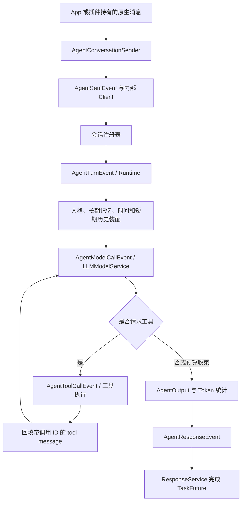
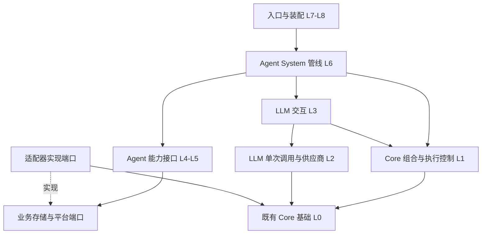

# 4.5.0 Agent 改编升级：需求确认与实施计划

创建日期：2026-10-27  
当前状态：S1、Command、S2、S3、Javadoc 专项及 S4 已通过离线验收；S5 已交付空间注册/绑定、事实/旧 JSON 导入、Recall、可追溯画像、实际记忆工具、自动记忆 Prompt/授权重放，以及基础人格、独立补正应用和切换生命周期。默认人格实际进入模型，切换时原子备份并为当前 scope 绑定新空补正，重建短期会话；共享原 key 的其他 scope 与长期记忆保留。Gradle 9.8.0、Spring Boot 4.1.2 强制重编译通过，940 项离线测试成功，1 项真实模型测试跳过。整体按功能和剩余验收工作量粗估约 85%，不按文件/测试数量或固定增量计算。后续继续以完整功能闭环推进，只补必要的关键测试；下一目标为持久化聊天历史及可用检索工具，恢复入口见第 11.62 节。自动摘要、自动补正生成、管理/平台接入及真实环境联调仍待后续执行。
实现目标：`src/main/java/org/zexnocs/teanekoagent`。  
主要参考：`src/main/java/org/zexnocs/teanekoagent_old`。

## 1. 本阶段约定与填写方式

本次仅整理现状、需求和后续实施方案。**以下 60 项需求全部得到答复、相互冲突的选择得到澄清后，才开始编写或迁移 Agent 源码、配置和测试。** 不先搭建代码骨架，也不先移动旧文件。

每项的“你的答复”均为待填写项，“建议”只是讨论起点，不代表已经确认。可以填写“采用建议”“保留旧行为”“本版不做”或具体要求；涉及模型、数量、范围的项目可以直接填写实际值。可以分批按编号回复，也可以直接修改本文件；明确回复“其余全部采用建议”也可作为对应项目的答复。留空或暂未回复不视为同意。

2026-10-28 复核补充：第 3 节原始问题、建议和用户答复完整保留作对照。实际需求以用户答复为准；“同建议，但……”中的明确补充覆盖原建议的相应部分。60 项已填写不等于所有交叉语义已明确，第 9 节只追问尚需决定的内容，不要求重新填写原表。

本轮复核补充：第 9 节的 12 项也已填写，第 10 节据此收敛规格，不再沿用已被新答复替代的候选方案。本轮交付可执行性复核、从底层到高层的接口与组件设计，以及开发顺序；Core 的通用能力增补已纳入范围。第 3、9 节保留的原始答复用于追溯，最新取舍以第 10 节为准。

实施约定（用户最新要求）：按完整功能闭环分批实现，每次“继续”尽可能一并完成一个功能的实现、实际接入和必要验证，再停下等待下次指令；不按固定百分比或过细子阶段拆分。优先开发正确、可用的功能，只补必要的核心流程、重要约束及高风险边界测试，复用原夹具与覆盖，不用测试数量/覆盖率替代交付。每次上下文压缩后必须重新读取本文件，尤其是第 10 节规格与第 11 节实施记录，再继续编辑。所有命令处理方法统一返回 `CompletionStage<?>`，一般为 `CompletionStage<Void>`；命令分发/执行也必须可等待，不能只把原 void 方法包成一个提前完成的 Stage。

答复示例：

```text
A01：聊天助手为主，同时开放插件调用。
B02：私聊默认响应；群聊仅被 @ 时响应，需要先开启配置。
C01：群内按用户独立，暂不共享短期上下文。
G02：只有用户明确要求记住时才自动写入。
J05：本版不开放群管理工具。
```

本计划依据当前工作区调研，包含原本尚未提交的任务系统、缓存和 FakeClient 改动；它们不等同于 `v4.4.0-main` 标签中的内容。本次不修改这些已有改动，不提交代码，不更改版本文件。

## 2. 项目阅读结果

### 2.1 阅读范围与项目结构

调研范围包含根 README、`docs` 中的说明和更新记录、源码内全部模块 README、Gradle 构建脚本与 `buildSrc`、资源配置模板、主源码和测试源码。首次调研时已有 Markdown 文档共 48 份，不含本计划，其中 `docs/details.md` 为空。

源码采用全量文件盘点、包依赖、注解和公开 API 扫描，再重点展开 Agent 运行链路及其依赖的实现。统计如下，数量包含当前工作区文件：

| 模块 | 主源码 Java 文件数 | 测试 Java 文件数 | 与本次工作的关系 |
| --- | ---: | ---: | --- |
| `teanekocore` | 226 | 15 | TaskFuture、任务/事件、数据库事务、EasyData、缓存、文件配置、热重载和日志。 |
| `teanekoapp` | 77 | 18 | 原生消息、用户身份、客户端、Sender/Response、命令、作用域配置和 FakeClient。 |
| `teanekoclient` | 126 | 0 | 现有 OneBot 适配、消息内容转换、状态和发送限制。 |
| `teanekoplugin` | 77 | 1 | 现有命令与监听器的接入习惯、权限与业务服务复用边界。 |
| `teanekoagent` | 79 | 9 | 已存在的 LLM 基础设施，应以此为基础扩展。 |
| `teanekoagent_old` | 86 | 7 | 本次上层 Agent 改编的主要参考实现。 |
| 合计 | 671 | 50 | 完成静态梳理；本阶段未运行应用、构建、数据库集成或真实模型请求。 |

本次对 Agent 的 Runtime、上下文、Prompt、受控决策、工具注册和执行、记忆读写、人格解析和学习、内部客户端、Sender/Response、Token 监控，以及 App/Core 接口和扫描逻辑进行了重点核对。其他业务插件用于理解集成关系，不将其功能并入本次重构。

### 2.2 可以直接承接的基础能力

| 现有能力 | 已确认的代码事实 | 后续处理方向 |
| --- | --- | --- |
| 构建与技术栈 | 构建脚本使用 Java 25、Spring Boot 4.1.0、Gradle Kotlin DSL、Jackson 3、JPA/MySQL、虚拟线程及 Reactor。 | 沿用当前技术栈，不为 Agent 另建工程。 |
| LLM 抽象 | 新包已有 Prompt、Message、Options、Result/Usage、Function Tool 及模型服务。 | 继续使用这些抽象，避免维护平行的消息或工具协议。 |
| 模型适配 | 代码中注册了 `deepseek`、`openai`、`kimi`；OpenAI 的注册适配器使用 Responses，Chat Completions 通用层不单独注册。 | 保持现有路由与协议映射；具体默认模型见 D01。这里描述仓库实现，不作为供应商最新能力说明。 |
| 模型参数合并 | 模型内建参数 → `config/agent/model.yml` → 单次 Prompt 参数，路由 provider 最终由注册 ID 固定。 | 在该顺序上明确 Agent 和作用域覆盖规则。 |
| 原生消息 | `ITeaNekoMessageData` 已携带来源客户端、scope、消息时间/ID、用户 UUID、平台 ID、昵称和内容段。 | 尽量保持原生消息入口，不新建重复的入站消息模型。 |
| 异步调用 | App 已有 Sender → SentEvent → Client → ResponseEvent → TaskFuture 链路。 | 可以承接旧版三类 Agent 操作。 |
| 配置与存储 | 文件配置、ConfigData、EasyData、事务任务、重载、定时器和日志均可复用。 | 明确装配、写入完成与业务返回的顺序。 |
| 测试替身 | 当前 FakeClient 可以构造群/私聊消息、接收响应并记录发送结果，已有相关测试。 | 用它做平台无关的 Agent 集成验证，不默认调用真实聊天平台。 |

### 2.3 旧 Agent 的实际主链路

旧实现已经包含上层 Agent 的主要模块，迁移并非只移动包名。它的当前调用链是：



旧 Runtime 自身不发送外部平台消息，也未提供完整的通用“自动监听聊天并回复”接入。内部 Agent Client 不接收 WebSocket，不冒充普通平台消息事件。自动回复入口、触发规则和出站发送仍需在 B 组明确。

### 2.4 改编时需要处理的差异

以下为静态代码发现，尚不代表已通过运行复现；对应处理方案将在需求确认后落实。

| 编号 | 现状与依据 | 对新实现的影响 |
| --- | --- | --- |
| 现状01 | 新包 `LLMModelService` 仍导入旧包的 `IAgentFileConfigService`。 | 上层迁移时需要消除新包对旧包的生产依赖，并明确默认模型配置的归属。 |
| 现状02 | 应用使用 `scanBasePackages = {"org.zexnocs"}`；旧包仍有 `@Service`、`@Component`、`@TeaNekoClient` 等注解。`AgentConfig` 的自动配置包已指向新包，Core 类扫描又使用 `AutoConfigurationPackages`。 | 旧目录不等于停用目录。需要统一检查组件、事件、文件配置、Entity 和 Repository 的扫描范围，避免重复注册或漏装配。 |
| 现状03 | 旧默认 conversationId 使用 client、scope 和平台用户 ID，没有 agentId；注册表只校验 scope 和 user 是否一致。 | 需要决定人格隔离、群共享会话与身份规则，防止复用同一会话时忽略 Agent 的变化。 |
| 现状04 | 上下文只有单次列表操作使用同步保护；整轮模型/工具循环没有会话级串行边界。注册表也没有会话淘汰机制。 | 同会话并发可能交错历史；需要定义排队、取消、过期和资源回收。 |
| 现状05 | 旧压缩策略保留首条 system 和末尾若干消息，未按完整对话轮次或 tool call/result 配对截断。 | 新压缩必须保留工具协议闭环，以及相关 provider metadata。 |
| 现状06 | 旧 Runtime 只提取文本片段，未保留发言者名称、引用、@、图片等完整语义。 | “App 有图片消息”不代表 Agent 已具备多模态能力，需单独界定输入范围。 |
| 现状07 | 旧 Runtime 默认工具轮数为 3，受控思考最多 3 次模型调用；实际允许的工具轮数会被夹到 2。单轮工具调用总数没有独立上限。 | 模型调用、工具轮数、工具总数和总耗时应分别定义，再统一执行预算。 |
| 现状08 | 工具执行按全局注册表查名称；Prompt 暴露的包筛选没有成为执行时的白名单。记忆工具允许模型直接提交 scope、agent、user。 | 本轮可见工具和实际可调用工具需要一致，数据访问身份由可信请求上下文约束。 |
| 现状09 | `memoryEnabled` 主要控制人格解析时的记忆注入，不能据此认定工具读写也已关闭。 | 记忆读、写、自动学习开关必须覆盖对应的执行路径。 |
| 现状10 | 旧记忆和人格记录采用“读取列表 → 修改 → 异步写回整个列表”；调用 `.push()` 后即可返回。 | 并发写入、更新丢失、幂等和“已写入”的返回语义需要明确。 |
| 现状11 | 人格的 `mutableFields` 已存在，但 `PersonalityBoundaryPolicy.accepts` 并未将它作为严格可学习字段白名单；主要检查不可变字段、少量关键词和置信度。 | 不能把现有人格学习机制直接视为完整的边界校验。 |
| 现状12 | 人格、记忆和运行参数主要在创建上下文时解析并缓存。时间装配和日期解析多处使用服务器默认时区。 | 要决定配置刷新时机、记忆刷新策略和统一时区。 |
| 现状13 | Token 监控同步等待摘要与快照入库，关闭监控后 Output 的 Token 汇总可能缺少记录。快照清理使用 `findAll()` 后过滤。 | 运行用量与可选调试落库应分离，清理按域分批，监控故障不应改变回答结果。 |
| 现状14 | 旧摘要、关系等 DTO 和 key 已存在，但不代表相应自动生成、管理流程已经完整实现。现有旧 Agent 测试主要覆盖时间、解析、配置默认值和 Client 契约。 | 自动摘要/关系学习需要明确范围；完整模型工具循环、并发、取消、落库和装配仍需补充验收。 |
| 现状15 | README、旧注释和历史记录中存在历史包名、路径或行为表述；`version.properties` 当前为 `4.4.1`。 | 以实际代码核对现状，实施阶段只更新受影响的文档和示例，本阶段不调整版本。 |

## 3. 需求确认表

### A. 本版目标与改造范围（4 项）

| 编号 | 需要确定的需求 | 现状 / 影响 | 建议（未确认） | 你的答复 |
| --- | --- | --- | --- | --- |
| A01 | Agent 的首要用途是什么：人格聊天、工具型任务执行、面向插件的服务，还是组合？请说明主要使用者和场景。 | 不同用途会改变触发入口、工具能力、记忆和响应方式。 | 以多人聊天环境中的人格助手为主，同时向插件开放调用。 | 以多人/私聊聊天环境中的人格助手为主，同时具备agent的大部分功能，包括skill、工具、插件调用、各种指令的方法。例如既可以聊天，也可以帮助群友签到/执行指令，同时也可以让系统主人调用一些系统级指令（要做好指令防护） |
| A02 | 本版必须交付哪些旧能力？哪些可以延期？ | 旧包涵盖会话、受控决策、工具、人格、记忆、内部 Client/Sender、Token 监控。 | 本版迁移这些主要能力并修正运行边界；可选功能用配置关闭。 | 同建议 |
| A03 | 本版是否新增旧版之外的能力：知识库/文档检索、向量检索、主动发言、定时任务、多 Agent 协作、文件/代码执行？请逐项注明做或不做。 | 这些不是已有上层代码迁包即可获得的能力，可能引入额外基础设施。 | 本版均延期，先完成现有架构下的可用 Agent；图像和流式另见 F01、D06。 | 多Agent协作需要在代码层级做好接口和相关服务功能；文件、代码执行做好工具功能即可方便扩展；定时任务core中相关的组件可以直接使用；主动发言功能需要做；知识库文档检索很重要，尤其是记忆方面。 |
| A04 | 改造可涉及哪些位置，旧包最终如何处理？ | 新包、旧包、资源模板、测试、扫描装配及少量通用接口可能需要联动。 | 新包承接实现；旧代码保留作参考但退出生产装配。允许修改必要的装配/通用接口和集成入口，避免无关 Core/插件重构。旧包删除另列后续工作。 | 同建议。尽量避免其他重构，旧包最终要完全删除。 |

### B. 调用入口、聊天触发与发送（5 项）

| 编号 | 需要确定的需求 | 现状 / 影响 | 建议（未确认） | 你的答复 |
| --- | --- | --- | --- | --- |
| B01 | 是否保留旧版内部 Client、Toolbox、三类 Sender 及异步响应 API？是否还需要直接服务调用入口？ | 旧版提供对话、记忆写入、人格修正 Sender，返回 `TaskFuture<ITaskResult<具体响应>>`。 | 保留该集成方式和 `teaneko-agent` Client ID；另外提供清晰的服务接口，内部等待不泄漏到公开调用端。 | 同建议 |
| B02 | 是否在本版实现自动聊天响应？私聊、群临时会话、群聊分别由什么触发，是否需先开启作用域配置？ | 当前缺少完整自动接入。群聊可选择 @、引用机器人、命令、概率或全量响应。 | 提供可关闭的自动接入：未启用的 scope 不响应；启用后私聊响应，群聊仅 @ 机器人触发，临时会话默认关闭。 | 使用 /cfg 管理自动触发。未注册 cfg 的 scope 不响应；注册后可供多条选择，例如主动和被动，主动就是机器人会定时聊天或主动接入别人的话题，被动就是 @ 或者主动找机器人聊天后才回复 |
| B03 | 需要哪些聊天命令及权限：对话、重置、选择人格/模型、查看状态、停止、管理记忆？命令名称和别名有无偏好？ | 当前已有 `/cfg` 与权限/作用域体系，Agent 专属命令尚需定义。 | `/agent` 提供 chat/reset/status/stop；配置沿用 `/cfg`。普通用户操作自己的会话，管理员管理当前群配置。人格和记忆管理按 I、G 组范围开放。 | 同建议。人格和记忆管理在不同 scope 默认沿用同一组（默认人格使用本地 config 读入）。可通过 '/cfg' 规定新的人格和记忆存储命名空间（不同 scope 相同命名空间存储同一数据，默认统一记忆命名空间）。 |
| B04 | Agent 与已有命令/插件的触发优先级如何处理？未知命令、自身消息、重复消息是否进入 Agent？ | App 命令接收在消息事件末尾执行；不能假定监听到消息就获得了命令执行结果。 | 已识别命令交原命令链处理；未知 `/` 命令不转给 Agent；忽略自身消息，并按来源与消息 ID 去重。自动接入代码由 Agent 或专门插件承担。 | 同建议。未知 `/` 命令作为普通 agent message 传入对话； |
| B05 | 最终回复如何发送：普通文本、引用、@、分段、转发？受 OneBot 状态限制时如何处理？ | Runtime 应返回结果，由入口决定平台发送。平台状态和 sender token 已有独立机制。 | 默认引用原消息发送 answer，超长按可配置长度分段；群内是否 @ 可配置。复用原平台 sender 和状态约束，不自动绕过静默/关闭状态。 | 为了更加拟人如何回复和分段由大语言模型自己判断。让大预言模型输出特殊符号或者指定的json结构来表示是回复的形式，例如是 reply 还是 at 还是直接分段发送 （根据性格和更加拟人的系统）。复用原平台 sender 和状态约束，不自动绕过静默/关闭状态。 |

### C. 用户身份与会话生命周期（6 项）

| 编号 | 需要确定的需求 | 现状 / 影响 | 建议（未确认） | 你的答复 |
| --- | --- | --- | --- | --- |
| C01 | 群内短期上下文是每人独立、全群共享，还是可按群配置？ | 旧版默认按用户分开。共享会话还需区分每条消息发言者和用户记忆归属。 | 默认每人独立，配置接口预留群共享；若本版必须共享，请给出参与者与旁观消息收集规则。 | 全群共享，使用 cfg 配置指定收集规则，默认收集全部规则。但这样可能会太消耗 token，也可以允许使用工具调用寻找指定对话后再进行判断如何恢复。 |
| C02 | 用户主标识采用 TeaNeko UUID 还是平台用户 ID？是否允许跨客户端/跨群共享用户信息？ | App 已有 UUID；旧 Agent 多处直接使用平台用户 ID，改键会影响历史数据命中。 | 新业务使用 UUID，并保留 client 与平台 ID 来源；跨 scope 默认不共享。若兼容旧数据，提供显式旧键读取/迁移规则。 | 新业务使用 UUID，并保留 client 与平台 ID 来源；跨 scope 默认共享，使用 cfg 可指定不共享。 |
| C03 | 同一用户在同一 scope 使用多个人格，是否必须拥有各自独立的会话？调用方指定 conversationId 时允许复用到什么范围？ | 旧默认键不包含 agentId，显式会话复用也未校验 agent。 | 默认键包含 client、scope、agent 和会话参与者；显式 ID 绑定相同身份边界，不跨 Agent 复用。 | 人格使用 cfg 单独设置；默认使用本地 config 中的人格；cfg 可自定义覆盖人格。 |
| C04 | 同一会话连续收到消息时，选择排队、拒绝忙碌请求、打断旧请求还是合并消息？排队上限是多少？ | 单次集合加锁不能保证整轮顺序。打断还涉及已执行工具的副作用。 | 同会话按接收顺序排队，不同会话并行；每会话最多等待 5 条，满时返回忙碌，不自动合并。 | 同会话按接收顺序排队，不同会话并行；最多等待条数和等待时间可以在本地 config 指定，提供默认值。 |
| C05 | 内存会话多久过期，最多缓存多少会话？过期/重置是否同时清理长期记忆？ | 旧注册表无限保留，默认历史上限 40 条。 | 空闲 30 分钟过期、最多 1000 个会话，均可配置；只清理短期会话，长期记忆使用独立管理操作。 | 同建议。提供本地默认值，均可配置。 |
| C06 | 进程重启后是否恢复会话历史、待执行任务和未完成回答？ | 当前会话仅在内存，长期记忆在数据库。恢复运行还需处理工具是否已执行。 | 本版仅恢复已落库的长期记忆/人格；短期会话重新开始，不自动续跑未完成工具。若需要历史恢复，单独增加会话持久化设计。 | 同建议。但是允许 LLM 使用工具调用查询最近会话情况，防止对话割裂。 |

### D. 模型、参数与运行配置（6 项）

| 编号 | 需要确定的需求 | 现状 / 影响 | 建议（未确认） | 你的答复 |
| --- | --- | --- | --- | --- |
| D01 | 本版主用哪个注册 provider 和具体 model？验收需要覆盖哪些适配器？ | 模板 `default-model-id` 为空，不能据此推断你的实际部署选择。 | 使用你已部署验证的模型；请填写 provider/model 名称。离线契约覆盖现有三类适配器，实际联网验收以选定模型为主；密钥继续保留在本地配置中。 | 同建议。此外允许 `\cfg` 配置密钥，但是可能会变成铭文。 |
| D02 | 对话、工具决策、摘要、人格学习是否分别选择模型？是否需要模型故障自动切换？ | 旧 Runtime 主要沿用同一配置，自动切换会影响成本、上下文和 metadata。 | 本版默认共用模型，不自动切换；保留按任务配置模型的扩展点，启用额外任务时再显式选择。 | 同建议 |
| D03 | 配置优先级是什么？普通 scope 管理员能覆盖 provider/model、采样、token、endpoint 中的哪些字段？ | 旧作用域人格配置可覆盖模型和 base URL/API；部分供应商不支持某些采样字段。 | 内建值 → 模型文件 → 作用域 → 显式请求覆盖，最后应用运行预算；scope 仅开放管理员允许的模型/参数，不允许普通 scope 覆盖密钥与 endpoint，参数按目标适配器校验。 | 同建议 |
| D04 | 缺少默认模型、密钥或配置非法时，应用应启动失败、仅禁用 Agent，还是运行时返回错误？ | 整个应用还承担非 Agent 业务。未选 provider 时旧服务在调用阶段抛错。 | 不影响非 Agent 功能启动；将受影响 Agent 标记为不可用，调用时返回明确的配置错误。重复注册、结构冲突等装配错误在启动验证中暴露。 | 同建议 |
| D05 | 热重载或 `/cfg` 修改后，已存在会话何时使用新的人格、模型、工具和记忆配置？ | 旧上下文缓存解析结果，已有会话未必立即读取变化。 | 每轮开始生成配置和人格快照；修改从下一轮生效，同一轮保持一致。涉及 Agent 身份改变时切换会话，不混用旧上下文。 | 同建议 |
| D06 | 本版是否必须支持流式输出？需要文字分片、工具状态事件，还是仅完整结果？ | 当前 HTTP/模型链路处理完整 JSON，现有适配器拒绝 `stream=true`。 | 本版返回完整结果，可先提供运行状态事件；SSE/模型流式与平台增量发送延期。若必需，需把它列入 A02 并调整底层范围。 | 同建议 |

### E. 单轮运行、预算与输出（6 项）

| 编号 | 需要确定的需求 | 现状 / 影响 | 建议（未确认） | 你的答复 |
| --- | --- | --- | --- | --- |
| E01 | 是否保留旧版 JSON 决策和简短过程摘要？摘要是否进入调用结果、日志或用户回复？ | 旧 `AgentOutput` 含 thoughts/answer/metadata；默认决策启用、摘要最多 240 字，不使用供应商原始推理正文。 | 保留受控决策；摘要仅供调用方按开关获取，默认平台只发 answer。供应商状态继续作为透明 metadata 回传，不作为用户正文。 | 同建议 |
| E02 | 模型调用次数、工具轮数、单轮工具总数及 token 限制分别是多少？ | 原有“3 步/3 轮”实际存在夹取关系，未独立限制工具总数。 | 默认每次回答最多 3 次模型调用、2 轮工具、6 次工具执行；最后一次模型调用关闭工具。输出 token 使用选定模型配置，总 token 可配置硬预算，usage 不可用时标记估算。 | 同建议，但可在本地 config 修改。 |
| E03 | 模型、工具、排队和整轮超时是多少？允许哪些失败重试？ | Core API 和 Sender 已各有超时/重试机制，需要避免多层放大与重复写操作。 | 模型单次 60 秒、工具 15 秒、整轮执行 120 秒、排队 30 秒，均可配置且由整轮截止时间收束；只对明确可重试的失败有限重试，业务写工具不盲目重放。 | 同建议，但可在本地 config 修改。 |
| E04 | 取消、超时、预算耗尽、Agent 关闭、模型空响应和工具失败分别如何返回？是否支持主动 stop？ | 旧实现混用 Optional 空值、success 标志、异常与工具错误文本。 | 输出可区分成功、跳过、取消、超时、预算不足和失败；支持按请求取消。已执行的外部副作用不假装回滚，后续步骤停止，Future 必须完成。 | 同建议 |
| E05 | 模型返回非法 JSON、带工具调用又给答案、截断或无法收束时，如何降级？ | 旧决策解析失败会回退纯文本；带工具调用时先清空 answer。 | 工具调用优先，结果返回前不发送提前答案；最终步骤可回退纯文本并标记解析失败。若响应看似结构化但解析失败，不直接把内部字段整段当答案发送；无可靠答案时给出简短错误结果。 | 同建议 |
| E06 | AgentOutput 需要哪些稳定字段？是否需要工具执行清单、usage、traceId、状态和错误码？ | 旧 metadata 已记录会话、模型、次数、时间、token 和人格来源，缺少统一业务状态约定。 | 保留 answer 和主要 metadata，增加 request/trace ID、明确状态、结束原因及工具成功/失败摘要；详细工具内容和调试快照独立管理。 | 同建议 |

### F. 输入、Prompt 与短期上下文（4 项）

| 编号 | 需要确定的需求 | 现状 / 影响 | 建议（未确认） | 你的答复 |
| --- | --- | --- | --- | --- |
| F01 | 本版输入支持到什么程度：纯文本、昵称/身份、@、引用、转发、图片、语音、文件？ | App 有多种内容段，但新 LLM builder 当前主要支持文本，旧 Runtime 也仅提取文本。 | 支持文本、发言者标识、@ 和引用的文本化表达；不支持的类型明确占位。图片理解、音频和文件延期，不自动读取任意图片/引用资源。 | 同建议，但允许读取图片。现有的 deepseek 可以读取图片但需要升级当前的代码，与 deepseek 的api对齐。 |
| F02 | 历史容量按消息数、token、字符还是组合控制？超限采用丢弃旧轮次还是模型摘要？ | 旧版只按约 40 条消息保留尾部；额外摘要会消耗模型调用与 token。 | 先保留完整最近轮次，默认沿用 40 条消息上限，并加可配置输入预算；不能拆开工具往返。自动摘要默认关闭，需要时明确摘要模型与预算。 | 同建议，这些可以在 cfg 中进行修改。开启cfg的scope默认开启自动摘要，未开启的则不进行摘要。 |
| F03 | Prompt 规则和人格是否需要文件模板、可插拔组件或开发接口？信任优先级如何定义？ | 旧版已有按优先级排列的 Prompt component，基础规则仍多在 Java 字符串中。 | 保留组件扩展；运行规则高于人格，历史/长期记忆/工具文本按数据注入。人格可文件配置，本版不开放任意普通用户修改运行规则。 | 同建议 |
| F04 | 失败、取消及部分工具成功后，哪些信息写入历史？是否允许重新执行同一消息？ | 旧版会在调用模型前写入用户消息、在工具完成前逐条修改上下文。 | 每轮记录状态；成功提交完整轮次。失败时不把未完成调用链作为正常历史注入，保留独立执行记录；同消息重试复用请求状态，明确区分重试与用户重新提问。 | 同建议 |

### G. 长期记忆、检索与管理（6 项）

| 编号 | 需要确定的需求 | 现状 / 影响 | 建议（未确认） | 你的答复 |
| --- | --- | --- | --- | --- |
| G01 | 哪些记忆必须可用：事实、偏好、关系、片段摘要、人格修正？哪些需自动生成？ | 旧版类型比较齐全，自动生成与管理流程并非都已实现。 | 本版完成事实/偏好及人格修正的存取；保留其他类型的数据兼容，关系和摘要自动生成默认延期。 | 同建议，保持可扩展性 |
| G02 | 什么情况下允许自动写记忆：每轮提取、模型主动选择、用户明确要求，还是只能手动 API？关闭记忆时允许手动管理吗？ | 旧工具可直接写入，暂存记忆也可由调用端提交；开关覆盖不完整。 | 保留手动接口；自动写入仅在用户明确表达记住时开启。读取、写入、学习分别配置，关闭后模型工具执行层也阻止对应操作，管理操作另行校验。 | 同建议 |
| G03 | 记忆是否限当前用户/群/人格？允许查询其他成员、跨群或跨人格吗？ | 旧 key 为 scope+agent，用户画像再按 user 分键；模型可直接传身份参数。 | 默认当前 scope+agent+user；身份由调用上下文绑定。群公共记忆和跨 scope 分享仅在明确授权与独立命名空间下实现。 | 不受限于用户/群/人格。默认情况下共享记忆，只有在 `\cfg` 中单独设置记忆命名空间才会隔离记忆。 |
| G04 | 检索需要按关键词、时间、类型、标签还是语义相关性？一次注入/查询最多几条？ | 旧版按重要度、置信度、更新时间排序，并支持时间交集；没有向量或关键词相关性实现。 | 保留时间/类型等确定性过滤，补简单关键词筛选；默认启动注入最多 12 条、工具查询 8 条、硬上限 20 条，并限制总字符。向量检索随 A03 决定。 | 同建议，保留本地配置修改值。优先调用自己的记忆，如果不存在再尝试使用工具调用客户端的消息；如果不存在那就当作不存在该记忆。 |
| G05 | 需要哪些记忆管理能力：列表、查询、修改、删除、清空、锁定、导出？由谁操作？ | 旧版缺少完整的管理 API 和命令；单靠 write 工具无法维护错误记忆。 | 提供分页列表、修改/删除/锁定与按用户清空接口；用户管理自己数据，管理员仅在允许范围内管理。导出与聊天命令按需要选择，清空独立于 reset。 | 不允许任何用户管理记忆，只允许修改记忆命名空间来清空记忆。只允许 DEBUGGER 导出、修改、克隆、清空、控制记忆 |
| G06 | 记忆如何去重、处理冲突、设置保留期和容量？写入成功是否必须表示数据库提交完成？ | 旧代码会追加整个 JSON 列表，无明确容量与并发合并规则，写入返回可能早于事务。 | 同用户同类型的完全重复记录合并；冲突保留来源/时间且不静默覆盖锁定记录。容量/保留期可配置，明确成功仅在持久化完成后返回；若采用异步接受，返回独立的“已接受待写入”状态。 | 同建议 |

### H. 时间语义（3 项）

| 编号 | 需要确定的需求 | 现状 / 影响 | 建议（未确认） | 你的答复 |
| --- | --- | --- | --- | --- |
| H01 | 默认时区是什么？是否支持按用户或 scope 设置？ | 旧实现多处使用 `ZoneId.systemDefault()`，与 Core 中国时区工具不完全统一。 | 默认 `Asia/Shanghai`，内部存 `Instant`，Prompt 明示时区；本版可配置全局时区，按用户覆盖延期。 | 默认 `Asia/Shanghai`。可本地配置。 |
| H02 | “昨天/一周前”以消息发生时间还是当前处理时间为参照？模型解析失败和模糊时间如何处理？ | 旧 Prompt 提供当前时间与消息时间轴，工具仅接收 ISO-8601 时间点/范围。 | 优先以原消息发生时间为参照，同时提供处理时间；由模型换算、代码校验 ISO 边界。模糊时间保留范围和原表达，不确定时询问，不把估算包装成精确时间。 | 同建议 |
| H03 | 无事件时间的旧记忆，在时间查询中是否继续按 createdAt 回退？ | 旧 `MemoryTimeRange` 支持该回退，记录时间不必然等于事情发生时间。 | 为兼容可回退，但明确标记“记录时间估算”；严格事件时间查询允许排除这类记录。保留发生、记录、更新、过期四种时间含义。 | 同建议 |

### I. 人格、学习和边界（5 项）

| 编号 | 需要确定的需求 | 现状 / 影响 | 建议（未确认） | 你的答复 |
| --- | --- | --- | --- | --- |
| I01 | 默认人格 ID、显示名称和基础设定是什么？是否需要随版本提供可直接使用的完整人格示例？ | 模板默认 `teaneko`，角色列表为空，代码使用最小回退人格。 | 保留 `teaneko` / `TeaNeko`，提供可用示例；具体身份、口吻、核心特质和硬边界由你补充，可单独附文本。 | 同建议 |
| I02 | 支持哪些人格来源，谁可以创建/修改/切换？群自定义人格是替换文件基础人格还是补充？ | 旧版启用 custom 后替换基础人格，运行规则仍独立。 | 兼容文件人格与 scope 自定义人格；管理员管理群人格，用户可选择允许的人格。自定义可替换人格层，但不改变运行权限。 | 同建议。每个人格都是由基础人格+人格学习补正实现，最一开始每个 scope 会初始化一个空的补正，并以 `scope-<scope>` 的形式来存储为人格补正的 `key`。DEBUGGER 允许人格补正的克隆、修改当前 scope 的人格补正 `key`。  |
| I03 | 人格学习本版是否启用？自动学习、手动修正分别由谁触发，作用于个人还是全 scope？ | 旧版默认学习开启，修正列表按 scope+agent 保存，可能影响同群其他用户。 | 本版保留手动修正，自动人格学习默认关闭；个人偏好留在用户记忆，公共人格修正需管理员操作。 | 使用 `/cfg` 是否开启人格补正；默认开启；按照 `key` 方式来存储补正，并允许 scope 修改这个 `key`（仅限 DEBUGGER 修改） |
| I04 | 哪些字段允许学习，哪些永久不可变？是否需要置信度、来源和冲突审计？ | 旧版有字段列表，但接受逻辑未严格落实 mutable 白名单。 | 仅允许明确列出的表达细节和关系偏好；身份、硬边界、权限及工具规则不可学习覆盖。记录来源、时间、置信度和拒绝原因，锁定记录不被自动修改。 | 同建议 |
| I05 | 人格升级、撤销修正或更换角色后，旧修正、记忆和会话如何处理？ | 当前缺少完整的版本失效与回滚策略。 | 基础人格版本可追踪；下一轮重新解析并过滤不再兼容的修正。跨角色使用独立会话，旧记忆默认按原 agent 保留，可显式管理。 | 切换人格后，记忆会保留（仅受限于记忆命名空间）；旧补正会作为一个快照保存（key为 `backup-<原key>-<时间>`）但清除原补正 |

### J. 工具开放范围和执行策略（6 项）

| 编号 | 需要确定的需求 | 现状 / 影响 | 建议（未确认） | 你的答复 |
| --- | --- | --- | --- | --- |
| J01 | 本版向模型开放哪些工具包？是否允许默认 `all`？ | 旧 Runtime 默认所有已注册工具，未来添加工具可能改变 Agent 能力。 | 默认显式白名单：允许的记忆查询与按 G02 启用的写入工具；其他工具包由 scope/Agent 配置授权，不默认 all。 | 同建议 |
| J02 | 扩展工具继续使用注解 provider、`ILLMTool` Bean，还是需要额外 Agent provider 接口？重名怎么处理？ | LLM 层已有注解/接口/Bean，旧 Agent 又合并自己的 provider；重名策略不一致。 | 复用 LLM 工具体系；保留确有必要的 Agent 上下文扩展。重名明确报错，不用扫描顺序决定覆盖。 | 同建议 |
| J03 | 工具是否需要本轮调用上下文、权限、可见列表和参数校验？是否需要用户确认类工具？ | 旧执行只按全局名称查询，不能只依靠 Prompt 声明边界。 | 执行前检查本轮白名单和调用者权限；scope/user/agent 从可信上下文绑定。需确认的写操作由宿主入口返回待确认状态，不让模型自行视为已确认。 | 同建议 |
| J04 | 多个工具按顺序还是并行执行？工具失败是否中断整轮？结果长度和敏感错误如何处理？ | 旧版逐个执行，失败作为字符串回填；没有结果长度的独立预算。 | 本版默认顺序执行；可恢复错误结构化回填，不把异常堆栈/密钥放入工具结果；单次结果默认最多 8000 字符。并行只留给声明无副作用的工具，并保留调用 ID。 | 同建议；默认字符可本地配置修改 |
| J05 | 是否把现有插件操作开放为工具？请明确名单：用户信息、签到、好感度、搜索、发消息、禁言、踢人、撤回等。 | 现有插件业务服务和平台工具并不等于已授权的 LLM 工具。 | 首版仅显式选定的查询能力；写业务、主动消息发送和群管理默认不开放。启用时通过现有服务与原权限执行，不用模型直接拼平台请求。 | 同建议 |
| J06 | 有副作用工具如何保证幂等、重试和审计？取消/失败后是否允许模型再次尝试？ | 重试和同消息重复请求可能导致重复写记忆或重复外部操作。 | 使用 requestId+toolCallId 记录执行结果；已完成写操作不重复执行，不同参数的再次操作视为新动作并重新校验，取消只阻止后续动作。 | 同建议 |

### K. 用量、日志和监控（4 项）

| 编号 | 需要确定的需求 | 现状 / 影响 | 建议（未确认） | 你的答复 |
| --- | --- | --- | --- | --- |
| K01 | 必须统计哪些指标：模型/工具次数、延时、token、缓存命中、失败、估算费用、每日配额？ | 旧监控记录 usage 与阈值，未提供完整费用与按日配额控制。 | 本版统计次数、耗时和供应商 usage，按请求/Agent/scope 汇总；usage 缺失明确标识。费用估算与每日硬配额延期，运行用量不依赖调试落库开关。 | 同建议 |
| K02 | 是否默认保存完整 Prompt/工具内容快照？保留多久，大小多少，谁能查看？ | 旧模板默认保存上下文，最多 200000 字符，普通快照保留 7/30 天，异常快照默认不保存。 | 默认只存用量与必要状态；完整快照为调试开关，开启时限制大小并配置保留期，过滤敏感字段。请指定是否需要沿用旧保留策略。 | 同建议 |
| K03 | 告警只记日志，还是要通知 debugger/管理员？哪些阈值和频率？ | 旧 TokenWarningEvent 在日志前推送；当前 DefaultLogger 的 report 入口主要写日志，不能据此认为已有真实消息通知。 | 保留告警事件及日志，阈值可配置，按 scope/Agent 冷却聚合；真实聊天通知只在明确指定接收方式后接入。 | 同建议 |
| K04 | 监控写入失败是否允许正常返回答案？是否需要调试查询界面或状态命令？ | 旧监控会在主流程等待落库，异常捕获但可能增加延迟。 | 监控写入故障不阻断回答，受限异步队列落库并报告失败；本版提供简要 status/日志查询接口，不新增 Web 管理界面。 | 同建议 |

### L. 兼容、交付与验收（5 项）

| 编号 | 需要确定的需求 | 现状 / 影响 | 建议（未确认） | 你的答复 |
| --- | --- | --- | --- | --- |
| L01 | 现有 Agent YAML、作用域配置、数据库记忆和人格修正是否有必须保留的实际数据？需要兼容到哪一层？ | 改包名通常不必改表名，但用户键、字段、配置名和 Entity 装配会影响兼容。 | 默认保持 `config/agent`、配置名、`llm_related` 表及既有 namespace/key 的可读性；若没有旧数据，可明确采用新键，避免无必要的迁移逻辑。 | 同建议 |
| L02 | 旧 Java 包 API 是否必须保持源码兼容？旧事件 key、Client ID、Sender 方法签名哪些不能改？ | 保留兼容门面与关闭旧包装配要配合，不能同时注册两套实现。 | 保持 Client ID 和必要的数据协议；新 Java API 使用新包。默认不保留旧包生产门面，如有外部调用方请列出。 | 同建议 |
| L03 | 目标部署环境、并发和响应要求是什么？是否需要多实例共享会话或分布式锁？ | 当前以单进程内存上下文、MySQL、虚拟线程为基础。 | 本版单实例；并发/队列限制可配置，验证同会话有序与不同会话并行。请补充大致群数、用户数、同时请求数和可接受延迟，多实例暂不纳入。 | 同建议。群数约为 3~10 （每个群约 100~300人），私聊用户数约 20，可接受延迟尽量控制在半分钟以内。 |
| L04 | 测试必须覆盖哪些入口与场景，真实模型测试如何触发？ | 已有适配器映射测试、旧模块单测和部分依赖 Spring/数据库的测试；另有可发起真实 DeepSeek 请求的测试。 | 离线模型替身+FakeClient 为默认验收，覆盖完整循环、隔离、失败、取消和幂等；数据库测试单独隔离。真实模型测试手动启用，不因默认 test 自动消耗真实 API 或发送平台消息。 | 同建议 |
| L05 | 最终交付是否包含模块 README、配置示例、迁移说明、命令帮助、演示测试和完成清单？是否有额外必过场景？ | 目前文档存在部分历史表述，迁移后需与实际 API 一起更新。 | 包含上述文档与可复现的离线演示；按本文件验收矩阵逐项记录结果。请补充必须满足的实际聊天样例或明确“无补充”。 | 同建议 |

## 4. 拟定架构与改编映射

本节为待补充澄清后细化的方案，目录名和接口不作为既定实现。已按第 3 节答复修正共享记忆、群会话和主动接入等方向；新增能力的交付深度见第 9 节。

### 4.1 依赖方向

```text
聊天入口 / 命令 / 其他插件
              ↓
Agent 公共服务与 Sender / 内部 Client
              ↓
会话调度 → Runtime → 人格 / Prompt / 记忆 / 工具执行策略
              ↓
现有 LLM Framework 与模型适配器
              ↓
Core 的 Task / Event / API / Database / Config / Logger
```

Agent 可以依赖 App 的通用 API；App 的通用消息、Sender 和 Response 不导入 Agent 专属类型。自动聊天接入、命令和平台回复放在明确的集成边界。现有框架内部已经存在协作依赖，不为这次工作顺带拆分整个 Core。

答复后需要区分三个维度：群内短期会话按群共享；长期记忆按 `memoryNamespace` 共享且不默认绑定 scope/user/agent；人格由基础设定与 `correctionKey` 指向的补正组成，默认补正 key 为 `scope-<scope>`。用户和消息来源仍需保留，数据共享不改变命令操作者身份和权限。

LLM 层的默认模型读取可以在保留文件布局的情况下，通过新包内的配置接口或默认模型解析接口承接；至少保证生产代码不再依赖 `teanekoagent_old`。是否进一步分离 LLM 与 Agent 上层配置，在确认 D 组后确定。

### 4.2 旧实现与新实现的映射

下表路径均相对于 `src/main/java/org/zexnocs`。

| 参考实现 | 新位置 / 承接方向 | 改编重点 |
| --- | --- | --- |
| `teanekoagent/llm/**` | 保留现有位置 | 复用消息、模型和工具协议，维护供应商透明状态，修正旧包依赖。 |
| `teanekoagent_old/agent/AgentRuntimeService`、`agent/event` | `teanekoagent/agent`、对应事件目录 | 按轮次调度、统一预算、工具白名单、结果状态和终止路径。 |
| `agent/AgentConversationContext`、`AgentConversationRegistryService` | 新包会话与上下文模块 | 身份绑定、整轮并发、生命周期、完整历史提交与可选持久化。 |
| `agent/prompt`、`TailKeepingAgentContextCompressionStrategy` | 新包 Prompt 与上下文策略 | 完整轮次/工具配对、时间与参与者语义、可插拔组件。 |
| `agent/thinking` | 新包决策解析和输出模块 | 有限步骤、JSON 校验/降级、摘要可见性与可用答案。 |
| `client`、`sender`、`response` | 新包对应目录 | 继续复用 App 异步链，完成失败/取消响应，不回灌普通平台消息。 |
| `file_config`、`personality/config/app` | 新包配置与 App 集成适配 | 配置快照、热更新、字段校验、装配去重。 |
| `personality`、`personality/learning` | 新包人格模块 | 基础人格和学习边界、版本、个人偏好与群人格区分。 |
| `memory`、`database` | 新包记忆与持久化模块 | 按 memoryNamespace 跨 scope/用户/人格检索，保留来源与事实主体；处理兼容、去重/冲突、并发写入和持久化确认。 |
| `tool/AgentToolRegistryService` | 新包 Agent 工具策略层 | 复用 LLM 工具注册；执行权限、上下文绑定、超时/幂等与可见列表一致。 |
| `agent/token` | 新包用量与监控模块 | 必要用量和可选快照分离、非阻塞监控、限定范围分批清理。 |
| 缺少的自动聊天/命令接入 | 按 B 组选择新建集成模块 | 主动/被动触发、未知命令转对话、权限、消息去重、模型决定的发送计划和平台状态。 |
| 尚缺的历史检索、知识库、Skill 和协作能力 | 按第 9 节澄清结果安排模块 | 明确哪些本版提供可用功能，哪些只提供扩展接口；不把现有 DTO 或 Timer 当作完整能力。 |
| `src/test/.../teanekoagent_old` | 新包相关测试，并保留必要兼容样例 | 迁移有价值的测试，补完整循环和跨模块装配验收。 |

### 4.3 持久化与配置兼容基线

| 项目 | 当前定位 | 若要求兼容，必须验证 |
| --- | --- | --- |
| 模型文件 | `config/agent/model.yml` | 注册 ID、options 覆盖、扩展 metadata 和本地访问参数仍可用。 |
| Agent 主配置 | `config/agent/main-config.yml` | 默认模型、受控决策参数的旧字段可读取，新预算字段有明确默认值。 |
| 人格文件 | `config/agent/personality.yml` | 角色 ID、默认角色、基础设定、边界和学习字段可读取。 |
| Token 配置 | `config/agent/token-monitor.yml` | 保留期、开关、阈值和清理行为变动有明确说明。 |
| 作用域人格配置 | manager 名称 `agent-personality`，key 为 scope 或 `scope:agent:agentId` | 与 `/cfg` 的 key 规则协调，不出现可写入但 Agent 读不到的配置。 |
| 长期记忆表 | `llm_related`，唯一维度 namespace+target+o_key | 改包后 Entity/Repository 正确装配，不无意建新表。 |
| 记忆定位 | 旧版 namespace=`memory`；target=`scope:{scopeId}:agent:{agentId}` | 新业务按 memoryNamespace 共享；旧 scope/agent/user 键仅作为来源和兼容映射，不能继续无条件充当新检索的隔离边界。 |
| 人格补正引用 | 新需求默认 key=`scope-<scope>`，可由 DEBUGGER 修改或克隆 | 引用相同 key 的 scope 共享补正；切换人格时清空共享原 key 还是只重置当前 scope，见 R09。 |
| 人格学习记录 | `personality.delta` / `personality.conflict` | 旧 JSON 有默认字段，新边界可过滤不兼容记录，冲突记录不注入 Prompt。 |
| 调试用量与快照 | `agent-token-usage` / `agent-token-context` | 历史读与清理只处理自己的域，不依赖整个表全量加载。 |

## 5. 需求确认后的实施顺序

所有阶段均在第 3 节全部答复并澄清后开始；这里的阶段是后续工作顺序，不表示现在开始实施。

| 阶段 | 主要工作 | 完成条件 / 交付物 |
| --- | --- | --- |
| P0 需求定稿 | 原 60 项已填写；补充 R01–R12，确定新增能力的交付深度、共享引用行为和权限。 | 澄清完成，形成本版范围与验收基线。 |
| P1 装配与公共契约 | 确定新服务入口、输出/发送计划、配置契约和必要的图像内容映射，处理旧包停用、旧依赖、Entity/Repository 和扫描顺序。 | 只有一套有效 Agent 组件；启动、配置和所选图像协议的契约可验证。 |
| P2 最小对话闭环 | 接原生消息、群共享/私聊会话、人格补正引用、Prompt、模型调用与输出；先不执行写工具。 | 离线替身连续完成多轮，Future 正常结束，会话隔离与生命周期符合答复。 |
| P3 工具与运行控制 | 工具往返、指令桥接、身份与字段权限、配对压缩、预算、超时、取消、失败回填和幂等；按澄清结果加入 Skill/扩展服务。 | 正常与异常路径都能终止；后台自主任务不继承聊天中某人的权限；写操作不重复。 |
| P4 记忆、历史与人格 | 共享记忆命名空间、聊天历史/知识检索、自动上下文摘要、补正 key/快照和必要兼容。 | 命名空间和归属正确、并发不丢更新、持久化成功语义一致、共享引用的切换行为符合 R09。 |
| P5 接入与监控 | 实现主动/被动触发与平台发送计划，加入用量、告警、快照与清理。 | FakeClient 覆盖入站到多段发送，触发限流和静默有效，监控不阻断答案，无自动事件回流。 |
| P6 联调与文档 | 运行选定测试和构建，按需手动模型验收，更新 README、模板、迁移与操作说明；验收通过后删除旧包及不再使用的旧包测试。 | 逐项记录结果、环境和限制，旧生产实现不再保留，不用未执行的测试冒充通过。 |

默认采取小步实现和可独立复核的改动；不在功能闭环形成之前一次性复制旧包全部代码。

## 6. 验收矩阵草案

最终预期以需求答复为准；本表将作为实现阶段的检查项，而非本阶段已执行结果。

| 验收项 | 必须观察到的行为 | 关联需求 |
| --- | --- | --- |
| 装配唯一与依赖 | 新包无旧生产包依赖；Client/工具/事件不重复注册；配置类、Entity 与 Repository 可用。 | A04、B01、L01、L02 |
| 基础对话 | 单条与连续消息得到可用 answer，空输入/禁用/缺配置有明确状态，Future 无悬挂。 | B01、D04、E04、E06 |
| 身份与共享 | 群短期会话共享、不同 scope 的短期会话分开；长期记忆按 namespace 共享；发言者/来源不混淆，共享内容不携带额外操作权限。 | C01–C03、G03、I02 |
| 并发与生命周期 | 同会话顺序稳定、跨会话可并行；超出队列、TTL、容量和重置行为可验证。 | C04–C06、E03 |
| 工具闭环 | 支持一轮多个工具和多轮往返；assistant 调用与 tool result 的 ID、顺序、provider metadata 保持完整。 | E02、F02、J04 |
| 执行权限 | 未暴露工具不能执行；模型不能伪造操作者或修改本轮已授权 namespace；可按需求检索同 namespace 的其他成员记忆。记忆开关覆盖注入与工具路径，DEBUG 专属字段不可绕过 `/cfg` 修改。 | G02、G03、G05、I03、J01、J03 |
| 预算与终止 | 模型/工具/时间预算耗尽后收束；最终仍要求工具时不会越过限制继续执行。 | E02–E05 |
| 失败与取消 | 非法 JSON、异常、空响应、拒绝、截断、取消分别可识别，历史不包含孤立的工具结果。 | E04–E06、F04 |
| 写入与重放 | 同请求重复投递、工具重复调用、并发写记忆不造成重复副作用或已完成更新丢失。 | F04、G06、J06 |
| 时间检索 | 日期/范围交集、跨午夜、带偏移时间、延迟消息和未知事件时间符合 H 组规则。 | H01–H03 |
| 人格与热更新 | 文件/自定义选择正确，配置变化按轮次生效，不可学习字段被拒绝且有明确原因。 | D05、I01–I05 |
| 平台接入 | 自动入口遵循主动/被动规则与命令优先级；同一请求只执行一次发送计划，计划可含多段/reply/@；遵守平台状态，不回灌普通入站事件。 | B02–B05 |
| 自动摘要与图像 | 自动摘要按确认的触发/预算执行，区别于长期事实记忆；图像内容按选定模型协议映射，不把图像转成无意义字符串。 | D01、F01、F02、G01、R10、R11 |
| 监控故障隔离 | 关闭快照不丢必要 usage；监控落库失败仍返回答案，清理不处理其他业务域。 | K01–K04 |
| 旧数据与文档 | 使用脱敏旧配置/JSON 样例验证读取或迁移；示例能按实际步骤复现。 | L01、L04、L05 |

测试会优先验证这些可观察行为，不为简单 DTO 的每个 getter/setter 单独添加镜像测试。现有 Spring/数据库测试与真实模型测试需区分运行条件，再选择相应命令；本阶段没有执行这些测试。

## 7. 关键阅读入口

下面保留可供下一轮核对的源码与文档链接；计划中的事实以当前代码为准。

| 入口 | 用途 |
| --- | --- |
| [项目 README](../../README.md)、[客户端设计笔记](../notebook/client.md)、[构建脚本](../../build.gradle.kts) | 项目目标、入站/出站架构、依赖与构建约定。 |
| [旧 Agent 总览](../../src/main/java/org/zexnocs/teanekoagent_old/README.md) | 参考模块边界和既有设计约定。 |
| [旧 Runtime](../../src/main/java/org/zexnocs/teanekoagent_old/agent/AgentRuntimeService.java) | 模型/工具循环、预算和输出。 |
| [会话注册表](../../src/main/java/org/zexnocs/teanekoagent_old/agent/AgentConversationRegistryService.java)、[上下文](../../src/main/java/org/zexnocs/teanekoagent_old/agent/AgentConversationContext.java) | 会话身份、历史、时间轴与并发边界。 |
| [上下文服务](../../src/main/java/org/zexnocs/teanekoagent_old/agent/AgentContextService.java)、[压缩策略](../../src/main/java/org/zexnocs/teanekoagent_old/agent/TailKeepingAgentContextCompressionStrategy.java) | 人格解析、Prompt 装配、时间及历史截断。 |
| [内部客户端](../../src/main/java/org/zexnocs/teanekoagent_old/client/TeaNekoAgentInternalClient.java)、[对话 Sender](../../src/main/java/org/zexnocs/teanekoagent_old/sender/AgentConversationSender.java) | App Sender/Response 的集成方式。 |
| [人格解析](../../src/main/java/org/zexnocs/teanekoagent_old/personality/AgentPersonalityResolver.java)、[人格边界](../../src/main/java/org/zexnocs/teanekoagent_old/personality/PersonalityBoundaryPolicy.java) | 人格来源、可学习范围和记忆注入。 |
| [记忆服务](../../src/main/java/org/zexnocs/teanekoagent_old/memory/AgentMemoryQueryService.java)、[记忆工具](../../src/main/java/org/zexnocs/teanekoagent_old/memory/AgentMemoryToolProvider.java) | 存储键、时间查询、模型传参及写入语义。 |
| [工具注册表](../../src/main/java/org/zexnocs/teanekoagent_old/tool/AgentToolRegistryService.java)、[Token 监控](../../src/main/java/org/zexnocs/teanekoagent_old/agent/token/AgentTokenMonitorService.java) | 工具筛选/执行、用量落库与快照清理。 |
| [LLM Framework](../../src/main/java/org/zexnocs/teanekoagent/llm/framework/README.md)、[消息约定](../../src/main/java/org/zexnocs/teanekoagent/llm/framework/message/README.md) | 已存在的统一消息/工具协议与 provider metadata。 |
| [模型服务](../../src/main/java/org/zexnocs/teanekoagent/llm/framework/model/LLMModelService.java)、[模型文件配置](../../src/main/java/org/zexnocs/teanekoagent/llm/file_config/README.md) | 注册 ID、参数合并、默认路由与旧包依赖。 |
| [应用入口](../../src/main/java/org/zexnocs/teanekoapp/TeaNekoAppApplication.java)、[Agent 装配](../../src/main/java/org/zexnocs/teanekoagent/_app_config/AgentConfig.java)、[ClassScanner](../../src/main/java/org/zexnocs/teanekocore/utils/scanner/ClassScanner.java) | 组件与类扫描范围的差别。 |
| [App Sender](../../src/main/java/org/zexnocs/teanekoapp/sender/README.md)、[Response](../../src/main/java/org/zexnocs/teanekoapp/response/README.md)、[Core Event](../../src/main/java/org/zexnocs/teanekocore/event/README.md)、[数据库](../../src/main/java/org/zexnocs/teanekocore/database/README.md) | 复用的异步、事件和持久化约束。 |
| [Agent 配置模板](../../src/main/resources/templates/config/agent/main-config.yml)、[FakeClient 测试](../../src/test/java/org/zexnocs/teanekoapp/fake_client/FakeClientTest.java)、[旧 Client 契约测试](../../src/test/java/org/zexnocs/teanekoagent_old/client/TeaNekoAgentClientContractTest.java) | 配置默认值和可复用验证入口。 |

## 8. 需求确认进度

| 组别 | 项目数 | 已答复 | 状态 |
| --- | ---: | ---: | --- |
| A 目标与范围 | 4 | 4 | 已答复；规格见第 10 节 |
| B 调用与聊天接入 | 5 | 5 | 已答复；规格见第 10 节 |
| C 身份与会话 | 6 | 6 | 已答复；规格见第 10 节 |
| D 模型与配置 | 6 | 6 | 已答复；规格见第 10 节 |
| E 运行与输出 | 6 | 6 | 已答复；规格见第 10 节 |
| F 输入与上下文 | 4 | 4 | 已答复；规格见第 10 节 |
| G 长期记忆 | 6 | 6 | 已答复；规格见第 10 节 |
| H 时间 | 3 | 3 | 已填写 |
| I 人格 | 5 | 5 | 已答复；规格见第 10 节 |
| J 工具 | 6 | 6 | 已答复；规格见第 10 节 |
| K 监控 | 4 | 4 | 已填写 |
| L 兼容与验收 | 5 | 5 | 已答复；规格见第 10 节 |
| 合计 | 60 | 60 | 原表与补充答复完成，按第 10 节实施 |

后续收到答复时，在对应行记录决定并更新进度；如答复引入新的必须决策项，先补充并澄清。本文件同时作为后续实施和验收记录的入口。

## 9. 答复复核与补充确认（2026-10-28）

复核结论：原 60 项均已填写，未发现空白答复。主要方向已经清楚：全群短期会话、默认跨 scope 共享记忆、可配置的人格补正 key、主动发言、图像输入，以及由模型决定回复形式。以下区分可以直接解释的内容和确实需要补充的决定。本轮仅更新计划，没有改动实现、配置或测试，也没有调用真实模型和聊天平台。

### 9.1 已明确的解释，不要求重新回答

| 项目 | 复核后的解释 |
| --- | --- |
| 明确补充优先于旧建议 | B04 的未知 `/` 命令进入普通 Agent 对话；F01 的图片读取、F02 的默认自动摘要，以及 G03 的默认共享记忆都覆盖原先的延期/隔离建议。它们不是填写错误。未知命令仍受 Agent 触发规则约束，不能同时发送“未知指令”与 Agent 两份结果。 |
| 基础人格与补正分开 | B03 的通用基础人格与 I02 的默认每 scope 独立补正可以并存。基础人格由本地 config 或 scope 配置选择，补正默认 `scope-<scope>`，显式使用相同 key 才共享补正。 |
| 记忆按 namespace 共享 | G03 已明确不限用户/群/人格：同 memoryNamespace 的长期记忆可共享检索。记录仍保留 subject UUID、来源 client/scope/消息和时间，避免将甲的事实误归给乙；这些字段不自动恢复为检索隔离条件。默认跨群/私聊共享的选择予以保留。 |
| 修改 namespace 与删除数据不同 | 改为一个新空 namespace 可以得到空的记忆视图；原 namespace 数据保留。改到已有 namespace 会看到该空间原有数据。真正删除/克隆/导出属于 DEBUGGER 管理操作，不能因为某群换了名称就清空其他群共享的数据。 |
| 自动发言与发送工具分开 | A03/B02 的主动发言可以通过已授权 scope 的正常出站回复实现；J05 不开放任意发送工具并不要求取消主动发言。主动任务不因此获得任意目标发送或群管理能力。 |
| 分段与流式分开 | B05 要求模型决定 reply/@/分段，D06 不要求流式，两者兼容。可使用结构化发送计划；平台执行层检查目标消息/成员、次数和长度，answer 继续作为兼容输出。无需依赖特殊分隔符，也不必先改成 SSE。 |
| 全量收集不等于全量发送给模型 | C01 可以收集所有符合规则的群消息，同时只注入近期窗口、摘要和检索片段。被动收集不应让每条旁观消息都执行完整模型循环；是否发言另由触发策略决定。具体存储与检索范围见 R06。 |
| 两种摘要不同 | F02 已要求本版自动生成用于上下文压缩的摘要；G01 接受“长期片段摘要记忆自动生成延期”。两者可分别实现，不能用 G01 把 F02 的自动摘要推迟；摘要存储/预算尚见 R11。 |
| 延迟目标与超时上限不同 | L03 使用“尽量半分钟以内”，可解释为普通对话的性能目标；E03 的 120 秒仍是复杂工具任务的可配置硬超时。不能把 30 秒排队加 120 秒执行声称为已满足半分钟，验收应分别记录普通对话与复杂任务延时。 |
| DEBUGGER 的代码映射 | 用户所称 DEBUGGER 对应当前 `CommandPermission.DEBUG`，不是新增一个更高权限的群角色。应由真实入站用户身份取得，不能让模型、Skill、历史引用或自主定时任务自行声明。 |
| 旧包最终删除 | 按 A04 的明确补充，迁移中可临时参考旧包，最终验收后删除旧生产包及无用旧测试；L01 的数据兼容与 L02 的新 Java 包 API 可以同时满足，不要求保留两套运行实现。 |

### 9.2 补充 12 项与答复（已填写）

本表保留上一轮的问题与候选方案作对照，最后一列为实际补充答复。全部 12 项已填写；其中覆盖旧建议的部分和具体落地解释见第 10 节，不需要重填 A–L 或再次确认整表。

| 编号 | 涉及需求 | 冲突或尚缺的信息 | 候选方案 / 需要补充的决定（未确认） | 你的补充 |
| --- | --- | --- | --- | --- |
| R01 | A01、J01、J03、J05 | A01 要求代签到、执行插件指令和主人的系统级指令；J05 又接受“首版仅查询能力”。可以做成能力已实现、默认关闭，但需明确本版确实交付的名单。 | 建议本版提供原命令链的受控桥接，开放当前发言者自己的签到和选定查询；系统操作仅 DEBUG 按显式白名单启用。请列出必须实现的系统/写业务操作，例如状态查询、缓存清理、其他具体指令。Skill/工具不能伪造调用者或绕过原权限、scope 与业务校验。 | 作为 tool 来帮助执行指令(调用command dispatch 服务)，但不会绕过指令权限。指令全部执行、权限验证部分依旧照例执行。 |
| R02 | A01、J02、F03 | “skill”是新增能力，旧包只有相关扩展注释，没有实际 Skill 加载/执行系统。需要确定它是提示词预设、可加载的 Markdown 工作流程，还是可执行插件。 | 建议本版实现本地目录中的 `SKILL.md` 加载、元数据/步骤/工具依赖、按需选择和启停，提供一个可运行示例；安装更新仅 DEBUG，Skill 不提升权限。是否采用这种形式？若不同，请说明期望格式和一个使用例子。 | 同建议 |
| R03 | A03、A04、J05 | 多 Agent 的“接口和相关服务功能”、文件/代码执行的“做好工具功能”，以及复用 Timer，不能直接确定是扩展口还是本版真实可用功能。 | 请分别明确三项：①多 Agent 仅 API/服务及离线协作示例，还是主聊天会实际自动分派；②文件/代码工具只留 SPI，还是本版实现实际读写/执行，如做请给允许目录与执行类型；③定时任务只用于主动聊天，还是用户能自然语言创建、查询、取消通用任务。建议先实现协作服务与示例、执行扩展口和主动聊天定时器。 | ①. 多 Agent 仅服务层面体现（创建 Agent 相关类就新产生了一个 Agent），不需要自动分派； ②. 作为 tool 方法存在，先暂时保留扩展性 ③. 能自然语言创建任务，并做出合理的可视化|
| R04 | A03、G01、G04 | A03 强调知识库文档检索，但未指定知识来源、文档格式、导入权限/更新方式，以及是否必须有向量检索。仅检索现有事实列表不等于文档知识库。 | 建议首版包含记忆/聊天历史检索，并可导入指定本地目录的 Markdown/TXT 文档，提供分块、关键词检索、来源与更新；向量接口预留。请确认是否足够，或补充 PDF、网页、其他格式、语义向量检索及实际文档位置。若要求向量，还需确定 embedding 模型和存储方案。 | 保留相关可扩展性 |
| R05 | B02、B04、C01、L03 | “被动时主动找机器人聊天”没有明确判定方式；主动接话的启动条件、节奏和静默时段未给出。未注册 cfg 时是否仍允许显式 `/agent chat`/服务调用也需区分。 | 建议注册后默认被动：@、引用机器人、明确称呼机器人，或同发起者最近 5 分钟的直接对话续接；无关旁观消息不触发。主动需显式开启，可选择定时/接话并允许放弃发言，默认 15 分钟发言冷却和夜间静默，数值可配置；未注册仅关闭自动接入。请确认这些规则及显式调用是否也必须注册。 | 主动被动分级表示；最低被动只包含@、引用机器人；中级被动包含@、引用机器人、明确称呼机器人，或同发起者最近 5 分钟的直接对话续接；最主动包括建议中所述内容。未注册 agent 功能时则关闭所有 agent 相关功能 |
| R06 | C01、C06、G03、G04、K02 | 重启后不恢复运行态却要查最近会话，需要独立的可查询历史。现有通用客户端只有按已知 messageId 的 `getMsg`，没有“搜索最近 N 条”的 API；记忆共享也不自动说明原始聊天记录是否跨 scope 共享。 | 建议对已启用 scope 的消息维护本地持久化文本/元数据历史（默认 7 天，可配置），按 scope 分页检索，重启后仍可查询；内存会话与未完成工具不恢复。默认原始历史只查当前 scope，跨 scope 的长期记忆仍按你选的 namespace 共享；客户端查询只做已知 ID 的补取，无能力时明确返回缺失。请确认保存期限、跨 scope 原文范围及未启用 scope 是否采集。 | 同建议，保留可扩充项 |
| R07 | D01、D03、G05、I02、I03 | D01 允许 `/cfg` 写密钥，D03 接受普通 scope 不改密钥；G05/I03 又限定 DEBUG 管理记忆/补正 key。可以分权限实现，但当前 `/cfg` 只有统一 OWNER 入口，字段校验器也没有调用者上下文。 | 建议密钥和 correctionKey 绑定仅 DEBUG 可改；密钥经指定私聊管理入口为目标 scope 配置，查询/日志不回显，含密钥命令在采集/摘要/Prompt 前剔除。请指定 memoryNamespace 的修改者是 OWNER 还是仅 DEBUG，以及非 DEBUG 是否能绑定已有空间。密钥本地文件或数据库的存储方式也请确认；遮罩显示不能宣称数据库已加密。 | 密钥只允许本地可改(spring boot 的 application 配置，这可以允许使用环境变量读入从而保护密钥)，不再使用指令修改；correctionKey 不使用 cfg 修改，而是单独指令；memoryNamespace修改者是Owner，非DEBUG 也可以绑定已有空间。 |
| R08 | G02、G05、I03、I04 | G02 允许用户明确请求记住后自动写事实，G05 的“任何用户不能管理记忆”是否连新增也禁止？I03 的补正默认开启，是只应用已有补正，还是还包括模型自主学习写入？旧 I03 建议曾默认关闭自动学习。 | 请分别确定：①普通用户能否通过“记住……”新增自己提供的事实，维护/导出仍只 DEBUG；②补正的应用开关与自动生成开关是否分开。建议普通用户可请求新增事实；补正可自动生成受 I04 白名单和来源审计约束的表达细节，但不能借此隐式提取 G02 未允许的长期个人事实。若只允许 DEBUG 手动提交补正，也请明确。 | ①. 允许新增，记忆方面每个用户的画像使用用户 ID 单独记录在各个 memory namespace 中 （更换 namespace 也需要重新构建用户画像）；具体记忆组成需要仔细考虑，结合一些更加拟人的功能 ②. 补正是用户对人物性格的影响/补正，不属于用户画像记忆自动生成方面内容，这两个不一样，需要分开。 |
| R09 | C03、D05、I02、I05 | 多个 scope 可以指向同一 correctionKey；若某群换人格时备份并清空“原 key”，会同时清掉其他群正在使用的补正。C03 还没有直接回答换人格后短期会话是否保留。 | 请选择：A 按原描述备份后清空共享原 key，所有引用者都受影响；B 当前 scope 切到新的空补正 key，保留其他引用者（建议）。同时确认换基础人格后是否重建短期会话（D05 的原建议如此），长期记忆始终由 memoryNamespace 决定。无论选哪种，备份需在重置前完成，并处理并发写入/共享引用。 | 使用 B；需要重构短期会话； |
| R10 | D01、D02、F01 | D01 回复“同建议”仍没有给 provider/model；本地 `default-model-id` 也为空。F01 的 DeepSeek 图像方向已验证可行，但需要确定具体模型和何时处理图片，避免把群全部图片都即时识别。 | 建议 `provider=deepseek`、`model=deepseek-flash`，对话/工具/图片共用，不自动切模型；本版升级统一图像内容和 DeepSeek mapper。只有触发回答且与请求相关的图片进入识图，旁观图片只保存引用；其他适配器的图像能力单独声明。请确认主模型与图片触发范围，或给出实际要用的模型。依据见 9.3。 | 默认的provide和model取决于本地 config 怎么写。如果本地 config 加载失败则日志报错关闭 agent 功能。 |
| R11 | E02、E03、F02、G01、K01 | 每次回答最多 3 次模型调用已接受，但新加的自动摘要、主动意图判断和可能的协作也会调用模型。需要明确是否包含在 3 次里，以及摘要保存到哪里；否则会出现预算数字相同而实际调用更多的情况。 | 建议前台一次请求的必要调用总计不超过配置预算；摘要按消息/token 阈值触发，常规在后台合并生成，使用独立的次数/频率预算并统一记 usage。摘要保存为可重建的会话压缩状态，不自动写入 G01 延期的长期事实/片段记忆。请确认，或指定所有派生调用一律共用 3 次总额度。 | 这属于调用一次 LLM 的底层逻辑中。底层逻辑是 3次（可本地配置）那就是 3 次；此外也允许相关服务函数调用中指定最多次数。 |
| R12 | B03、C01、E04、G05 | B03 接受“普通用户操作自己的 reset/stop”，但 C01 已改为全群共享会话，群内不再存在每人的独立上下文；普通成员重置会影响所有人。 | 建议私聊可重置/停止自己的会话；群 reset 仅 OWNER/DEBUG，普通成员 stop 仅取消自己触发的轮次，不中止别人或主动任务；主动任务由 scope 管理者停止。reset 仅清短期会话，不删除共享长期记忆或人格补正。请确认该权限和作用范围。 | 私聊中可以使用 /cfg 来主动切换 namespace，或者使用 /agent reset 来帮助切换一个空的 namespace。每个 namespace 记录其创始的来源，可以使用 /agent 的方式查询自己创建过的所有 namespace （但是要限定数量，例如限定五次，可本地配置），并使用 agent setnamespace 方式设置（同使用 cfg 修改）；只允许 DEBUGGER 使用 clear 来清除某一个 namespace  |

补充答复进度：**12 / 12**。当前答复已足够形成可执行规格，具体接口、默认值和实现顺序见第 10 节；不将历史候选方案当作覆盖实际答复的依据。

### 9.3 本轮针对性核对的依据

| 核对项 | 事实与依据 |
| --- | --- |
| 配置字段权限 | [TeaNekoConfigCommand](../../src/main/java/org/zexnocs/teanekoapp/config/TeaNekoConfigCommand.java) 当前使用 `CommandPermission.OWNER`；[IConfigFieldChecker](../../src/main/java/org/zexnocs/teanekocore/database/configdata/api/IConfigFieldChecker.java) 仅有 `isValid(field, value)`，不能凭该接口判断操作者。要落实 DEBUG 专属字段，需要命令/服务边界的调用者校验，并覆盖 register/unregister/list 修改等相关路径。 |
| DEBUGGER 身份 | [CommandPermission](../../src/main/java/org/zexnocs/teanekocore/command/api/CommandPermission.java) 中对应 `DEBUG`；[OnebotDebuggerService](../../src/main/java/org/zexnocs/teanekoclient/onebot/core/OnebotDebuggerService.java) 按实际平台账号配置识别。不能让模型在共享上下文里通过文本指定身份。 |
| 最近会话检索 | [IGetMessageSender](../../src/main/java/org/zexnocs/teanekoapp/sender/api/sender_box/IGetMessageSender.java) 与 [OnebotGetMsgSender](../../src/main/java/org/zexnocs/teanekoclient/onebot/sender/message/OnebotGetMsgSender.java) 暴露的是按 messageId 获取单条消息，不能据此承诺重启后可搜索整群历史。 |
| 旧键与新共享语义 | [AgentMemoryKeys](../../src/main/java/org/zexnocs/teanekoagent_old/memory/AgentMemoryKeys.java) 当前将 scope/agent 编入 target；[AgentConfigKey](../../src/main/java/org/zexnocs/teanekoagent_old/personality/config/AgentConfigKey.java) 使用 scope/agent 配置键。这些旧定位不能直接当作新 memoryNamespace 和 correctionKey 的最终定义。 |
| Skill 与扩展深度 | 旧 [IAgentToolProvider](../../src/main/java/org/zexnocs/teanekoagent_old/tool/IAgentToolProvider.java) 注释提及 Skills/MCP 可包装为工具，但这不是已有的 Skill 加载器；Core 的 [plugin](../../src/main/java/org/zexnocs/teanekocore/plugin/README.md) 仍为预留模块。实际交付深度需按 R02/R03 确认。 |
| 当前模型配置 | 本轮仅读取本地配置中的非敏感路由字段：`config/agent/main-config.yml` 的默认模型仍为空，模型列表存在 deepseek/kimi；没有输出密钥。代码默认模型名仍是旧 Flash 名称，图像 mapper 当前只提取文本片段。 |
| DeepSeek 图像支持（2026-10-28 查询） | 官方 [Vision 指南](https://api-docs.deepseek.com/guides/vision/) 明确支持 `deepseek-flash` 图文输入，使用 content 数组中的 `image_url` 等内容块；[模型说明](https://api-docs.deepseek.com/quick_start/pricing/) 显示旧 `deepseek-v4-flash` 名称仍可使用并由新 Flash 提供服务，而 `deepseek-v4-pro` 不支持视觉。因此 F01 方向可实现，但不能把整个 DeepSeek provider 一概标记成所有模型均支持图像。 |

本轮核对只确认文档、接口和配置事实；性能、真实图像返回、平台历史能力及数据库装配均未做运行验收。

## 10. 可执行架构：从 Core、LLM 到 Agent 与管理功能

本轮结论：需求在现有 Java/Spring/Task/Event/Database 基础上可以落地。新增通用组合与执行控制可以放入 Core，记忆、人格、Skill 和聊天语义留在 Agent。采用轻量 Entity–Component–System 思路组合能力，保留普通服务和接口来表达业务；不引入逐帧循环、全局可变 World 或第二套任务/数据库框架。

本节中的接口名为实现规划，尚不是已经新增的源码。接口需先通过其所在层的契约测试，再接入上一层，避免再次形成一个承包模型、会话、记忆、权限和发送的巨型 Runtime。

### 10.1 补充答复收敛结果

| 项目 | 采用的规格 |
| --- | --- |
| 命令工具 | 暴露受控的命令分发工具，进入原 `CommandDispatcher`；所有已注册命令均可参与匹配，不再要求另填命令白名单。原命令的启用、客户端、scope、参数、权限及状态限制继续执行。工具自身仍须在本轮可用工具集中，不能伪造调用者。 |
| Skill | 实现本地 `SKILL.md` 加载、元数据、按需选择/启停和可用示例；Skill 描述流程与工具需求，不授予权限，不自行执行文件中的任意代码。 |
| 多 Agent 与执行工具 | 支持创建多个独立 Agent 实例及服务层协作，不做聊天中的自动分派。文件/代码执行只提供明确的工具扩展接口，本版不内置任意宿主命令执行器。 |
| 知识库 | 根据 R04 的最新答复，本版提供知识源/分块/检索扩展接口；完整文档导入、PDF/网页及向量后端延期。当前必须可用的是 Agent 自有记忆与聊天历史检索。 |
| 自然语言任务 | 实现自然语言创建、查询、取消任务及聊天内可读展示；复用 Core Timer 执行，但任务定义、持久化、权限和管理属于独立 Agent 能力。 |
| 触发级别与开关 | 最低被动仅 @/引用机器人；中级加入明确称呼和同发起者最近 5 分钟续聊；主动级再加入定时/接话、冷却与静默规则。默认采用最低被动。scope 未注册 Agent 时，对话、工具、采集、摘要和自主/定时执行全部关闭。普通配置注册/注销及说明不可用原因的管理入口仍须可达，否则无法开启功能。 |
| 密钥、模型与故障 | 密钥只由 Spring application 配置/环境变量读入，不再经 `/cfg` 或其他聊天指令写入，也不写入普通组件、Prompt 或快照。provider/model 以本地 config 为准，不硬编码候选模型。Agent 配置读取失败、必需路由或凭据缺失时记录不含密钥的原因，关闭 Agent 执行，不影响其他机器人功能。 |
| 配置引用权限 | memoryNamespace 可由 OWNER 修改，非 DEBUG 也能绑定已有空间，按用户选择保留这种共享语义。correctionKey 不作为 `/cfg` 可写字段，改由 DEBUG 专属指令管理；记忆导出、修改、克隆和清空同样使用独立 DEBUG 指令。由此不必为本次需求全面重写通用 `/cfg` 字段权限框架。 |
| 记忆与用户画像 | 在每个 memoryNamespace 内按 TeaNeko UUID 单独维护用户画像；同空间仍可检索不同用户/群/人格的记录。更换空间后，不沿用旧空间的画像。允许普通用户明确请求新增事实，维护能力与新增事实分开授权。 |
| 人格补正 | 是用户互动对人物表达/性格细节的影响，独立于用户画像与个人事实学习；保留基础人格、补正应用和补正生成的独立边界。允许的补正候选仍受 I04 字段白名单和来源审计约束。 |
| 切换人格 | 采用 R09 的 B：只让当前 scope 绑定新的空补正 key，不清空其他 scope 共用的原 key；先完成备份，再原子切换引用并重建短期会话。长期记忆仍由 memoryNamespace 决定。 |
| 次数限制 | R11 的“底层 3 次”落实为通用 LLM 交互服务的模型请求预算，可由本地配置设默认值，服务调用可显式指定。本计划将其定义为一次交互中实际发出的模型请求总数，工具往返也消耗该额度；不把它解释成每个阶段自动重试 3 次。独立后台任务使用自己的交互预算，所有调用统一统计。 |
| reset 与 namespace 管理 | 按 R12，`/agent reset` 的最新含义是创建并切换到新的空记忆空间，不再只是删几条短期消息。创建记录保留发起 UUID、来源 scope/client 和时间；提供自己创建的空间列表与 setnamespace。将“限定五次”落实为每个创建者最多持有 5 个活动自建空间，默认共享空间不占该配额，可本地配置；达到上限时提示改用已有空间，不自动删除旧数据。真正 clear 仅 DEBUG。 |
| stop 与共享会话 | 沿用“请求级停止”边界：普通用户可取消自己触发的请求，不能借共享群会话取消他人的请求；群级停止/任务管理由 scope 管理者或 DEBUG 执行。更换 namespace 时建立新的会话代次，旧请求不能再向新上下文提交结果。 |

上表中的默认被动级别、namespace 活动数限额和请求级 stop 是为已有答复补齐的具体实现解释，均以独立配置/策略表达，避免固化在大段业务判断中。

### 10.2 从低层到高层的依赖顺序

下表“可依赖”表示编译依赖方向。上层定义自己的业务端口，适配器实现这些端口；LLM 与 Core 不反向导入 Agent/App 业务类型。

| 层级 | 责任 | 主要接口 / 类型 | 可依赖 |
| --- | --- | --- | --- |
| L0 现有 Core 基础 | TaskFuture、执行器、Timer、Event、数据库事务、缓存、FileConfig、日志及时间工具。 | 复用现有 `ITaskService`、`ITimerService`、`IEventService`、`IDatabaseService`。 | Java 与现有基础依赖。 |
| L1 Core 通用组合与控制 | 类型安全组件、实体快照、System 顺序、取消/截止时间、通用资源预算。 | `EntityId`、`ComponentKey<T>`、`ComponentView`、`EntitySnapshot`、`IEntitySystem`、`SystemPipeline`、`ExecutionControl`。 | Java 基础；通过适配器接 L0，不出现 LLM、人格或 scope 规则。 |
| L2 LLM 协议与单次调用 | 统一消息/图像、Options、Usage、基础工具协议、能力声明、模型路由和供应商映射。 | 现有 `ILLMModel`、`ILLMModelService`；新增 `ModelCapabilities`、`IDefaultModelResolver`、`ICredentialResolver` 及可信工具上下文协议。 | L0，必要时使用 L1 的通用执行数据；不依赖 Agent、平台消息或具体 ECS 业务实体。 |
| L3 LLM 交互与工具 | 模型/工具有限往返、实际调用计数、可信工具上下文、结果回填与终止。 | `ILLMInteractionService`、`LLMInteractionRequest/Result`、`IContextualToolExecutor`、`ToolInvocationContext`、`LLMCallLimits`。 | L0/L1 的执行控制及 L2；不读取人格、记忆或聊天配置。 |
| L4 Agent 定义与业务端口 | Agent 实例、会话/轮次身份、配置快照、记忆空间与补正引用、输出计划。 | `AgentDefinition`、`AgentHandle`、`IAgentFactory`、`IAgentRegistry`、`AgentRunRequest/Result`、各能力端口。 | L1/L2 的稳定类型；业务端口不暴露 JPA、WebClient、OneBot。 |
| L5 Agent 能力服务 | 记忆/画像、历史、人格补正、Skill、知识源接口、计划任务与管理策略。 | `IMemoryService`、`IUserProfileService`、`IConversationHistory`、`IPersonalityService`、`ISkillService`、`IKnowledgeSource`、`IAgentScheduleService`。 | L4 端口与所需低层协议；不相互读取对方 Repository 或组件内部状态。 |
| L6 Agent System 管线 | 组合能力、管理会话顺序、构造 Prompt、调用 LLM 交互、生成/提交结果。 | `IAgentService`、会话执行器、各 `IEntitySystem` 实现及 Agent 事件桥。 | L1、L3、L4/L5 接口。 |
| L7 适配与平台接入 | 数据库存储、Spring 配置、原生消息转入、命令桥接、Client/Sender/Response、任务卡片和平台回复。 | Repository/Config 适配器、`ICommandInvocationPort`、`IOutboundPort`、`ITaskPresentation` 等端口实现。 | 对应业务端口、App/Core；OneBot 专属实现只放在适配边界。 |
| L8 装配与启用 | 创建 Bean、选择适配器/策略、构造 Agent 实例、验证配置与启用状态。 | `_app_config` 中的 composition root、readiness/config 校验。 | 各层的显式接口和实现；不承载对话业务。 |



不允许的依赖示例：Core 导入 `AgentMemoryRecord`；LLM 模型服务导入 Agent 文件配置接口；记忆服务直接操作 OneBot sender；组件保存 Repository/Bean；平台接收器直接拼供应商 HTTP JSON。默认路由由 LLM 所属端口提供，当前文件布局的读取适配在装配层完成，不让文件路径决定代码耦合。

### 10.3 Core 的轻量 ECS 组合模型

#### 10.3.1 最小通用能力

拟在 `teanekocore/framework/composition` 放置数据与组合协议，在 `teanekocore/actuator/execution` 放置对现有 Task 的执行控制适配。新增目录不要求搬迁现有框架代码。

| 通用能力 | 最小职责 | 限制 |
| --- | --- | --- |
| `EntityId` | 稳定标识一个可组合对象。 | 不编码平台用户权限或数据库表名。 |
| `ComponentKey<T>` | 以稳定 key+类型访问组件；拒绝同 key 不同类型。 | 不使用散落的字符串强转或 `Map<String,Object>` 作为公共 API。 |
| `ComponentView` / `EntitySnapshot` | 向 System 提供只读、带 revision 的组件快照。 | 组件值采用不可变 record/防御性集合；不把任意 mutable Bean 当作快照。 |
| 实体写入与 `ComponentPatch` | 受控添加、替换、移除组件；按预期 revision 提交。 | 同一实体的提交由其拥有者串行处理；不把数据库事务假装成内存 patch。 |
| `IEntitySystem` | 声明输入、输出与前后依赖，执行单个明确步骤。 | 依赖服务由构造器注入，不从实体中查找服务。 |
| `SystemPipeline` | 编译顺序、校验缺失依赖/重复 ID/环、顺序执行并传播停止/失败。 | 按请求/事件运行，不建立逐帧 tick；无依赖的步骤也不自动并发写同一实体。 |
| `ExecutionControl` | 取消 token、截止时间、运行 ID/父子链路、通用预算计数。 | Core 只提供通用计数机制；“模型调用”“工具次数”的维度由 LLM 声明。 |
| 任务适配 | 复用现有执行器和 TaskFuture，在边界对接 JDK CompletionStage。 | 不另建线程池，不在管线步骤中递归等待同一会话队列。 |

管线只暴露继续、跳过、停止、失败等少量明确结果。缺少必需组件应报契约错误；可选能力只有在声明为 optional 时才跳过，不静默吞掉装配问题。System 的依赖关系在装配/配置改变时校验，不在每条消息上重新扫描整个 classpath。

#### 10.3.2 Agent 中如何使用实体

| 实体 | 生命周期与数据 | 写入边界 |
| --- | --- | --- |
| Agent 实例 | 定义 ID、实例 ID、模型选择、已启用能力与策略引用。 | 定义快照可共享；实例状态独立。`IAgentFactory.create(definition)` 创建新实例，不自动授予 scope 权限。 |
| Conversation | scope/client/agent 实例与会话代次、近期历史索引、摘要引用。 | 同会话邮箱串行提交；新 namespace/基础人格建立新代次。 |
| Turn | 当前发起者、输入、配置/权限快照、检索结果、Prompt、运行结果、发送计划。 | 单轮 System 有序写入；不能覆盖可信发起者和已解析的绑定引用。 |

长期记忆记录、namespace 注册表和计划任务仍由独立业务服务/Repository 管理，不强制把所有数据库行变成可变组件。相同基础人格的两个 Agent 可以组合不同工具、Skill、记忆空间和触发策略，无须为每种组合新增继承子类。

实体不保存密钥、Spring Bean、HTTP 客户端、JPA Session 或可随意取服务的容器。持久化使用显式 DTO/schema version，不直接序列化整个 Component 容器或 Java 类全限定名。

#### 10.3.3 Core 与既有事件的分工

System 表达顺序和数据依赖；Event 表达可观察/可取消的扩展节点。通过 Agent 事件适配器将 turn/model/tool 等节点接入 `IEventService`，不让两个系统各自重复执行同一步。事件取消要更新执行控制，事件结果替换后仍需重新验证预算、工具范围和可信身份。异步日志/监控监听器只能取得不可变快照，不能在步骤结束后任意改写当前轮。

### 10.4 LLM 底层接口与交互预算

| 层内接口 | 输入 / 输出 | 保持独立的职责 |
| --- | --- | --- |
| `ILLMModelService.call` | Prompt+有效模型选项 → 单次结果及 usage。 | 仍代表一次供应商请求，不偷偷加入 Agent 记忆、人格和工具循环。 |
| 模型能力与内容协议 | 模型相关 `ModelCapabilities`；文本/图片等统一 content。 | 能否读图取决于具体模型，mapper 负责协议转换，Agent 不检查供应商 JSON 字段。 |
| 默认路由端口 | 本地配置解析出的 provider/model。 | 实现可在装配层适配当前配置文件，LLM 不导入 Agent config。纯 LLM 测试可注入固定路由。 |
| 凭据解析端口 | provider 的配置引用 → 调用时所需认证。 | Spring application/环境变量提供密钥；仅传入请求认证边界，不复制进通用消息、组件或可导出的 options。 |
| `ILLMInteractionService` | 初始消息、工具定义、执行回调、`LLMCallLimits` 与执行控制 → 完整交互结果。 | 负责有限模型/工具往返、调用计数、tool ID 配对、透明 provider metadata 和终止原因。 |
| 工具定义/执行绑定 | schema 与可执行绑定分离；调用参数与可信上下文分离。 | 模型只产生业务参数，不能产生操作者、namespace、凭据或权限上下文。 |
| `IContextualToolExecutor` | tool call+显式上下文 → 可等待的工具结果。 | 通过兼容适配器支持旧 `ILLMToolExecutor.call(String)`；复杂业务可异步完成，不把 ThreadLocal 当作上下文传播方式。 |

预算的具体执行规则：

`LLMCallLimits` 保留原答复的默认组合：3 次模型请求、2 轮工具、6 次工具执行，分别可配置。显式降低模型次数时，可用工具轮数不能超过剩余模型往返能力；降低到 1 次时只做无工具收束，不暗中增加一次最终回答调用。

1. 默认最多 3 次实际模型请求，可本地配置，也允许服务函数明确指定；参数需为正值并受本次执行的总限额约束。
2. 每次请求前预占次数；失败后的再次请求同样计数。当前三个模型请求类已经设置 `retryCount=0`，继续避免 HTTP 层暗中再重试多次。
3. 工具回填后的下一次模型请求消耗同一预算。最后一次请求关闭工具并收束，不能因换 System/Skill 就重新获得 3 次。
4. 单次 HTTP 超时、工具超时和整轮截止时间分别存在，有效超时取剩余时间与阶段上限的较小值。现有 HTTP 注解超时为静态值，需要运行时执行策略适配才能遵守较短的剩余时间。
5. 独立后台摘要是独立交互，可传入更小上限且默认不开放工具；有自己的频率/积压限制，usage 统一汇总。为前台同一问题拆分的子步骤必须继承该轮总预算。
6. 模型/工具异常、空输出、截断、取消、超限分别返回明确结果；原始供应商推理状态按协议透明保留，不充当用户可见思考正文。

这样 Agent、摘要器、普通插件和将来的多 Agent 服务都可复用同一交互能力，而无需各自复制一份工具循环。

### 10.5 Agent 组件、System 与扩展点

| 组件 / 状态 | 拥有者 | 主要消费方 |
| --- | --- | --- |
| `AgentDefinitionComponent` | Agent 实例 | 能力选择、模型策略、管线装配。 |
| `ActorContextComponent` | 入站/调用适配器创建的可信只读值 | 命令权限、事实归属、管理操作审计；不由模型改写。 |
| `ScopeBindingComponent` | scope 配置解析器 | memoryNamespace、correctionKey、会话代次、注册/触发级别。 |
| `ModelRouteComponent` | 本轮配置快照 | LLM 请求构造与能力验证；不包含密钥。 |
| `ConversationWindowComponent` | 会话服务 | 近期窗口、时间轴、参与者信息与配对安全压缩。 |
| `RecallComponent` | 记忆/历史检索系统 | 来源明确的事实、画像和相关片段，不直接当作系统指令。 |
| `PersonalityComponent` | 人格服务 | 基础人格+补正快照、边界和版本。 |
| `ToolSetComponent` / `SkillSelectionComponent` | 工具/Skill 服务 | 本轮实际可见且可执行的工具与按需加载流程。 |
| `PromptComponent` | Prompt 装配系统 | LLM 交互系统；保留统一消息类型。 |
| `InteractionResultComponent` | LLM 交互系统 | 决策解析、事实/补正候选、最终输出。 |
| `ReplyPlanComponent` | 输出解析系统 | 平台出站适配器，含模型选择的 reply/@/分段动作。 |
| `TurnOutcomeComponent` | 提交系统 | 会话提交、响应 Future、事件和监控。 |

建议的前台顺序：启用与身份检查 → 固定本轮配置/代次 → 原生内容标准化 → 检索近期上下文/记忆 → 解析基础人格与补正 → 选择工具/Skill → 装配 Prompt → LLM 交互 → 校验输出与候选变更 → 持久化/会话提交 → 执行发送计划 → 输出响应及可选监控。

被动采集和后台摘要走独立管线，不占用同一会话的长时间模型锁。新增能力通过新增组件、端口实现和声明依赖的 System 接入；仅启用对应能力时组装进去，不在 Runtime 增加一串 `if provider/if plugin/if memoryType`。

每次提交和出站前检查 scope 是否仍启用、会话代次与相关引用是否仍有效。已切换人格/namespace 的旧轮可以结束或取消，但不得向新会话追加旧上下文。已经执行的外部副作用只记录真实状态，不声称回滚。

### 10.6 记忆、画像、人格和历史的解耦

#### 10.6.1 数据归属

| 数据 | 定位维度 | 写入 / 读取规则 |
| --- | --- | --- |
| namespace 注册记录 | `MemoryNamespaceId` | 记录创建者 UUID、创建来源、时间、状态、数据 generation；当前 scope 只保存其引用。不同 scope 可按 R07 绑定同一空间。 |
| 长期事实/偏好 | namespace+recordId，保留 subject UUID | 普通用户明确请求新增；在同空间允许跨用户检索，但不能丢失事实主语、来源或把别人事实写成当前用户的。 |
| 用户画像 | namespace+用户 UUID | 从该空间已接受的事实/偏好形成可追溯画像；换空间后不复制旧画像。画像是读取视图，不成为一份脱离证据的重复“真相”。 |
| 对话历史 | client+scope+消息 ID，另记采集时的 namespace/会话代次 | 仅已启用 scope 采集，默认保留 7 天并分页检索。当前 scope 的常规回忆同时使用有效绑定/代次过滤，避免 reset 后工具立即将旧空间内容重新注入。 |
| 短期窗口/压缩摘要 | conversationId+epoch+覆盖消息序列 | 缓存或持久化可重建状态；不算用户个人事实记忆，不跨人格/namespace 切换继续沿用。 |
| 基础人格 | definitionId+version | 文件/配置读取，不由用户画像或学习补正覆盖身份和运行硬边界。 |
| 人格补正 | correctionKey+revision | 独立服务和存储；应用于基础人格的允许字段，不挂在用户画像下，也不随 memoryNamespace 自动清空。 |
| 补正备份 | `backup-<原key>-<时间>`，必要时附唯一序号 | 备份指定 revision 后再切换当前 scope 引用；其他 scope 继续使用原 key。 |
| 工具执行记录 | executionId+toolCallId | 记录真实副作用与完成状态，支持去重和重放判断；不与对话摘要混存。 |
| 计划任务 | taskId+创建者+目标 scope | 独立于记忆 namespace；切换记忆空间不会悄悄删掉任务，执行时仍检查当前 scope 注册状态和权限。 |

`MemoryNamespaceId` 是面向业务的共享空间标识，不直接等同 Core EasyData 的存储 namespace 字段。由适配器映射这些层次，避免“换存储表名”“换画像 key”“换人格”三个操作都被称为换 namespace。

#### 10.6.2 能力端口

| 端口 | 单一职责 | 不负责 |
| --- | --- | --- |
| `IMemoryNamespaceService` | 创建、绑定、列举本人创建的空间、配额、克隆/清空与 generation。 | Prompt、角色表达、平台消息发送。 |
| `IMemoryStore` / `IMemoryService` | 事实记录、版本、去重、事件时间与有效性过滤。 | 替用户切换 scope 配置，或直接调用供应商模型。 |
| `IUserProfileService` | 按 namespace+UUID 构建/读取画像，保留事实来源和重建版本。 | 人格补正、推断未经允许的个人事实。 |
| `IMemoryRecallService` | 组合来源、时间、类型、关键词等检索并按预算返回证据。 | 让模型自由指定未经本轮绑定的空间、数据库表或任意查询语句。 |
| `IConversationHistory` | 追加历史、分页/时间/关键词查找、保留期清理。 | 因记忆共享而默认开放全部私聊原文。 |
| `IPersonalityService` / `ICorrectionStore` | 解析基础人格、筛选/保存补正、备份与引用切换。 | 管理用户画像或修改密钥。 |
| `IKnowledgeSource` | 为以后文档、向量等来源提供标准证据检索接口。 | 本版承诺尚未实现的 PDF/网页/embedding 后端。 |

“更拟人”的第一步是可解释地记住称呼、明确偏好、事件时间、最近互动与来源，并在证据不足时承认不记得。事实、偏好、关系和事件均可扩展，但本版不把所有聊天自动写成人格或个人画像，也不以无证据的情绪值替代记忆。关系/片段等未来类型通过新策略和记录类型接入，不修改现有事实读写路径。

检索顺序为：当前空间中的相关事实/画像 → 当前有效历史中的相关片段 → 若持有已知消息 ID，尝试客户端补取。查询无结果、来源不可用与工具失败要区分；不能把“前 12 条里没有”或“客户端不支持搜索”伪装成确定不存在。

#### 10.6.3 持久化、并发与生命周期

- 业务服务只依赖 Repository 端口。初期可由现有 EasyData/DatabaseTask 适配，但不继续用无保护的整列表覆盖；事实按稳定记录键追加，画像/引用使用版本控制。高频聊天历史和计划任务可使用独立的、带索引的 JPA 表，业务实体仍位于 Agent 存储适配目录。
- 保留旧 `llm_related` 数据的兼容读取/迁移入口，不因换 Java 包名另造同义表。兼容键和新业务键之间有明确映射，不把旧 scope 隔离结构继续强加给新共享空间。
- 创建 namespace 与修改当前绑定作为一个可观察的事务结果；持久化成功才返回“已切换”。切换失败保留原绑定，不先清内存再丢失引用。
- DEBUG 清空先推进 namespace generation；普通读取立即看到空的新代次，再分批处理旧记录。迟到的旧轮/后台任务必须校验 generation，不能在 clear 后把旧画像或事实写回来。
- 人格备份与新补正引用切换需要处理 revision 和共享引用；克隆复制的是记录快照，不是共享一个可变内存 List。
- 清理按业务域、时间索引和固定 batch 分页，不调用全表 `findAll()` 再过滤。用户主动创建的持久空间与 30 分钟内存会话 TTL 互不替代。

### 10.7 命令工具与自然语言计划任务

#### 10.7.1 命令桥接的可执行方案

现有 `ICommandDispatcher.dispatch(...)` 和 `ICommandExecutor.execute(...)` 均返回 void，实际在事件/Task 中继续执行。因此“调用分发方法没有抛异常”不能等于签到或其他业务已成功。

按用户最新要求，命令处理方法统一返回 `CompletionStage<?>`，一般为 `CompletionStage<Void>`；异步业务/发送链也要被该 Stage 包含。分发与执行入口返回可等待结果，反射执行器展开并等待处理方法返回的 Stage；扫描器在统一迁移完成后拒绝 void/非 Stage 的命令处理方法。普通调用者可以忽略返回值，但不能保留一条提前完成的旧 void 执行旁路。

分发回执区分未匹配、被取消、参数/权限/scope 拒绝、已提交与执行完成/失败。若处理方法未等待其内部异步业务，属于需要修复的命令实现缺陷，不能仅凭反射调用返回就宣称成功。迁移包括 Core、App、Client、Plugin 命令及对应测试/文档。

| 接口边界 | 实施要求 |
| --- | --- |
| Agent 的 `ICommandInvocationPort` | 接收命令文本与可信发起上下文，返回结构化回执；接口不依赖具体 OneBot sender。 |
| App 适配器 | 复用命令解析/分发，保留原客户端类型、UUID、平台身份和 scope，不使用内部 Agent Client 身份冒充来源。 |
| Core 分发回执 | 走现有 Dispatch/Execute Event 与权限链，为所有终止路径完成 Stage；展开处理方法的 Stage，异步异常必须传播到分发调用者。 |
| 原生命令反馈 | 默认保持原命令的正常平台回复，回执标明反馈归属。Agent 不再额外捏造一份“执行成功”；将来支持结构化业务返回时通过可选协议接入。 |
| 防重入 | 保留执行链路 ID；识别同会话递归调用 Agent、自触发计划和重复副作用，快速返回明确结果，不让工具等待自己占有的会话队列。该限制不替代原命令权限。 |

本版会按最新要求迁移全部命令处理方法，不通过直接反射调用插件方法绕过分发。通用异步执行与回执协议留在 Core；对聊天消息的反馈收集、展示与整合留在 App/Agent 适配器。

#### 10.7.2 计划任务的最小闭环

新增 `IAgentScheduleService`、`IScheduleStore`、`IScheduledActionExecutor` 和 `ITaskPresentation`。自然语言只生成任务候选，代码负责校验目标 scope、创建者、时间、重复规则和动作能力，再持久化。时间含糊时在对话中澄清，不静默猜测一个日期。

任务规格至少包含：ID、标题、创建者/来源、目标、动作类型/参数、单次或重复规则、时区、下一次执行时间、状态、最近结果、revision。动作使用可注册执行器，可支持提醒/对话任务/原命令分发；文件或代码执行不因定时器存在而自动开放。

| 阶段 | 行为 |
| --- | --- |
| 创建 | 使用当前真实发起者校验，先落库再返回成功和任务卡片；同一请求重放不重复创建。 |
| 运行 | 由 Core Timer/Task 驱动；按 taskId+计划发生时间取得一次执行权，再解析当前有效配置。任务执行者不能自称 DEBUG，命令动作需重新验证原创建者当前权限；权限无法验证则跳过/暂停并记录原因。 |
| 配置关闭 | scope 未注册/禁用时，暂停采集、主动行为和任务动作，不继续使用旧配置执行；任务记录保留供后续管理。 |
| 取消/修改 | 按任务归属与 scope 管理权限执行，更新 revision/状态；已取消任务的旧回调不再产生新动作。 |
| 重启 | 重新装载有效任务，绑定 Timer 句柄。默认不批量补跑错过的写操作；单次过期任务标记过期，重复任务计算下一次有效时间。 |
| 时区 | 使用任务中明确的 ZoneId/Clock 计算执行时间，不依赖服务器默认时区；必要时为 Core Timer 增补兼容的时区/句柄接口。 |

任务可视化首先面向聊天：可分页的任务列表、单任务卡片、时间顺序视图，展示标题、简短 ID、下次时间/时区、状态、重复方式和最近结果。支持 `/agent tasks`、查看详情和取消；使用普通消息/转发消息渲染即可，不把“可视化”扩大成另建 Web 管理站。渲染端口可在以后替换为图片或其他客户端卡片。

### 10.8 从一次入站到共享状态变更的顺序

| 场景 | 必须保持的步骤 |
| --- | --- |
| 普通群消息 | 先检查 Agent 注册/级别，再采集允许的元数据和内容；未达到发言条件不调用模型。达到条件后形成带发起者的独立 Turn，进入该群会话队列。 |
| 工具内写事实 | 从本轮可信绑定取得 namespace、发起 UUID 和 generation；验证明确新增意图与内容，再以稳定记录 ID 提交。模型参数不能替换这些绑定。 |
| 应用/生成人格补正 | 读取基础人格与 correction revision；候选只影响允许字段。存入独立 correction store，不借它自动生成用户画像事实。 |
| 切换人格 | 读取并备份旧 correction revision → 为当前 scope 建立新空补正 key → 原子更新绑定和会话 epoch → 旧轮停止向新代次提交。其他 scope 的原 key 不清空。 |
| reset / setnamespace | 检查调用者与创建配额 → 创建新空间或查找已有空间 → 持久化当前 scope 引用 → 新画像/摘要/短期会话代次 → 返回切换结果；不删除原空间。私聊普通用户管理自己的配置，群内仍用 OWNER/DEBUG 边界。 |
| DEBUG clear | 校验真实 DEBUG → 推进目标 namespace generation 并完成逻辑清空 → 分批清理旧记录/索引 → 返回可跟踪的管理结果；不允许旧任务重新写回旧 generation。 |
| 配置加载失败 | readiness 进入不可用，取消/阻止后续 Agent 执行并记录具体非敏感原因；不改写成静默默认模型，不关闭整个 App。配置修正后通过明确重载/启用流程恢复。 |

namespace 列表按创建者分页，创建来源用于审计；它不是“只有创建者可读”的新权限规则。按 R07，OWNER 绑定已有空间仍有效。clear、克隆、导出是独立管理操作，不能通过普通 `/cfg` 字段反射修改间接调用。

### 10.9 扩展接口与维护约束

跨层调用至少明确以下操作和返回含义；其余内部实现类不必全部另配接口：

| 接口 / 调用 | 输入和返回合同 |
| --- | --- |
| `ComponentView.find/require` | 按 `ComponentKey<T>` 返回正确类型；可选不存在返回 Optional，必需缺失报告组件 key，不暴露业务数据。 |
| `SystemPipeline.execute` | 实体快照+执行控制 → CompletionStage 形式的管线结果/patch；不让 System 直接持有其他实体的可变容器。 |
| `ILLMInteractionService.interact` | 消息、工具绑定、调用限额、工具上下文 → 完整 transcript、最终候选、各请求 usage、终止原因；不自动写业务历史。 |
| `IAgentFactory.create` | AgentDefinition → 新 AgentHandle；仅构造与组合能力，不自动注册 scope、切 namespace 或启动自主任务。 |
| `IAgentService.run` | AgentHandle、原生输入的规范化请求、可信调用上下文 → AgentRunResult；经过统一启用门控及会话队列。 |
| `IMemoryNamespaceService` | create/bind/listCreated/clone/clear 使用不同 command，写操作带操作者、预期版本与幂等键；返回持久化后的 namespace/绑定结果。 |
| `IMemoryService.append` | 事实写入 command+可信 namespace generation/subject/来源 → accepted/duplicate/rejected 的写入结果；accepted 表示已持久化。 |
| `IMemoryRecallService.recall` | 当前空间与 subject 提示、查询/时间范围、结果与字符/token 上限 → 带来源和置信信息的证据，不返回任意 Repository 对象。 |
| `IPersonalityService` | resolve/propose/apply/backup/switch 使用不同操作；人格切换返回新的绑定和会话代次，补正生成不调用画像管理 API。 |
| `IAgentScheduleService` | create/get/list/update/cancel 返回已存储规格、分页视图或状态结果，不能只返回内存 Timer 对象。 |
| `ICommandInvocationPort` | 命令文本+可信发起者 → 分发/执行回执；明确是否有原生命令反馈及是否获得真正业务结果。 |
| `IOutboundPort` | 已校验的 ReplyPlan+来源目标+幂等键 → 每段发送结果与整体状态；模型不能任意改变执行目标。 |

| 以后要增加的能力 | 应新增/替换的部分 | 不应改动的部分 |
| --- | --- | --- |
| 新模型供应商/图片能力 | LLM adapter、能力声明、协议映射与契约用例。 | 人格、记忆存储、平台触发和 Core。 |
| 新工具/文件执行器 | 工具绑定、显式执行上下文与对应执行策略。 | LLM 循环、已存在的其他工具和 Actor 身份规则。 |
| 新记忆类型/检索策略 | 新记录/策略及对应 Store/Recall adapter。 | namespace 生命周期、用户 UUID 语义和基础人格接口。 |
| 文档/向量后端 | `IKnowledgeSource` 或 Recall adapter。 | Runtime、聊天命令、用户画像和 LLM provider。 |
| 新 Skill | 本地技能描述及必要的已授权工具。 | System 主循环和平台权限。 |
| 新平台/任务卡片 | 原生消息/出站/命令和 presentation 适配器。 | 记忆核心、LLM 协议和 Agent 定义。 |
| 多 Agent 工作流 | 使用 AgentFactory/服务组合实例，显式传递输入与预算。 | 不共享可变 Conversation、补正内存 List 或其他实例的权限。 |

维护约束：

- 仅在跨模块边界、可替换策略和外部资源访问处定义接口，不给每个 DTO/工具类增加一一对应的空接口。
- 服务通过构造器依赖接口；组件只放数据和受控运行句柄。避免静态全局上下文、ThreadLocal 传身份及业务代码自行取 Spring Bean。
- 对外配置、模型响应、工具参数、组件数据和持久化记录分别校验，不能因为都是 JSON 就共用一个可任意修改的 Map。
- 配置/人格/工具/Skill 在一轮内使用同版本快照；可选能力缺失有明确降级，必需能力缺失有明确错误。重载使用新快照替换，不能清掉其他实例仍在使用的注册表。
- 主流程只依赖端口，不同时读写多个能力的内部缓存。副作用通过持久化服务或工具执行器提交，效果和失败可观察。
- 在现有单工程内用包边界与导入依赖校验约束方向；本版不为分层而先拆 Maven/Gradle 多模块。

Core 的必要改动控制在通用缺口：新增组合/执行控制，给 TaskFuture 提供不依赖 `finish().join()` 的非阻塞边界适配，为 APIResponse 增加可选的运行时超时/取消策略，给 CommandDispatcher/Executor 增加兼容的分发回执。Timer 的时区/句柄扩展仅在适配现有能力不足时增加。业务画像、namespace 配额、Skill 和计划任务表均不进入 Core。

### 10.10 按依赖顺序实施与验收

此顺序替代第 5 节早期按旧能力迁移的阶段安排，后续从最底层开始。每一阶段均需有最小可验证使用方，避免先写大量没有调用者的抽象。

| 顺序 | 交付 | 必须验证的行为 |
| --- | --- | --- |
| S0 构建与边界基线 | 固定 JDK 25 的构建方式，保存现有未提交改动基线，明确新旧包扫描/测试边界。 | 主源码和测试源码可编译；当前用户改动不被覆盖。 |
| S1 Core 组合与执行控制 | 类型安全组件、快照/patch、依赖管线、取消/截止时间/预算及 Task 适配。 | 类型冲突、重复 System、缺依赖/依赖环被拒绝；取消/超时终止；不同实体互不污染。 |
| S2 LLM 单次调用边界 | 移除对旧 Agent 配置的依赖，接 Spring 凭据，能力验证和图像 content/mapper。 | LLM 可脱离 Agent 运行；配置密钥不出现在消息/快照；已选模型的图文请求结构可离线验证。 |
| S3 LLM 交互与工具上下文 | 有限工具循环、可信上下文、实际调用预算、异常/取消、provider 状态回放。 | 默认 3 次严格计数且服务参数可覆盖；多工具 ID 配对正确；无越界执行/隐性重试；不要求数据库或平台启动。 |
| S4 Agent 实例与会话 | Factory/Registry、Agent/Conversation/Turn 组件与管线、scope gate、群共享与会话代次。 | 新建两个实例状态独立；未注册入口与后台执行均关闭；同群顺序和跨会话并发正确。 |
| S5 记忆与人格生命周期 | namespace 注册/配额/绑定、按 UUID 画像、独立 correction、历史/摘要与检索。 | 换空间无旧画像回灌；共享数据保留主体；切人格不清其他 key；clear 后旧写入被拒绝；并发不丢记录。 |
| S6 命令桥接与管理接口 | 可等待回执、全量原命令分发、namespace/personality 管理、原生反馈整合。 | 原权限/客户端/scope 限制全部生效；拒绝/未匹配也能结束 Future；提交不冒充业务成功；递归不会锁住会话。 |
| S7 Skill 与扩展服务 | Skill 加载/按需使用；多 Agent 服务组合；文件/代码/知识源扩展接口。 | 示例 Skill 可运行，工具依赖不授予额外权限；多 Agent 不自动分派，不共享可变运行状态。 |
| S8 自然语言任务与主动级别 | 任务规格/持久化/管理/展示、Timer 适配、主动/被动触发策略。 | 创建后可列举/取消/重启重建；禁用与权限变化阻止后续动作；静默、冷却和重复执行控制生效。 |
| S9 平台全链路与文档 | Client/Sender/Response、LLM 发送计划、监控隔离、配置/操作文档，最终删除旧包。 | FakeClient 离线验证从入站到多段输出；现有测试适当回归；新生产代码无旧包依赖；部署与配置迁移可复现。 |

真实模型/数据库/OneBot 联调在其依赖的离线契约通过后按环境单独执行，不用一套依赖真实密钥和数据库的 SpringBootTest 覆盖所有底层功能。性能验收分别记录普通对话、图片、工具循环、队列和后台摘要，30 秒仍是普通对话目标，不能由本次编译结果推断已达到。

### 10.11 本轮可执行性验证记录

| 项目 | 本轮结果 |
| --- | --- |
| 需求答复 | 60 项原表与 12 项补充均有答复；原始答复行保持不变。本节补齐接口、语义和顺序，没有追加一轮强制需求表。 |
| 默认构建环境 | 默认 `JAVA_HOME` 指向 Java 21，导致 buildSrc 的 Java 25 要求无法满足；已识别，并仅在构建进程中临时使用现有 `C:/Users/q9375/.jdks/ms-25.0.4.1`。没有修改系统 JAVA_HOME。 |
| 依赖准备 | 离线模式缺少 `kotlin-reflect-2.3.20.jar`；随后按构建脚本声明的仓库补齐依赖。没有修改构建依赖声明。 |
| 编译基线 | `compileJava compileTestJava --no-daemon` 在 JDK 25 下通过，构建输出为 `BUILD SUCCESSFUL`。验证的是当前项目及已有工作区改动，不是本节尚未实现的新架构。 |
| 接口核对 | 已核对 TaskFuture、CommandDispatcher/Executor、LLM Model/Tool 接口、Timer、API 请求超时和数据库事务入口。命令回执、运行时 deadline、持久任务、共享状态版本控制均已列入实施前置项。 |
| 本轮改动 | 仅维护此计划文档，保留现有源码改动；构建生成物和依赖缓存由 Gradle 更新。本轮未新增 Core/Agent 源码，也未运行测试、应用、数据库操作或真实模型/平台调用。 |

进入编码时从 S1/S2 开始，先交付可独立测试的 Core 组合协议和 LLM 底层边界，再按上表逐层接入 Agent。新增 Core 能力只解决本次确有调用者的通用问题，其余业务扩展留在对应端口之后。

## 11. 分步实施记录与恢复入口

本节记录已经完成的代码、验证结果和下一批工作。每次上下文压缩或收到“继续”后，先重读本计划与本节，并检查当前 Git 状态；保留用户原有未提交改动，不重新执行已完成批次。

| 批次 | 范围 | 状态 |
| --- | --- | --- |
| 第 1 批 / S1 | Core 类型安全组件、实体版本提交、异步 System 管线、执行取消/截止时间/通用预算，TaskFuture 与 CompletionStage 桥接及离线契约测试。 | 已完成；31 项测试通过 |
| 第 2 批 / Command 前置迁移 | 全部命令处理方法返回 CompletionStage，Core 分发/反射执行等待 Stage 并传播失败，原权限与事件链保持有效。 | 已完成：2A、2B1、2B2；最终 147 项纯单测通过 |
| 第 3 批 / S2A | 默认路由端口、Spring 凭据/连接边界、模型文件严格校验与离线契约。 | 已完成；最终 199 项离线测试成功，真实模型 1 项跳过 |
| 第 4 批 / S2B | 统一图像内容、具体模型能力、供应商图文映射、请求扩展保护与 LLM/App 解耦。 | 已完成；最终 221 项离线测试成功，真实模型 1 项跳过 |
| 第 5 批 / S2C | Core 阶段执行策略、HTTP 取消/超时/资源释放、LLM 参数传递与离线集成。 | 已完成；最终 248 项离线测试成功，真实模型 1 项跳过 |
| 第 6 批 / S3A | 本轮工具定义/执行器快照、可信类型化上下文、参数校验、异步反射及结果回填。 | 已完成；最终 282 项离线测试成功，真实模型 1 项跳过 |
| 专项修正 / Javadoc | 按项目 AGENTS.md 复查此前改动，补齐类型版本语义、全部显式方法和文档标签。 | 已完成；205 个 Java 文件通过文档审计，强制重编译与原 282 项离线测试通过 |
| 第 7 批 / S3B1 | 共享调用预算、模型/顺序工具阶段执行、子截止时间与拥有者资源释放。 | 已完成；302 项离线测试成功，真实模型 1 项跳过 |
| 第 8 批 / S3B2 | 有限自动往返、响应与历史配对、深层快照、完整结果和逐次 usage、本地懒加载默认配置。 | 已完成；342 项离线测试成功，真实模型 1 项跳过 |
| 第 9 批 / S3C | Core 资源预留/结算、共享可选总 token 预算、本地估算与输出限额、逐次记账依据及预算终止维度。 | 已完成；374 项离线测试成功，真实模型 1 项跳过；S3 离线验收完成 |
| 第 10 批 / S4A1 | Agent 实例/注册表、可信身份、统一活动门控、scope 配置与 readiness、文件配置严格读取。 | 已完成；439 项离线测试成功，真实模型 1 项跳过；尚无实际 Agent run 管线 |
| 第 11 批 / S4A2a 与警告修正 | 明确已解析参数策略，贯穿模型服务、适配器、工具往返与 token 预检；修正用户列出的清理、空值、Optional 和泛型警告。 | 已完成；升级后强制重编译，452 项离线测试成功，真实模型 1 项跳过 |
| 第 12 批 / S4A2b | 独立 Agent 轮次服务、三步有序管线、可信工具绑定、逐次模型/工具门控、预算/时限及关闭回收。 | 已完成；501 项离线测试成功，真实模型 1 项跳过；会话邮箱和历史尚未接入 |
| 第 13 批 / S4B1 | 默认会话邮箱、顺序及跨会话并发、排队容量/时限、本人取消、冷启动轮次句柄和显式防重入。 | 已完成；545 项离线测试成功，真实模型 1 项跳过；TTL/容量、epoch 和历史窗口仍待实现 |
| 第 14 批 / S4B2a | 默认会话状态保留、30 分钟空闲 TTL、1000 会话容量、不可变 Conversation 组件及可信 epoch 失效。 | 已完成；571 项离线测试成功，真实模型 1 项跳过；完整历史窗口与输入限制待下一批 |
| 第 15 批 / S4B2b 与 S4 收尾 | 完整成功轮次窗口、输入字节限制、scope 覆盖、独立完成记录、显式 retry 与当前准入/epoch 复核。 | 已完成；616 项离线测试成功，真实模型 1 项跳过；S4 离线收尾 |
| 第 16 批 / S5A1 | namespace 注册元数据、真实 UUID 来源、个人创建配额、分页列表、版本和 generation CAS、EasyData 事务适配。 | 已完成；646 项离线测试成功，真实模型 1 项跳过；未接 scope 绑定或事实读写 |
| 第 17 批 / S5A2a | 原子创建/配额/绑定、已有空间共享绑定、引用版本及 generation 快照、持久化原操作回执。 | 已完成；680 项离线测试成功，真实模型 1 项跳过；运行引用校验与会话同步待下一批 |
| 第 18 批 / S5A2b1 | 异步模型/工具守卫、独立轮次固定持久化引用、按需默认空间、逐次及最终复核。 | 已完成；708 项离线测试成功，真实模型 1 项跳过；默认会话同步与装配待 S5A2b2 |
| 第 19 批 / S5A2b2 | 默认队首引用、跨实例同步与 epoch/窗口/记录协调、最终提交及缓存重放复核、Spring 默认装配。 | 已完成；734 项离线测试成功，真实模型 1 项跳过；S5A2 引用底座收尾，事实/画像等仍待实现 |
| 第 20 批 / S5B1a | 事实/偏好独立记录、完整来源、完全重复合并、原操作回执、namespace 行锁与 generation 事务校验、有界证据分页。 | 已完成；761 项离线测试成功，真实模型 1 项跳过；旧 JSON 转换及 Recall/画像待后续 |
| 第 21 批 / S5B1b | 显式旧 JSON 预览、主体到 UUID 映射、原始证据与时间/locked 保留、来源行锁、全局幂等映射及原子导入。 | 已完成；795 项离线测试成功，真实模型 1 项跳过；S5B1 底座收尾，Recall/画像待后续 |
| 第 22 批 / S5B2a | 共享锁稳定候选、确定性查询/排序、事件时间估算、条数/字符/扫描预算、完整性与失败分类、懒读配置及业务域执行。 | 已完成；830 项离线测试成功，真实模型 1 项跳过；独立 Recall 已可用，画像及实际工具/Prompt 接入待后续 |
| 第 23 批 / S5B2b1 | 按 namespace+UUID 重建画像、事实/偏好分类、证据/规则版本追溯、覆盖与预算保留、无缓存读取及当前提交缺失导入修复。 | 已完成；853 项离线测试成功，真实模型 1 项跳过；明确新增意图和实际工具/Prompt 接入待后续 |
| 第 24 批 / S5B2b2 | 可信身份交接、原始消息明确新增意图、读取/新增/学习独立开关、本人追加、动作幂等、前后引用复核及取消交付边界。 | 已完成；885 项离线测试成功，真实模型 1 项跳过；实际模型工具/Prompt 接入待 S5B2b3 |
| 第 25 批 / S5B2b3a | 当前原文凭据贯穿邮箱/引用交接、完整输入重放校验、默认查询/画像/明确新增工具、原调用 ID 幂等及完整有界 JSON 回填。 | 已完成；908 项离线测试成功，真实模型 1 项跳过；自动 Prompt 注入待 S5B2b3b |
| 第 26 批 / S5B2b3b1 | 可替换异步资料源、完整输入预算、低信任资料布局、实际交互/历史投影分别验证、取消及重放边界。 | 已完成；930 项离线测试成功，真实模型 1 项跳过；真实记忆资料适配及授权重放待 S5B2b3b2 |
| 第 27 批 / S5B2b3b2 | 默认真实记忆自动注入、本人优先/相关共享事实、共同预算、到期及动态访问校验、独立有界授权重放和默认装配。 | 已完成；936 项离线测试成功，真实模型 1 项跳过；自动记忆资料功能闭环完成 |
| 第 28 批 / S5 人格生命周期 | 文件/作用域人格实际生效、独立补正持久化/应用、候选来源和字段边界、原子备份/当前 scope 切换、窗口及旧轮失效。 | 已完成；940 项离线测试成功，真实模型 1 项跳过；自动生成与 DEBUG 聊天管理另行实现 |
| 后续批次 | 按 S5–S9 依赖顺序拆分；S6 复用已完成的异步命令基础。 | 待实现 |

当前下一步：整体约 85%，人格与补正应用/切换生命周期已经可用；下一次“继续”以持久化聊天历史和实际检索工具为完整交付目标，一并完成实现、接入与关键验证。先读最新 AGENTS.md 和整个计划，入口为第 11.62 节。复用原空间、记忆、执行控制、LLM 和投影，不将事实记忆共享规则套用到原始私聊历史；自动摘要、自动补正生成及 S6–S9 仍需推进。

### 11.0 已完成批次归档

第 11.1–11.32 节已原文移至 [早期批次归档](4.5.0-agent-history.md)，第 11.33–11.50 节已原文移至 [S4 收尾与 S5 底座归档](4.5.0-agent-history-s5.md)，第 11.51–11.58 节已原文移至 [S5 画像、工具与 Prompt 归档](4.5.0-agent-history-s5b.md)。本文件保留全部原始答复、第 10 节架构、批次概览、最近验收与当前恢复入口；每次上下文压缩后仍完整重读本文件。归档在追溯具体实现、失败原因或兼容约束时按对应章节读取，历史恢复清单仅说明当时状态。


### 11.59 第 27 批 / S5B2b3b2：自动记忆资料与授权重放闭环（2026-10-29，已完成）

本批完成实际功能接入，整体由约 79% 更新为约 **81%**。默认 Agent 现在会自动取得本人画像和字面相关的共享事实，并可在当前权限、空间及有效期仍成立时复用原回答。按用户本轮要求同步 AGENTS.md，后续优先完整功能，测试只保留必要风险覆盖，不以固定百分比拆分。

| 功能 | 已交付行为 |
| --- | --- |
| 自动资料与预算 | AgentMemoryPromptSource 经原 MemoryAccessService 以 INJECTION 先读真实 UUID 画像，再用剩余条数/字符/扫描额读取当前短原文在其他主体证据中的字面匹配。Recall 增加显式排除主体且保留旧构造，避免本人证据重复占额。每次默认总额十二条，信封外层另留空间，完整输入字节及模型/token 限额继续有效；初始读取关闭、无引用或系统任务不自动读用户资料。 |
| 来源与历史 | 每份查询作为独立完整低信任片段，保留主体、来源、时间依据、ID/revision、各自读取时刻和覆盖，不伪装同一快照或确定空。完整输入超限时沿用整份片段省略，诊断保留实际输入，正常窗口不沉积资料。AgentPromptFragment 保留原二参数构造并增加最早证据到期时间。 |
| 动态使用与重放 | verifyRead 只校验原完整引用和当前读开关，不重新检索；每次使用及交付前同时检查证据到期。资料源显式 verifyReplay，默认源支持，未知自定义源默认拒绝。进行中观察和完成重放共用独立截止/取消控制，前后复核准入及 epoch；允许时保留原对象，不再次检索、运行模型/工具或追加事实。关闭读取、clear/换绑定、证据到期及迟到允许均不能恢复旧回答。 |
| 实际装配与所有权 | MemoryPromptConfig 默认提供真实资料源，显式自定义源可完整替换，构造无 I/O。旧无持久化模式不假称可读。观察默认沿用排队的三十秒本地时限，可由父控制收紧，实例/邮箱关闭结束自己的观察，不停止原请求或关闭借用资源。同步 Agent、访问、Recall、画像 README。 |

验证：复用原集成夹具，仅新增 **6 个关键集成测试**，覆盖真实记忆到模型/历史/重放、共享主语和总预算/部分覆盖、开关及系统任务、到期和默认/自定义装配、观察取消/超时。原重放用例改为按异步接口有界等待，不再假定缓存同步完成；复用执行夹具支持外部完成线程入队，未扩充原用例数量。

最终 JDK 25 / Gradle 9.8.0 / Spring Boot 4.1.2，真实模型开关 false；原 **90 类**回归并强制重编译/JAR/classpath 导出：**937 项，936 成功、1 跳过、0 失败、0 错误**。当前差异 **66 个 Java 文件、82 个类型、648 个显式方法**通过中文 JavaDoc 审计，原生 private JavaDoc **0 错误、0 警告**；实际 JAR 的 **60 个**改动生产类/嵌套类字节及既有默认配置一致。格式、原 72 项答复和两份归档正文哈希核对通过。

边界：当前相关性是独立原文去首尾空白后 1–128 字符的完整字面匹配，不是分词或语义检索；缺失或过长原文只提供本人画像，模型仍可用原授权工具继续查询。两次读取各自快照，共用预算，不保证其间没有新追加；动态校验不构成跨配置/数据库/平台原子事务。未启动完整应用、真实数据库、OneBot 或供应商 HTTP，真实数据库事务/锁及平台模型联调仍需实机完成。没有提交、修改版本文件或改写 tag，用户既有代理和其他改动保留。

### 11.60 人格功能原恢复清单（已执行）

1. 先读最新 AGENTS.md 和整个主计划，重点 I/R08/R09、10.1、10.5–10.6、10.8、11.59–11.60；当前约 81%。按完整功能交付，优先实际可见行为，避免只新增接口/DTO 或将同一能力再次拆成数个固定百分比小批次。
2. 阅读旧人格配置/解析/补正及新版文件配置、作用域策略、空间绑定、Agent 管线和 Prompt 投影。复用现有 LLM/Core、配置加载、事务和生命周期，不复制巨型 Runtime，不让 Agent 业务反向依赖平台/Repository。
3. 本功能目标：基础人格文件与作用域选择真正进入 Agent；补正独立于画像和 namespace，具备可追溯版本、允许字段及来源校验；下一轮按快照生效。按 R09 B 完成备份与当前 scope 新空补正引用切换、短期代次失效，其他 scope 的共享原 key 保留，长期记忆不清空。默认 teaneko/TeaNeko、默认 scope 补正 key 及配置故障语义继续遵守原答复。
4. 人格应用与候选学习分开，不把记忆或任意用户文字升级为运行硬规则。人格补正不能改变身份、权限、工具或密钥，不通过 `/cfg` 开放 correctionKey；后续 DEBUG 管理命令走独立真实权限。若自动补正生成需要独立交互/频率预算，应作为明确的独立功能记录，不能借本功能省略原需求或宣称已经完成。
5. 同步必要默认配置、可用示例及模块说明；以少量关键集成流程验证人格实际生效、补正边界/共享引用切换与旧轮失效，复用原覆盖，禁止为机械细节堆叠用例。现有校验基线为 build/tmp/s5b2b3b2/test-classes.txt 和 review.py，交付时集中完成必要回归、强制编译、JAR、JavaDoc、格式及原始答复核对，再报告实际完成比例。

### 11.61 第 28 批：人格与补正应用、持久化及切换闭环（2026-10-29，已完成）

本批交付完整的人格应用与生命周期，整体由约 81% 更新为约 **85%**。功能已进入默认 Agent 的真实调用路径；自动生成候选是后续独立功能，不把仅有存储和开关称为已完成自动学习。保留用户已暂存及未提交内容、代理和版本文件，不提交代码或改写 tag。

| 功能 | 已交付行为 |
| --- | --- |
| 配置与分层 | 兼容 personality.yml 原字段布局，提供完整 teaneko 示例；空旧列表仅在选择 teaneko 时使用中文回退，其他未知 ID/损坏配置拒绝。scope 支持 personalityId、自定义正文/风格和独立应用/学习开关；默认装配无构造 I/O，Agent 只依赖人格端口和不可变快照，Repository、配置及学习服务不进入 ECS。 |
| 实际模型与窗口 | 邮箱先解析实际人格身份并为其预留完整协议字节，再按完整旧轮次缩小窗口。基础人格放在前导宿主 SYSTEM 之后；补正以 USER 数据加入，不改变身份、权限或工具规则。保留完整前缀、工具配对、实际输入及历史投影校验；窗口不沉积人格或补正。 |
| 独立补正 | general_data 的 agent.personality.v1 业务域保存绑定、状态和备份，不与 UUID 画像或 memory namespace 混存。真实宿主可用 propose(scope, basis, candidate, control) 提交有原始来源的候选；基础版本、实际旧绑定、双重字段白名单、置信度、到期及学习开关均受检查，不能将旧候选刷新投到新 key。每空间最多 64 条，同请求幂等/冲突拒绝，锁定字段不自动覆盖，提交后才完成 Stage。 |
| 备份与切换 | 首次 scope-<scopeId> 初始化空补正；基础实际内容指纹变化时，在一个事务内锁定旧补正、写不可变 backup-<原key>-<时间>-<唯一序号>、创建新空 key 并更新当前绑定。其他 scope 的共享原 key 保留，长期记忆不清空；失败整体回滚。可信 store.bind 为后续 DEBUG 管理保留端口，普通 cfg 和模型不开放 correctionKey。 |
| 生效与旧轮 | 每次模型/工具及最终交付只读检查原人格身份；普通补正 revision 更新从下一轮生效，不中途换快照。基础内容、绑定或应用开关变化会使旧轮和重放失效，下一队首协调 epoch、窗口和完成缓存；已采用补正到期后同样禁止使用。旧独立构造仍保持显式无人格模式，不假装拥有默认持久化能力。 |
| 文档与效率 | 新增人格 README，更新 Agent 说明及模板；第 11.51–11.58 节原文归档到同目录，正文 SHA-256 为 b915270b69878d895dfb76bcd9a5ed13452caf73f6b61cccd1605fd69c821aea，原相对链接保持有效。原始 72 项答复、前两份归档未改写。 |

验证复用既有事务夹具，只新增 **4 个关键集成测试**：实际文件/自定义人格和补正进入模型且不沉积历史、授权重放及完整输入预算；共享 key 的当前 scope 独立切换和迟到候选拒绝；备份/绑定写入失败回滚及模型期间换人格；非法配置与应用/学习开关独立。既有 Hibernate 映射用例同时核对新行锁 JPQL 与事务注解，不新增重复的 DTO 或机械边界测试。

最终 JDK 25 / Gradle 9.8.0 / Spring Boot 4.1.2，真实模型开关 false；**91 类、941 项，940 成功、1 跳过、0 失败、0 错误**，强制重编译/JAR/classpath 导出通过。当前累计差异 **85 个 Java 文件、106 个类型、715 个显式方法**通过中文 JavaDoc 审计，原生 private JavaDoc **0 错误、0 警告**；实际 JAR 的 **82 个**改动生产类/嵌套类字节和既有默认配置一致。格式及答复/归档原文哈希核对通过。

边界：数据库内部备份/引用写入是同事务，配置、数据库与内存会话之间仍以当前检查和代次协调，不声称跨资源原子事务；已开始的候选写入可能在观察取消后提交，不能假装回滚。当前不自动调用模型生成人格补正，不自动导入旧人格 delta/conflict，不提供 DEBUG 聊天管理命令；这些需求继续保留。未启动完整应用、真实数据库、OneBot 或供应商 HTTP，真实 MySQL/JPA 代理、行锁和平台模型联调仍需实机完成。

### 11.62 下一完整功能：持久化聊天历史与实际检索

1. 收到“继续”或上下文压缩后先读最新 AGENTS.md 和整个主计划，重点 C01/C06、G04、R06、10.5–10.6、10.8–10.10 及 11.59–11.62；当前约 85%。以完整可用功能为单位推进，复用本批基线，不重写已交付的人格、事实和记忆边界。
2. 阅读当前 Agent/会话/工具/Prompt 接口、scope 门控、固定 memory 引用和 epoch、原生消息及客户端 getMsg 能力。历史端口与数据库适配分离，实际工具和服务要有调用者；仅已登记且启用的 scope 允许采集，不把群中每条旁观消息转为一次模型调用。
3. 持久化有来源、真实发言者和时间的文本/元数据历史，默认保留七天并支持分页、时间/字面检索及有界清理；重启后可查，内存窗口和未完成工具不自动恢复。普通查询严格限定当前 client/scope 及有效空间/会话代次，reset/换人格后不把旧片段自动回灌；跨 scope 共享长期事实不等于共享私聊原文。
4. 接入真实可见/可执行的历史查询工具，使用可信当前请求固定身份和引用，模型参数不能更改 scope 或授权；输出保留来源、覆盖和预算。优先自有记忆，其次有效历史，再按明确已知 ID 补取客户端；没有最近消息搜索 API 时明确能力缺失，不声称执行了平台搜索。平台全量采集入口仍需 S9 接入时保持同一授权合同。
5. 与风险相称地复用夹具和关键集成用例，重点提交确认/幂等、重启查询、当前 scope 与切换隔离、关闭采集、分页/保留期和工具实际往返；不堆简单结构测试。复用 build/tmp/s5-personality/test-classes.txt 的 91 类及 review.py，集中验收、强制编译、JAR、中文 JavaDoc、格式和答复/归档哈希后更新实际完成比例，再等待下次“继续”。自动摘要、自动补正生成、DEBUG 管理和 S6–S9 继续按原需求实施，不因本批完成而删减。

### 11.63 专项修正：序列化注解与静态检查警告（2026-10-29，已完成）

本次只处理用户指出的警告，功能进度仍为约 **85%**，下一完整功能仍见第 11.62 节。补齐 AgentMemoryReferenceException、MemoryFactGenerationException 的 @Serial；全 src 六处显式 serialVersionUID 均已核对，并将此约定加入 AGENTS.md。

AgentRunResult 的六、七、八参数重载构造改为接收 @Nullable 实际类型，调用点同步移除 Optional 包装，记录规范构造和 Optional 读取接口保持一致。MemoryRecallQuery 只在有标签条件时构建哈希集合检查全部标签，避免列表重复线性查找，标签匹配规则不变。UserProfileServiceTest 沿用既有项目做法，通过通用只读断言验证修改被拒绝，保留原来的不可变合同。

未新增测试用例；复用 **24 类、371 项**相关测试，全部通过，主源码与测试源码 --rerun-tasks 强制编译及 JAR 生成通过。当前累计差异 **89 个 Java 文件、112 个类型、785 个显式方法**通过中文 JavaDoc 审计，原生 private JavaDoc **0 错误、0 警告**；JAR 的 **85 个**改动生产类/嵌套类字节和既有默认配置一致。git diff --check、原 72 项答复及三份归档原文哈希通过。未运行真实数据库、模型或平台；本次验证记录位于 build/tmp/warnings-20261029。
