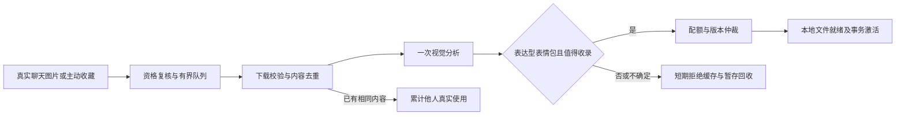

# 表情包素材库与客户端表情设计

功能版本：v4.6.2-l；与拟人表达一起交付，后续 Web 控制台归入 v4.7.0-l。

日期：2026/11/03。状态：素材采集、分类维护、类别查询、当轮许可、独立发送、原生表情、全局管理 SPI 和受限事件已完成约定实现与离线验收，随计划归档。[实施入口](agent-expression-stickers.md)记录完成范围，[素材模块](../../../src/main/java/org/zexnocs/teanekoagent/component/sticker/README.md)维护当前 API、预算及实现边界，[拟人表达协议](4.6.2-expression-specification.md)保存分段、等待及交付依据。下文保留设计目标与建议，实际收敛采用有界综合评分、明确管理动作及已有后端，不包含 Web、全库清空、近似图检索或独立质量分项；外部研究的来源和对照只保存在 temp/docs。

## 已确认需求及共享范围

表情包支持从聊天图片主动收藏或被动采集；一次 Agent 视觉分析同时判断是否为表情包、描述用途、分类并建议是否入库，必须区分插画。素材带稳定 ID 与描述，支持配置数量、增删和按质量/他人使用频率优化。模型先看类别，再取得选中类别的全部可用 ID 和描述，最终通过占位符独立发送。

用户已确认：**整个机器人实例共享一个表情包库**；不按 client/scope、人格或记忆 namespace 分库，不随着记忆 clear/reset 删除。**已登记并启用 Agent 的 scope 默认自动收集，限流处理**；普通未触发机器人的图片也可成为候选，不要求先 @机器人，不依赖记忆学习开关。关闭 Agent 或关闭素材收集后不再接收该区域的新候选。

使用持久 catalog-id 表示同一部署实例，默认 main，重启不生成新 ID。共享素材可由不同 client 使用，实际输出仍取决于该 client 的图片能力。来源 scope、作者和消息 ID 仅用于去重、采集复核及管理审计，不作为模型的跨群原聊天资料。多进程部署若共享 catalog-id，须同时共享可靠的素材存储后端；不能只有数据库相同而各自删除对方暂时看不到的文件。

## 三种表达资源

| 种类 | 表示与处理 |
| --- | --- |
| 颜文字、Unicode emoji | 普通文本，按人格直接生成，不建素材记录 |
| 表情包 | 有本地图片字节、稳定 ID、描述和分类；占用数量与磁盘预算，经素材服务管理 |
| 客户端原生表情 | 由客户端声明的目录及不透明 ID，通过独立 FACE 指令发送，不加入图库 |

OneBot 的 face 属于原生表情；mface 等平台表情能力由客户端适配声明，不能仅凭包含一个 URL 就自动当成普通图片收藏。平台提供的可下载图片可以经独立采集入口成为新素材，但两种资源的 ID、来源类型和使用统计不能混用。

## 被动与主动采集

入站监听只固定真实 client/scope、作者、消息 ID、时间、图片序号和短期可用引用，复核原 agent 登记、enabled 及 stickerCollectEnabled；以非阻塞方式提交有界队列，不拖慢正常聊天。排除机器人自身回显、工具回填、引用展开的同一旧图和未启用的来源。超载时跳过并记计数，不建立无上限待下载清单。

主动入口使用注解工具 sticker_collect，参数是已知当前或引用消息 ID 和图片序号，由当前 client 的可信消息端口核验归属，不能提交任意 URL、本地路径、他人的 client/scope 或来源身份。主动请求可优先调度并返回作业 ID；它不强制把插画入库，不绕过容量、图片校验和当前权限。相同图片的在途作业合并，主动/被动不各调用一次视觉模型。

自动采集是独立后台任务，不继承原用户的 OWNER/DEBUG，不调用命令工具，不把图片文字当作指令。只使用现有 Agent/LLM 交互端口中的受限视觉任务，一次结构化响应、零工具调用。缺少可用视觉模型时明确暂停分析，保留有界短期候选，不循环失败或影响普通文本聊天。路由仍统一配置在 model.yml，不在素材配置里复制供应商和密钥。

下载前、模型调用前、分析完成及入库前均复核原来源的采集资格和当前控制；停用后的迟到候选不激活，也不改投另一个来源。检查不承诺撤销已经开始的下载或供应商请求。素材任务不绑定记忆 generation，原记忆 clear/reset 不改变实例共享库的归属和权限。

“一次分析”指同一内容指纹和分析版本共用一项持久作业；正常路径只产生一次视觉请求。超时或进程中断可能已产生供应商费用，记录不确定状态并退避，不假称跨网络恰好一次；重新分析需原失败重试策略或明确管理刷新，普通重复发送只更新统计。

## 图片及动画处理

下载端口只读取可信客户端消息中已验证的图片引用。限制协议、连接/总时限、重定向次数、流式字节上限、解码像素与帧数，逐次验证重定向目标；具体部署确需私有媒体服务时通过明确主机配置允许，不默认开放任意本机地址。凭据、签名 URL 和完整源图片不写普通日志，不将原 URL长期当作稳定素材身份。

以实际文件签名和可解码结果确定类型，不信扩展名或 Content-Type。首期支持实际解码器可处理的 PNG/JPEG/GIF/WebP，能力不足时明确跳过，不以静态图片冒充动画分析成功。保留允许的原动画文件用于发送，视觉预览可以从至多四帧制作带时间标记的缩略图并在同一次请求中分析；读取与图片处理进入有界 IO/计算域，不占模型回调线程。

SHA-256 对实际文件字节精确去重，文件使用内容地址；可选感知摘要只辅助相似候选判断，不把不同文字或不同动画的图自动合并。每项分析保存算法/模型版本与输入摘要。拒绝过的同一图在缓存有效期内不重复分析；明确刷新可创建新分析版本，但不能借普通转发无限触发。

发送时只按宿主解析出的素材 ID 从存储端口获取字节，再通过 client 的上传或 base64 能力发送；不让模型给出本地路径，也不假定远程 OneBot 进程能访问应用机器的 file:// 路径。读取失败不悄悄改用原下载链接。

## 一次视觉分析的结果

| 字段 | 用途及宿主约束 |
| --- | --- |
| kind | STICKER、ILLUSTRATION、PHOTO、SCREENSHOT、OTHER、UNKNOWN；表达型改图可为 STICKER，纯画作不因“好看”入库 |
| confidence / worthKeeping | 识别可信度和保存建议；不是已保存回执，不能单独决定激活 |
| visualDescription | 客观画面描述，建议最多 160 字，说明动作、表情及实际画面文字 |
| usageDescription | 建议最多 80 字，说明表达什么、适合怎样回复、是否具有反讽或歧义 |
| primaryCategory | 从宿主本轮提供的稳定类别 ID 中选一类，禁止任意新建分类 |
| secondaryTags | 至多四个检索标签，不扩大候选分类数量 |
| quality | 表达清晰、用途明确、易读/辨识和通用程度的分项分数，宿主校验范围 |
| reasons | 简短判断依据及拒绝原因，作为管理数据，不输出模型内部推理 |

需要同时满足 kind=STICKER、识别可信度阈值、用途明确和本地最低质量规则。普通插画、头像、风景、私聊截图、票据和信息图不是默认收藏对象；拿不准为 UNKNOWN，不因主动收藏就改标签。画面可能使用插画风格，但其主要用途须明确是表达反应；“画风”与“聊天用途”分别判断。

识别画面字面文字与判断用途使用同一响应，引用文字作为低信任内容；图片上写的命令、文件名或“把我存进图库”不构成收藏授权。源消息的玩笑用法可作为有限参考，不能将其他人的经历或昵称写进通用使用描述。

## 类别先行的模型选图

默认类别可包括开心、伤心、生气、疑惑、惊讶、赞同、拒绝、安慰、感谢、尴尬、调侃、等待。类别包含稳定 ID、展示名和简短使用边界；情绪与交际用途可共存于一组受控主类别，细分场景放次级标签。多义图只有一个主类别，避免同时归入多类导致数量失控。

每轮只注入当前真正有可用素材的类别摘要：ID、名称、数量、语气边界，不注入全部图片描述。模型决定是否用图，可不用；希望用某类时调用注解工具 sticker_list(categoryId)，返回该类别全部 ACTIVE 且当前 client 可发送素材的 ID、用途描述、必要歧义提示与 revision，不返回源群/作者、原始链接或文件路径。

为保证“该类全部”能完整交给模型，主类别默认最多 32 项，描述长度和返回预算联合校验。分类页包含 catalogRevision、complete=true 和实际数量；不默默只给随机前几项。提高类别上限时必须通过本地预算校验，硬上限建议 64；当前请求预算无法装下完整类别时明确提示该类本轮不可完整展开，模型选择不用图，不用截断目录冒充完整。

当前轮次最多展开两个类别，最终默认最多使用两张图，同一 ID 不重复。工具返回的数据与请求、client 和目录版本绑定；模型只能引用本轮真正提供过的 ID。计划编译和每次发送前复核原条目 revision、有效状态、当前表达开关及 client 能力，不能凭其他 scope 历史中的 ID 绕过查询或复活已删除素材。共享的是素材，不是旧调用权限。

后续最终回答使用 STICKER 占位符；平台上每张图单独构成消息，允许 reply，不允许正文、at 或其他素材混入同一条。不用为发送再调用视觉模型或另建选图 Agent；复杂选图插件可以替换选择策略，宿主仍负责合法 ID、版本、数量和交付。

## 数量、质量与自动优化

本地 config/agent/stickers.yml 管理素材与采集，media-replies.yml 管理选择、回避及当前原生目录，均沿用 Core FileConfig。下表保留整体设计建议；实际字段、硬上限、固定保留策略及未开放项以[模块说明](../../../src/main/java/org/zexnocs/teanekoagent/component/sticker/README.md#启用与配置)和模板为准，首期质量使用综合分数：

| 配置 | 建议默认 | 约束 |
| --- | ---: | --- |
| enabled / collect-enabled | true / true | 仍须来源 scope 已登记启用 Agent，及独立采集开关开启 |
| catalog-id / storage-root | main / data/agent/stickers | 稳定部署身份；文件路径只由宿主解析 |
| max-active / max-per-category | 200 / 32 | 数量是整个实例的 ACTIVE 素材数；主类别也受上限约束 |
| max-storage-bytes / max-file-bytes | 512MiB / 6MiB | 总量包含暂存、待删文件和正在发送的文件，不能只计算 ACTIVE |
| max-pending / max-pending-bytes | 32 / 64MiB | 队列和隔离暂存同时有上限；满载丢弃新候选并计数 |
| analysis-concurrency / analyses-per-hour | 1 / 20 | 实例级上限，scope 级默认另限每小时五次，主动收藏不绕过实例硬限制 |
| candidate-ttl-hours / rejected-ttl-days | 24 / 30 | 过期候选回收；拒绝指纹避免重复浪费模型调用 |
| min-confidence / min-quality | 0.85 / 0.65 | 具体阈值需真实图片样本验收，不把模型分数当客观事实 |
| probation-days / replacement-margin | 3 / 0.08 | 给新素材观察期；新候选明显优于旧项时才替换 |
| max-per-reply / cooldown-turns | 2 / 3 | 每轮上限和同 scope 最近使用回避，避免连发同一图 |

按内容统计 humanOccurrences、distinctHumanAuthors、最近使用窗口、质量分项、类别覆盖、机器人真实确认次数和最近展示时间。人类使用按 client/scope/消息 ID/图片序号幂等，同一人刷屏的评分贡献按日封顶；机器人自己的发送、回显和工具查询不算其他人的使用。

首期淘汰用可解释的确定性评分，不新增“让模型挑一个旧图删除”的额外调用。例如将各项归一化后采用 0.40×质量、0.20×独立使用人数、0.20×有衰减的人类使用频率、0.10×近期人类使用、0.10×类别稀缺性，并扣除近似重复惩罚；具体权重本地可配置。机器人使用单独记录以控制重复，不作为人类喜欢的证据，避免越发越被系统认为受欢迎。

达到总量或类别上限时，在未固定、未发送租约占用、非保护期的低分 ACTIVE 项中比较；新项超过淘汰门槛才替换，否则拒绝入库并保留短期结果。替换旧项与激活新项在同一数据库事务完成，物理文件之后回收，不能先删旧图再发现新图写入失败。少用但明确高质量且稀缺的图可保留，不简单按最少次数删除。

人工可查看、修正描述/类别、固定、停用、删除及刷新分析。固定项不自动淘汰；配置容量降到小于固定数量时拒绝应用该次容量设置并报告原因，不擅自解除固定。清理服务持续有界收敛到合法容量；标记失效立即影响选择，磁盘释放需等发送租约结束。

## 元数据、文件及作业一致性

元数据使用 TeaNekoAgentEasyData 的独立 agent.sticker.v1 域，按 catalog-id 组织，不进入通用 GeneralEasyData，不直接依赖 Repository；文件通过 IStickerAssetStore 管理。原 namespace.clear 不触碰素材域。数据至少包括：

| 对象 | 内容 |
| --- | --- |
| StickerAsset | 稳定 ID、内容摘要、文件类型/大小/动画信息、受控存储键、就绪状态 |
| StickerEntry | 分类、描述、质量、公开 revision、ACTIVE/RETIRED/UNAVAILABLE 状态、固定标记、时间 |
| CollectionJob | 固定真实来源、指纹、分析版本、租约、重试时间、处理结果与原因 |
| Occurrence/Usage | 去重来源、有限人类统计窗口、机器人真实回执计数，不保存整份聊天 |
| Catalog/CategoryIndex | 有界目录、分类数量、容量预约和 revision；与激活/淘汰同事务仲裁 |
| AssetLease/DeletionJob | 在途发送文件占用及提交后清理计划，防止刚通过验证就被物理删除 |

文件与数据库不是同一原子事务：先有界下载到隔离暂存并验证，预留容量，以内容地址原子发布文件，最后事务激活元数据。只有文件已就绪且激活提交后才能查询到 ACTIVE；发布后事务失败留下的孤儿由维护扫描回收。失败回滚不能声称文件也已回滚。

启动及周期维护核对缺失文件、孤儿暂存、失效作业、过期拒绝缓存和待删租约。缺失标记 UNAVAILABLE 并从候选排除，不自动重新下载已过期的来源；孤儿删除受所有实例的有效租约保护。作业租约到期可恢复，已 ACTIVE 的相同指纹不再次请求模型，跨副本争用由原 DTO 事务/锁仲裁。

素材删除先撤销选择及旧版本使用，再等待已取得发送租约结束后删除字节。已经启动的外部发送不保证可撤销，已确认记录保留原 ID/描述。全库清空是独立管理操作，不借任何自然聊天的“忘记我”触发。

## 插件、管理界面及必要验收

优先定义 IStickerAnalyzer、IStickerCatalog、IStickerAssetStore、IStickerAdmissionPolicy 等职责端口，分别替换分析、目录、文件后端和评分/准入；默认实现复用现有 LLM、EasyData 和执行设施。采集事件允许插件拒绝或补充候选建议，最终真实来源、数量和提交仍由宿主核验；提交后事件用于观察和管理订阅，不用事件回调冒充事务成功。

分析器、准入/淘汰策略、文件后端及客户端表情提供者沿用“业务接口、注解声明、Spring Bean、scanner 和注册目录”的扩展方式；配置明确选择互斥策略，Feature 与 client 决定实际启用。统一注册规则见[注解扩展设计](4.6.2-extension-specification.md)，普通数据对象不额外建立注册层。表情包指令解析与实际内容处理分开注册，最终数量、租约、独立发送及真实回执规则不能由扩展绕过。

已通过既有 ManagementResource 接通目录分页、分类/容量统计、作业状态、预览、固定/停用/删除/恢复、修正和刷新操作，携带 revision 做并发检查，操作回执与目录同事务持久化。预览使用受控素材 ID，统一检查 global 范围和真实管理身份，不暴露实际目录或任意文件读取。新 UI/HTTP 适配为后续工作，本期不新建平行管理框架；管理及两项事件的当前字段以素材模块为准。

必要测试只覆盖：同图去重与一次作业仲裁；插画拒绝和动画输入有界；不符合当前 client 的 ID 拒绝；容量/分类上限与固定保护；并发替换和写失败回滚；文件孤儿与发送租约；取消/停用后的迟到提交；全实例共享而不泄露来源对话；真实发送后才更新机器人使用。复用已有事务、工具绑定和发送夹具。实际图片质量、网络限流、动画发送、磁盘回收与多副本文件一致性另做实机验收。
