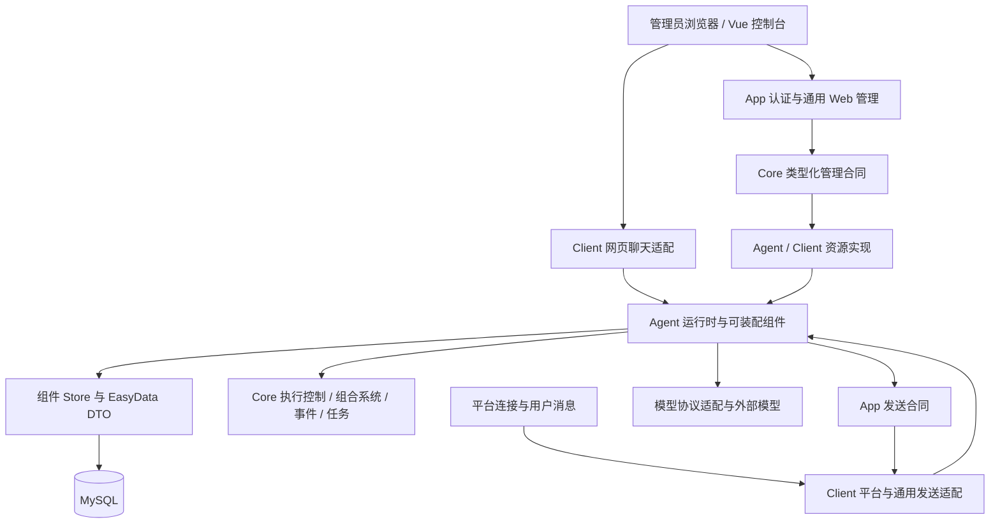
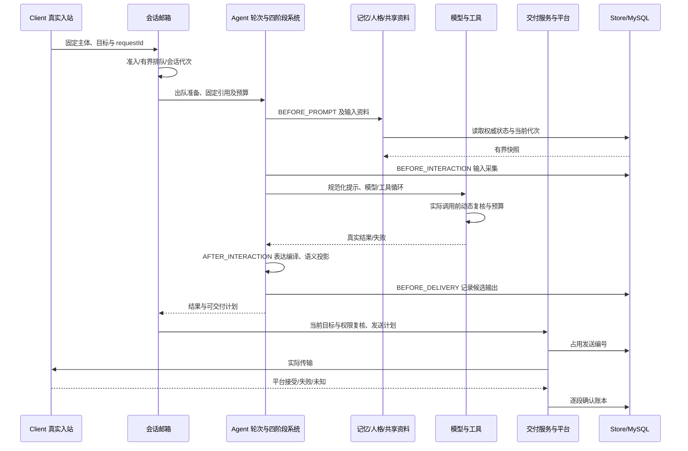
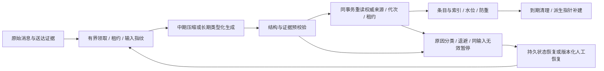

# v4.8.6-l 整体架构、组件作用与数据流

日期：2026/11/06；首发基线：单实例、小规模受控用户。结论依据当前源码、三项专题审查和 [本轮验证](verification.md)。共享记忆及社交 S01–S08 已完成归档；本轮没有重复执行其全部实施验收，也未调用真实模型或平台。

当前架构符合小团队 MVP 的基本形态：一个应用进程，按职责分层，业务组件通过声明与接口组合，复用统一存储、权限和执行控制。主要风险在已有状态机的边界不一致、大方法可读性、部分旧注册目录，以及尚无实测证明的容量与恢复。没有依据要求整体换框架或拆成微服务。

## 结构与目录

上图是运行调用/注入关系，不是 Java 依赖方向。Core 的接口调用上层注入实现，不要求 Core import Agent。编译依赖规则仍为：Core 自身；App→Core；Agent→App/Core；Client→Agent/App/Core；Plugin→前述层。

| 位置 | 真实职责 | 评价与下一步 |
| --- | --- | --- |
| `teanekocore` | 扫描、插件归属、ExecutionControl、组合系统、任务/事件、配置和数据库基础合同 | 公共能力已有消费者；不要搬入 Agent 业务判断。旧任务与旧目录按 E1/A1/A2 收敛 |
| `teanekoapp` | 通用客户端、消息/发送/身份合同、Web 安全与管理宿主 | 允许上层贡献资源及错误映射，层次合理；A01 的生命周期归宿主修复 |
| `teanekoagent/component` | 每种能力的参数、系统、服务、DTO、Store 与适配 | 是垂直能力模块，不只是 ECS 空壳；具体作用见下表 |
| `teanekoagent/runtime` | 实例、轮次、邮箱、准入、预算、结束与通用工作流 | 状态所有权集中有价值，但会话协调器职责过多，应沿现有锁边界逐步拆分 |
| `teanekoagent/integration` | App 通用消息/配置/命令/Web 接入 | 不应引用具体 OneBot/Web 实现；本轮分层定向测试通过 |
| `teanekoagent/database/configuration/plugin` | 专用数据入口、组合根和插件版本合同 | 与业务 Store 分开合理；配置不等于业务已启用 |
| `teanekoclient` | 网络/网页消息适配、真实主体映射与实际发送 | 内部 Agent 客户端仍是已有 Sender/Response 集成合同，不能只因可直调服务就删除 |
| `teanekoplugin` | 用户业务扩展 | 利用下层接口和注解；不能绕过真实身份与动态资格 |
| `frontend/src/pages` 与业务视图 | 单一页面声明、宿主、生命周期及功能页面 | 已无需在 App 和导航各加一份分支；大页面应渐进分离 DTO/decoder、业务状态和展示 |

当前是单 Gradle 应用的包级模块化，分层由约定和测试约束，不是编译器强制的多模块隔离。首发可接受；仅当团队、依赖或发布责任产生真实分化时，再把稳定合同拆为 Gradle 子模块。目录改名本身不能解决共享状态和事务耦合。

## 全部组件目录的实际作用

`component` 下共 14 个一级目录；`memory/shared` 是子目录。以下均检查到真实装配或调用点，不能把“默认不执行”当作无用，也不能把“有调用”当作模型效果已经达标。基础装配见 [AgentAssembly.java](../../../src/main/java/org/zexnocs/teanekoagent/component/AgentAssembly.java)，阶段编排见 [AgentTurnPipeline.java](../../../src/main/java/org/zexnocs/teanekoagent/runtime/AgentTurnPipeline.java)。

| 目录/能力 | 入口与实际消费 | 功能及重复判断 | 首发边界 |
| --- | --- | --- | --- |
| llm | `LLMComponent`，轮次 interact→`ILLMInteractionService` | 路由、参数、预算、协议及模型/工具循环；framework 与 instance 分别是通用合同和供应商实现 | 最低必需；真实模型质量未验 |
| tool | `ToolComponent`、注解目录→`LLMToolBinding` | Agent 参数与权限语义；与 LLM 工具协议层各有职责 | 可选；文件/代码/知识端口没有默认真实后端，不能宣传为已可用业务 |
| memory | `MemoryComponent` 两个系统阶段、资料来源、`LayeredMemoryProcessor` | 原话窗口、中期摘要、长期事实/画像、代次及证据，不是同一数据的无意义复制 | 可选；保留期/权威和派生数据须明确。分层启用时旧内存摘要关闭，非默认双重模型调用 |
| personality | `PersonalityResolveSystem`、观察与学习服务 | 稳定人格与表达风格，结果确实进入提示和持久补正 | 可独立装配；独立宿主回退有用途，不因默认少用直接删除 |
| expression | `ExpressionCompileSystem`、`ExpressionFeature` 与交付链 | 将结果编译为分段、节奏、表情与发送计划 | 可选；不拥有图库或社交状态，编译成功不等于发送成功 |
| sticker | 消息采集→后台采集服务，`MediaReplyFeature`→`StickerReplyService` | 图库采集、分类、生命周期与有证据选图；不是第二套 expression | 可选，依赖表达/工具；J01/J03 待修，根锁容量未验 |
| skill | `SkillComponent`、`AgentSkills`、`LocalSkillCatalog` | 按需资料和工具依赖复核 | 可选且默认无选择；不自行授予权限或运行任意代码 |
| schedule | `AgentScheduleService`→Store→`NativeScheduleAdapter` | 用户提出的持久提醒/计划、到期恢复、取消及防重 | 可选；与自主聊天候选的所有权不同，不宜简单合并 |
| proactive | Coordinator→Service→原 Agent 与 delivery | ACTIVE 下的定时/接话候选、静默/冷却/退避与弃言 | 可选；是 Care 执行宿主，不是第二套 Care；不承诺补跑所有错过时刻 |
| social | `SocialComponent`、`SocialStateService`、评估工具及 Store | 关系/心情共用的真实用户状态与来信防重、关怀账本 | 共享实现包，无独立组件卡片；affinity/mood/care 实际消费 |
| affinity | 继承 SocialComponent、提示资料、`social_appraise` | 持续亲近度影响表达与关怀门槛，不等同于用户事实画像 | 可选，依赖记忆/工具；不授予新权限 |
| mood | 继承 SocialComponent，当前心情投影及衰减 | 短期角色状态，与长期人格/亲近度不同 | 可独立于 affinity 选择，依赖记忆/工具；无模型效果实测 |
| care | `CareContextSource`→`ProactiveContexts` | 对已确认私聊的 TIMER 候选收紧资格，按联系/未回复提供理由，实际送达后记账 | 可选，依赖 proactive/affinity；条件不满足就不调用模型是正确行为 |
| contact | `PrivateContactTool`→Service→Client 的 `IPrivateContactTransport` | 本轮真实用户明确邀请后向本人既存同空间私聊发信，确认后记历史 | 可选，依赖记忆/工具；授权来源不同于系统自主关怀，不合并成任意目标发送器 |
| memory/shared | `SharedMemoryComponent`→PromptSource→`ISharedConversationStore` | 同空间按真实用户召回其他群聊近期原话/确认回复，保留来源并复核 | 独立可选；私聊内容不会仅因同用户出现在群里就自动公开 |

社交入口及参数详见 [开发说明](../../development/agent-social-memory.md)，持久化域见 [EasyData 权威说明](../../../src/main/java/org/zexnocs/teanekoagent/database/easydata/README.md)。内存历史、分层存储、旧事实和新长期记忆存在兼容/独立宿主用途，删除前须确认运行配置、迁移及回退需求结束。

要判断功能是否值得保留，后续真实模型验收应记录：功能装配次数、合格输入数、实际触发数、成功/拒绝原因、增量耗时/成本，以及用户可观察收益。例如记忆检查事实正确引用与遗忘，图库检查工具选择和实际图片送达，社交检查有无实质表达影响及合理弃言。未触发率高可能是没有合格输入，不能直接认定服务在“摸鱼”。

## 扩展成本与剩余限制

`M_core` 表示修改原核心编排类数，`M_ui` 表示修改既有前端组件数；配置启用与新声明单列。以下是源码合同判断，并非本轮新建插件后的端到端实验。

| 扩展 | 当前可复用路径 | 成本和限制 |
| --- | --- | --- |
| ECS 组件/系统 | [AgentComponentRegistry](../../../src/main/java/org/zexnocs/teanekoagent/component/AgentComponentRegistry.java)→[AgentComponentFeature](../../../src/main/java/org/zexnocs/teanekoagent/component/AgentComponentFeature.java)→[AgentPluginRuntime](../../../src/main/java/org/zexnocs/teanekoagent/plugin/AgentPluginRuntime.java) | 既有四阶段和字段内 `M_core=0, M_ui=0`；声明进入真实系统管线。人格 SNAPSHOT 和表达 PLAN 仍由宿主显式消费，替换内建语义不承诺零修改 |
| 注解工具 | [TeaNekoAgentToolRegistry](../../../src/main/java/org/zexnocs/teanekoagent/component/tool/TeaNekoAgentToolRegistry.java) 与 [TeaNekoAgentToolMethods](../../../src/main/java/org/zexnocs/teanekoagent/component/tool/TeaNekoAgentToolMethods.java) | 既有参数/可信上下文内 `M_core=0`；重名拒绝、真实代理和动态资格仍在。G03 历史关闭保持 |
| 模型/配置适配 | [LLMModelService](../../../src/main/java/org/zexnocs/teanekoagent/llm/framework/model/LLMModelService.java)、[LLMConfigurationDirectory](../../../src/main/java/org/zexnocs/teanekoagent/llm/file_config/form/LLMConfigurationDirectory.java) | 注解/接口发现并原子发布；普通模型字段可复用表单。新增协议仍须履行凭据、容量和规范化响应合同 |
| 管理能力 | [ManagementGateway](../../../src/main/java/org/zexnocs/teanekocore/plugin/management/ManagementGateway.java)、[WebManagementCalls](../../../src/main/java/org/zexnocs/teanekoapp/web/WebManagementCalls.java) | 普通资源 `M_core=0`，类型化 DTO 和原路由复用；仍需宿主白名单和真实授权，注册不等于启用 |
| 顶层页面 | [page-registry.ts](../../../frontend/src/app/pages/page-registry.ts)、[ConsolePageHost.vue](../../../frontend/src/app/pages/ConsolePageHost.vue) | 新页面及一条声明即可，原宿主 `M_ui=0`；构建期装配适合首发，不等于远程 UI 热插拔 |
| 旧 Client/内容/命令目录 | 现有 Bean/注解扫描 | 新实现容易加入，但 E1 冲突及重扫仍不统一，不能宣布所有扩展目录已满足 AGENTS |
| 全新协议/可信类型/控件/阶段 | 新合同与实际消费方 | 允许有依据的一次性修改；不把所有变化包装成“只加注解”，也不新增中央业务 ID 分支 |

专用 HTTP 路径仍需显式修改安全允许列表，这是 V484-D01 的条件边界。普通管理已经可扩展，首发无需先建“自动开放所有 Controller”的框架。

收尾的装配补丁进一步区分了资料所有权：独立 Spring 组件资料通过 [IAgentComponentPromptSource](../../../src/main/java/org/zexnocs/teanekoagent/component/IAgentComponentPromptSource.java) 声明由组件拥有，[AgentExecutionConfig](../../../src/main/java/org/zexnocs/teanekoagent/configuration/AgentExecutionConfig.java) 不再将其重复聚合为宿主全局来源。新增同类资料须遵守这个合同，仍由所选组件贡献并动态复核权限；类型标记本身不授予权限。本轮另补跑了相关 Spring 装配检查，范围见验证记录。

## 请求、交付与后台数据流

图中输出历史/计划不是“已送达事实”。实际发送由宿主和交付服务完成，逐段确认供后续摘要/学习使用；无法确认时不能虚构用户已收到。`CompletionStage` 也不统一代表持久提交、平台接受或用户已读，必须读具体端口合同。

旧长期记忆故障的修复保留“失败不推进成功水位”的约束。最新共享索引在低频维护中逐批补建，不能再列为永久不可恢复；维护关闭或分区多时恢复仍需要时间。后台和前台应共享可观测容量，不靠无限并行追赶积压。

管理 API 数据流、物理表及全部端点族单独维护于 [存储/API 专题](storage-api-review.md)，不在这里复制第二份接口清单。

## 异步执行与失败边界

| 边界 | 已有机制 | 当前风险与判断 |
| --- | --- | --- |
| 会话与轮次 | 同会话串行、排队期限/容量、代次、取消控制、预算与实际结果 | 有实质异步设计；大协调器维护风险高，局部容量不等于整个应用都有限额 |
| 组件 System | [SystemPipeline](../../../src/main/java/org/zexnocs/teanekocore/framework/composition/SystemPipeline.java) 串行组合 Stage，检查写集合和快照版本，拒绝迟到补丁 | `thenCompose` 不自动切线程；System 同步前段必须及时返回。旧 A4 仍是扩展执行域合同，不是已测得阻塞事故 |
| 事务与内存 | EasyData 事务重试、行版本、提交后缓存失效 | J01 表明可重试回调不能修改进程计数；回滚只覆盖数据库，不覆盖内存对象 |
| 模型/发送 | 预算、期限、原发送账本、未知结果保护 | 停止等待不保证外部服务撤销；迟到成功也不能重授旧空间权限 |
| 管理资源 | 真实会话守卫、统一授权、共享槽 | A01 无宿主截止；补期限时仍须等待物理工作回收 |
| 旧 Task/平台入站 | 执行器与任务状态已有实现 | A1/A2：容量和协作停止不足，不能把取消 Future 当停止 Callable |
| 前端请求 | 同源/CSRF、部分 Abort 与回执守卫、活动轮询 | F01 覆盖遗漏；fetch 缺统一产品期限。读可重试，写超时必须保留未知状态 |

调度器注释不能作为背压证明。当前 `ScheduledThreadPoolExecutor` 是固定核心线程加无界队列，`setMaximumPoolSize` 不产生注释中的扩容/有界能力；此判断已对照 [JDK 25 合同](https://docs.oracle.com/en/java/javase/25/docs/api/java.base/java/util/concurrent/ScheduledThreadPoolExecutor.html)。当前已设置移除取消任务策略，不报成“取消任务必然积压”。

## 重复工作与扩展边界

| 观察 | 事实、风险与建议 |
| --- | --- |
| V486-P01：社交来信重复观察 | [SocialComponent.resolve](../../../src/main/java/org/zexnocs/teanekoplugin/agent/social/social/SocialComponent.java) 在 affinity/mood 各调用一次 `SocialStateService.observe()`；[EasyDataSocialStateStore](../../../src/main/java/org/zexnocs/teanekoplugin/agent/social/social/adapter/EasyDataSocialStateStore.java#L69) 先锁关系再用事件去重。不会重复计分，但重复事务存在。收尾装配已改为按类型延迟取得容器服务及显式资料归属，该重复工作仍在。可在单轮拥有者内共享观察结果，各能力继续复核资格；没有实测瓶颈，不提前大改 |
| V486-E02：主动来源的扩展合同 | [ProactiveContexts](../../../src/main/java/org/zexnocs/teanekoplugin/agent/social/proactive/ProactiveContexts.java) 直接使用来源列表；没有来源 ID/owner 目录。内置 Care 有自己的插件/组件门控，所以不能宣称当前可被任意用户绕过；但新增第三方来源不会自动取得常规 Feature 的归属、冲突、停用守卫。开放前复用现有基础设施 |
| 主动来源是交集 | `prepare()` 中任何适用来源返回空都会拒绝整个候选；不是多个理由竞争的并集。目前唯一内置 Care 用于收紧资格，行为明确。新需求若要独立候选须另定义合同，不能为了触发更多发言直接把 AND 改 OR |
| 前端恢复规则重复 | 多页面各自维护 pending/确认/刷新，已造成 F01 与旧修复范围漂移。抽取生命周期和展示，保留各端点 decoder，不做一个接受任意响应的万能成功函数 |
| 大服务与紧凑写法 | 会话服务约 1670 行、长期 Store 约 1190 行，复杂锁和状态分散；具体方法见 Java 专题。先展开、命名和明确所有者，再提取协作者，不能只按行数拆文件 |
| 文档漂移 | namespace README 仍称 GeneralRepository，旧模块说明也保留历史版本叙述；实施时更新实际操作入口并链接权威数据说明，不覆盖历史计划和发布记录 |

本轮没有足够证据判定某个完整组件目录应删除。存在可裁剪的首发装配和重复执行机会，但兼容回退、观测、安全守卫和失败分支的低频执行不能作为删除理由。

## 扩容路线与触发条件

1. **首发**：修正确认缺陷，限定启用组件/客户端、入口额度和数据窗口；建立 schema、备份恢复与关键指标。保留单实例和现有协议。
2. **单实例增长**：先实测房间全站写锁、图库根锁、JSON 解码、目录遍历和后台竞争。按热点拆聚合/索引、分页或缓存，不预先把所有 JSON 改关系表。
3. **需要多副本时**：明确会话、在途工作和草稿的归属；验证持久领取/租约、发送防重、跨实例缓存失效和代次仲裁。本地 Semaphore、邮箱和本地会话不能靠增加负载均衡自动扩展。
4. **出现独立团队/发布责任时**：再考虑编译子模块或独立进程，继续复用稳定 Store/API 合同。若没有数据或运维收益，不引入分布式事务和服务网络成本。

是否达到首发标准按 [assessment-standard.md](assessment-standard.md)判定；本页的架构适用结论不替代真实数据库、模型质量、外部送达与负荷证据。
