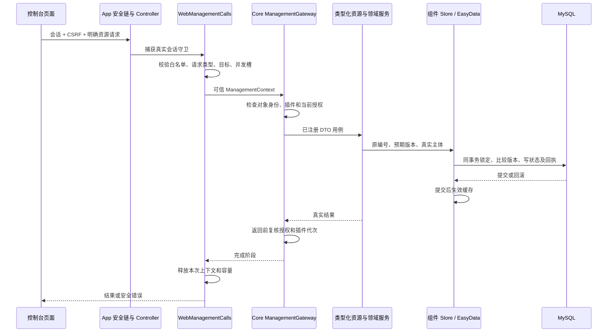

# v4.8.6-l 存储、API 与生产边界审查

审查日期：2026/11/06。基线是当前 `4.8.6-l` 工作区，包括尚未提交的共享记忆与社交组件修改。首发目标采用用户确认的“单实例、小规模受控用户”。本文是源码审查，没有连接真实 MySQL、模型或平台，没有执行负荷测试；正式回归结果由本版总评统一记录。

结论：当前“模块化单体＋类型化管理用例＋EasyData 事务适配”适合这一首发范围。权限边界和持久防重设计有实际作用，不需要为了 MVP 改成微服务或把所有键值数据改成独立业务表。主要不足是管理调用缺少宿主层有界生命周期、网页聊天读取使用全站写锁，以及生产建表和恢复流程尚缺实际验收。当前控制台是管理员产品，不是多个普通用户共享登录的 SaaS 门户。

实现器以[下一步实施](next-steps.md)为准；本文解释证据、机制和验收方法，不另建一份任务状态。

## 1. 历史事项复核与当前边界

| 范围 | 当前源码判断 | 本轮结论边界 |
| --- | --- | --- |
| V484-D01：增加专用 HTTP 端点需修改中央安全白名单 | 普通管理资源仍可通过新增 `ManagementResource<Q,R>` Bean 接入既有路由；专用 Controller 才需补充精确授权 | 保持条件设计项。默认拒绝具有实际安全价值，不为追求“完全不修改原类”自动开放全部 Controller |
| 4.8.5-l 持久状态与临时观察分流 | `TeaNekoAgentEasyData.cleanable()` 明确选择临时实体，继续使用同一事务服务；防重摘要、租约、业务水位保留在持久域 | 源码方向合理；此前通过的迁移测试属于历史证据，本页不重复计数。MySQL 跨表回滚和恢复仍须实机验收 |
| 共享记忆索引缺少重建的早期候选 V486-D03 | 最终读取的 `EasyDataLayeredMemoryStore.maintain()` 已对未过期短期消息调用 `indexShared()`；每页 16 行，分区和消息游标循环 | **撤销“没有重建入口”的缺陷判断。** 应验证清理后补建、回滚及代次边界，不再要求实现已经存在的入口 |
| 管理请求权限与撤销 | 真实会话、上下文对象身份、资源白名单、插件代次在调用和业务阶段继续校验 | 本轮未确认越权漏洞；源码审查不能替代所有并发交错与代理部署验证 |

共享索引的补建与轮转证据见 [EasyDataLayeredMemoryStore.java](../../../src/main/java/org/zexnocs/teanekoagent/component/memory/adapter/EasyDataLayeredMemoryStore.java) 第 339–391 行。更新审查期间工作区发生了这一变化，因此不保留较早读取形成的过期缺陷。

## 2. 实际数据结构

当前生产源码声明 **6 张实体表**，其中 5 张是 EasyData 表，1 张是物品表；Java 领域类型的数量不等于数据库表的数量。这里描述的是实体映射，实际部署中的旧表、列定义和索引仍需查询 MySQL。

| 物理表 | 映射与字段 | 约束/索引 | 实际用途与评价 |
| --- | --- | --- | --- |
| `general_data` | 继承 `BaseEasyDataObject`：`id`、`namespace`、`target`、`o_key`、`o_value LONGTEXT`、`version` | 自增主键；`(namespace,target,o_key)` 唯一；`@Version` | 通用业务及 `web.chat.v1` 网页目录、房间消息窗口和媒体。低规模配置适合，聊天正文整行 JSON 形成读写放大 |
| `tea_neko_agent_data` | 同上 | 唯一键；`(namespace,target,id)`；`(namespace,id)` | Agent 配置、空间、记忆、人格、发送/命令账本、图库、计划和社交状态的权威存储 |
| `cleanable_data` | 同上 | 唯一键；`(namespace,id)` | 可恢复的维护游标、观察回执和共享消息指针。不能因为表名包含“可清理”就将执行权写入其中 |
| `command_data` | 同上 | 唯一键 | Core 指令专用数据入口；和 Agent 的 `agent.command.v1` 命名空间不等价，不能按名称相似合并 |
| `debug_data` | 同上 | 唯一键 | 调试数据隔离入口。存在专用表并不说明它在每次请求上工作，也不构成应自动启用的业务功能 |
| `item_data` | `uuid`、`owner_id`、`namespace`、`type`、`metadata_type`、`metadata MEDIUMTEXT`、`count`、`version` | UUID 主键；`(owner_id,namespace,type)` 唯一；`@Version` | 通用物品数量与附加信息。属于其他机器人业务，不应为瘦身 Agent 而直接删除 |

字段权威来源：[BaseEasyDataObject.java](../../../src/main/java/org/zexnocs/teanekocore/database/easydata/BaseEasyDataObject.java)、[TeaNekoAgentEasyDataObject.java](../../../src/main/java/org/zexnocs/teanekoagent/database/easydata/TeaNekoAgentEasyDataObject.java)、[CleanableEasyDataObject.java](../../../src/main/java/org/zexnocs/teanekocore/database/easydata/cleanable/CleanableEasyDataObject.java)、[ItemDataObject.java](../../../src/main/java/org/zexnocs/teanekocore/database/itemdata/data/ItemDataObject.java)。其余三张表分别由 [GeneralEasyDataObject.java](../../../src/main/java/org/zexnocs/teanekocore/database/easydata/general/GeneralEasyDataObject.java)、[CommandEasyDataObject.java](../../../src/main/java/org/zexnocs/teanekocore/command/easydata/CommandEasyDataObject.java)、[DebugEasyDataObject.java](../../../src/main/java/org/zexnocs/teanekocore/database/easydata/debug/DebugEasyDataObject.java)声明。

Agent 的逻辑域及保留责任已集中维护在[专用 EasyData 文档](../../../src/main/java/org/zexnocs/teanekoagent/database/easydata/README.md)，本页不再复制完整命名空间表。需要保持三类区别：

- **权威业务状态**：事实、空间代次、人格、整理水位、租约和待发送/待释放资源责任。
- **防重与仲裁记录**：操作编号、身份/参数摘要、终态、删除决定、社交事件来源摘要。即使没有正文，也可能必须持久保留。
- **派生或短期观察**：可从权威记录重建的指针、维护扫描位置、已完成且无恢复责任的观察回执。

EasyData 的职责不是掩盖数据库：`atomic()` 强制已有事务；锁、范围扫描和行版本由基础层统一提供；缓存失效注册到 `afterCommit()`。当前业务 Store 没有必要绕过 DTO 直接访问 Repository。相关实现见 [EasyDataTransactionDto.java](../../../src/main/java/org/zexnocs/teanekocore/database/easydata/core/EasyDataTransactionDto.java) 第 44–135 行和 [TeaNekoAgentEasyData.java](../../../src/main/java/org/zexnocs/teanekoagent/database/easydata/TeaNekoAgentEasyData.java) 第 76–100 行。

这种存储设计降低了小规模产品扩展字段和增加组件的成本，但数据库不能直接用业务字段约束所有 JSON 内容。实现器仍须维护 `schemaVersion`、有界解码、版本拒绝、锁顺序和滚动清理。只有当真实查询、热点竞争或容量数据证明需要时，再将热点域映射为独立表，并保持原 Store 接口，不要求所有域同步迁移。

## 3. API 端点与扩展路径

以下是实际端点族；动态段以花括号表示，不代表通配授权。请求/响应的权威定义是对应 Controller、领域请求 DTO 和错误映射，不把设计文档中的未来接口列为已实现。

| 用例 | 实际端点 | 状态与权限合同 |
| --- | --- | --- |
| 登录与会话 | `GET /api/v1/auth/csrf`；`POST /api/v1/auth/login`；`GET /api/v1/auth/session`；`POST /api/v1/auth/logout` | 本地管理员凭据；服务端会话；登录和退出有 CSRF 边界，登录入口另有频率限制 |
| 运行观测 | `GET /api/v1/console/overview`、`/console/machine` | 管理员只读；没有直接开放全部 Actuator |
| 客户端/目标 | `GET /api/v1/clients`、`/clients/{client}/accounts`、`.../accounts/{account}/targets`；`POST /api/v1/clients/{client}/actions/discover` | 服务端目录解析真实目标；显式发现操作与高频读取分离 |
| 聊天配置 | `GET /api/v1/settings/sections`；`GET/POST /api/v1/clients/{client}/accounts/{account}/targets/{target}/settings/{section}`；同路径下 `GET /operations/{operation}` | 类型化配置区、版本冲突与原编号回执；不接收任意 Bean/类名 |
| 文件配置 | `GET /api/v1/file-configs`、`/{id}`；`POST /{id}/actions/validate`、`/save`、`/apply`；`GET /{id}/operations/{operation}` | 明确文件配置适配器；保存与应用分离；原操作标识核验；不提供任意路径写入 |
| 机器令牌 | `GET /api/v1/client-tokens`；`POST /{client}/reveal`、`/{client}/actions/save`、`/actions/apply`；`GET /operations/{operation}` | 单独管理员 API；显式查看；机器连接使用独立凭据，不沿用浏览器令牌 |
| 作用域管理 | `POST /api/v1/clients/{client}/accounts/{account}/targets/{target}/management/{resource}` | 新增类型化 `ManagementResource<Q,R>`，保留宿主白名单和插件资格，复用既有路由 |
| 实例管理 | `POST /api/v1/management/{resource}` | 仅 `GlobalManagementResource`，不借用聊天目标扩大作用域 |
| 模型与 Agent 目录 | `GET /api/v1/model-configurations`；`POST /api/v1/model-configurations/{id}/probe`；`GET /api/v1/agent/catalog/components`、`/tools` | 已认证管理员；目录读取不代表启用组件/工具；探测是有副作用及成本的显式操作 |
| 指令目录/执行 | `GET /api/v1/commands`；`POST /api/v1/chat/rooms/{room}/commands`；`GET/POST /api/v1/clients/{client}/accounts/{account}/targets/{target}/console`；`GET .../operations/{operation}` | 管理会话与实际平台身份分离；指令受理与完成用回执区分 |
| 网页房间 | `GET/POST /api/v1/chat/rooms`；`POST /rooms/{room}/open`、`/members`；`DELETE /rooms/{room}?revision=...`；`POST /profiles` | 档案由服务端映射 TeaUser；成员更新和删除带版本；网页模拟档案不是独立登录用户 |
| 网页消息/媒体 | `GET/POST /api/v1/chat/rooms/{room}/messages`；`GET /operations/{operation}`；`GET/POST /media`；`GET/DELETE /media/{media}` | 消息游标和窗口重置显式返回；发送原编号防重；图片须经已认证入口，上传为受控二进制 |

来源：[WebSecurityConfig.java](../../../src/main/java/org/zexnocs/teanekoapp/web/WebSecurityConfig.java)、[WebManagementController.java](../../../src/main/java/org/zexnocs/teanekoapp/web/WebManagementController.java)、[ChatSettingsController.java](../../../src/main/java/org/zexnocs/teanekoapp/web/settings/ChatSettingsController.java)、[WebFileSettingsController.java](../../../src/main/java/org/zexnocs/teanekoapp/web/files/WebFileSettingsController.java)、[MachineTokenController.java](../../../src/main/java/org/zexnocs/teanekoapp/web/files/MachineTokenController.java)、[WebChatController.java](../../../src/main/java/org/zexnocs/teanekoclient/web/controller/WebChatController.java)。

管理用例通过 POST 携带显式 action，并不自动意味着架构落后。它复用了授权、类型绑定、版本和幂等合同，适合当前管理产品。进一步扩展的重点是稳定请求/响应样例、字段限制、错误码、重放期限及兼容策略，不是机械地把所有 action 改成 REST 动词。

已存在的错误映射将参数、目标不存在、权限撤销、版本冲突和内部失败分开；但容量拒绝当前使用 `IllegalStateException`，会映射为一般 `409 SETTINGS_UNAVAILABLE`。容量拥塞应提供独立、可识别的错误类型及 429/503 等合适响应，避免 UI 将重试型容量不足误解成配置冲突。该调整与下述 A01 一并处理，不另立重复任务。

## 4. 管理数据流与实际关注点分离

这里 Core 不需要认识 Web、Agent 或 OneBot；App 定义宿主管理与认证，Agent 实现组件领域能力，Client 提供平台适配。它不是仅有接口外观的分层。`WebSessionGuard` 捕获服务端会话后可在异步事务上复核，避免依赖原 HTTP 线程的 ThreadLocal；`ManagementGateway` 在授权前后和返回前检查插件状态；资源重名在构造期失败。这些边界应保留。

资源实现仍需负责原编号防重、预期版本和副作用前的授权复核。新增一个 `ManagementResource` 不会自动获得这些领域语义；扩展文档和测试应明确这一责任，不能把“已注册”当成“安全执行完备”。

## 5. 问题、失效机制与修改建议

| 编号 | 类别/建议优先级 | 证据与触发场景 | 实际后果 | 修改方案 | 验收 |
| --- | --- | --- | --- | --- | --- |
| V486-A01 | 生命周期设计缺口，P2；生产前需给出明确处理策略 | `WebManagementCalls` 第 40 行固定共享 32 槽；第 123 行用不带 deadline 的 `ExecutionControl.create()`；第 149–153 行只在返回阶段结束时释放。一个已授权资源返回长期不完成的 stage，多次调用可占满全部管理槽 | 管理调用持续显示繁忙，后续健康管理资源也被拒绝；`active` 和会话引用一直保留。当前没有证据证明现有资源已发生永久挂起，这是明确可达的宿主契约缺口 | 复用现有 `ExecutionControl` 增加可配置逻辑截止与关闭处理；下游 I/O/事务有自己的真实时限；限制单资源占用并暴露在途年龄/占用。将业务实际完成与 HTTP 等待结束分开，已开始的写操作按原编号查询结果；容量错误采用独立映射 | 用一个可控未完成资源占位，确认无关资源仍能响应；到期/关闭后无新副作用；真实底层完成才释放物理容量；取消、迟到结果及重复完成不重复释放，写入超时不误报回滚 |
| V486-D01 | 已确认串行化设计，P2；吞吐影响待测 | `WebChatStore.page()` 第 242 行进入公共事务；第 669 行无条件取全站 catalog 写锁；第 628 行读取房间 journal 也取写锁。多个房间同时轮询就相互竞争；每次读取解码整个房间 JSON，再筛最多 50 条 | 增加房间/浏览器会扩大锁等待与 JSON 处理成本；跨房间读请求可以阻塞发送、成员修改与删除。源码能证明串行路径，不能据此声称当前已超时或达到某个 QPS 上限 | 第一步分离纯读取和修改路径，保持会话、房间存在性和版本检查；只读快照或必要的共享锁按一致性目标选择。第二步仅在真实容量需要时把目录元数据、每房间状态和消息窗口拆分为独立目标/行，保留序列和操作账本原子性 | 使用多个房间同时轮询与发送，记录数据库锁等待、P95、连接池等待；覆盖删房/成员撤销与读写交错；分页 reset、重复发送、掉线查询和唯一序号保持正确 |
| V486-D02 | 生产发布门槛，P1 验收项；不是已证实的数据损坏缺陷 | `application-prod.properties:5` 使用 `ddl-auto=update`；仓库没有本次完整版本化 schema 迁移与演练结果；实体与文档声明新表、索引和跨表迁移 | 无法仅凭应用启动断言生产索引、权限、锁语义或回退成立；启动期 DDL 失败/耗时与业务变更耦合，旧二进制不了解已迁移结构 | 首发建立可重复的建表基线和 schema 清单；后续迁移编号化并记录应用版本/校验值。生产权限区分建表与运行；完成基线后可用 validate 检查。允许采用已有部署 SQL 流程，不要求为这一目的立刻引入新框架 | 新库安装、上一版本数据升级、失败回滚与完整备份恢复均实际运行；查 `SHOW CREATE TABLE`/索引和关键 `EXPLAIN`；验证两表事务及关闭旧实例后升级，不以 H2/Mock 替代 MySQL |
| V486-D03 | 早期候选已撤销，保留验证项 | 最新 `EasyDataLayeredMemoryStore:355–357` 有补建；第 388–391 行循环游标 | 当前不能再归因为“清理临时索引后永远不会恢复”。补建是渐进过程，关闭维护时不会自行恢复 | 不再新增第二套补建器。补充现有维护链的清理后恢复验收，并说明恢复受维护开关、分区数和每页预算影响 | 有效旧消息重建；过期/退役消息不复活；写指针失败原事务回滚；清理期间新增消息无重复；多分区完整轮转 |

A01 修改须特别注意：[ManagementGateway.java](../../../src/main/java/org/zexnocs/teanekocore/plugin/management/ManagementGateway.java) 已对资源 stage 调用 `control.guard()`。**仅把 `create()` 换成 `withDeadline()`，再沿用当前 `whenComplete` 释放槽，会把逻辑到期误当作底层工作结束。** 截止时间不强制撤销已开始的数据库事务或外部发送。需要明确可观测的底层完成阶段和资源所有权；未能实际取消的任务继续占用对应物理容量或被隔离，不能无限放行新任务。

D01 不应简单把所有 `WRITE` 换成 `NONE`：`home()` 在首次访问时会建立默认档案，删除房间和成员更新也依赖原子性。先识别纯读函数，再拆分初始化/写用例和读取快照，保留必要的锁顺序及撤权检查。

一个非阻断文档漂移：[`memory/namespace/README.md`](../../../src/main/java/org/zexnocs/teanekoagent/component/memory/namespace/README.md) 第 27 行仍声称使用 `GeneralEasyDataRepository` 且不增加表，已与专用 `TeaNekoAgentEasyData` 和 `tea_neko_agent_data` 不符。应改为引用专用存储权威文档，避免实现器照旧说明绕过当前入口。

## 6. 扩容准备与容量检查

单实例首发可保留以下实现，扩容时按实际触发条件演进：

| 当前选择 | 首发是否合理 | 需要升级的触发条件 | 扩容前必须保留/增加的合同 |
| --- | --- | --- | --- |
| 服务端本地管理员会话与实例内在途上下文 | 合理，符合当前管理员控制台 | 多副本或独立普通用户登录 | 会话策略、凭据代次传播、独立用户授权和目标归属；不能把网页模拟档案直接当登录主体 |
| EasyData JSON 业务聚合 | 有界数据适用，减少早期 schema 和 ORM 成本 | 单行变大、锁等待或业务字段查询成为瓶颈 | 保留 Store 接口、原编号/版本/代次；热点域逐项拆分，数据迁移可回退 |
| 房间消息最多 500 条的默认窗口（配置范围 50–2000） | 可作为受控测试/管理员聊天窗口 | 用户要求完整聊天归档、搜索或大量房间 | 区分窗口和历史产品承诺；采用行级游标分页、保留策略和可验证删除，不用无限提高窗口掩盖问题 |
| 共享索引先检查最新 128 条指针、最终最多 24 条 | 有明确工作预算 | 当前聊天、不可用来源或重建插入的旧指针挤占候选窗口，跨聊天召回不足 | 衡量有效命中率和扫描截断；需要时按业务时间/来源分区设计索引，并继续对权威消息、当前授权及代次复核；不要取消预算变成全域扫描 |
| 进程内缓存、房间门闩和并发槽 | 支持单实例隔离与限流 | 计划水平扩容 | 明确跨实例缓存失效、任务领取/发送防重和版本 fencing；增加实例数之前先验证多实例竞争，不能仅加负载均衡 |

以上是扩容条件，不是本轮必须落地的分布式框架。小规模 MVP 仍需测量最慢路径：网页读轮询、长上下文管理读取、图库根锁、记忆后台维护与正常对话同时运行。至少记录活跃目标数、并发数、数据规模、P50/P95、错误率、锁等待、连接池等待和在途任务年龄；没有这些实际输出时，不给“生产容量已达标”的结论。

## 7. 存储/API 评估通过标准

| 维度 | 首发必须达到 | 证明方式 |
| --- | --- | --- |
| 身份与权限 | 匿名不能读业务 API；已登录管理权限不等于平台原生身份；撤权、插件停用与目标删除后迟到调用被拒绝 | 安全定向回归＋实际 HTTPS/代理环境检查 |
| 协议与错误 | DTO 有界，缺字段/错误类型/未知 action/非法版本可诊断；未决写操作可用原编号查询；忙碌与版本冲突可区分 | Controller/用例协议测试，覆盖成功、失败和超时未知结果 |
| 事务与幂等 | 权威状态、索引、防重记录同事务；重复操作不重做副作用；回滚不发布新缓存/游标 | 真实 MySQL 故障注入、并发更新与跨表回滚 |
| 数据保留 | 清理临时观察不重授执行权；仍有效派生索引可恢复；过期/旧代次正文不继续召回 | 清理前后对照，原编号重放、空间换代与重启验证 |
| 资源与容量 | 界定 API、后台任务、数据库连接和模型调用的容量；逻辑超时不提前释放底层资源；可定位长期占用 | 有界挂起诊断＋代表性负载，结果包含环境和输入规模 |
| 发布与恢复 | 初次建表、版本迁移、配置/JAR/数据库一致备份和恢复可重演 | 保存实际 SQL/schema、迁移日志和恢复演练输出 |
| 扩展 | 新增普通资源/Store 实现不修改中央业务条件分支；声明冲突明确失败；新增能力仍需授权和生命周期约束 | 一个最小扩展样例＋冲突/停用/超时用例 |

本页完成了源码和目录层面的核查，不宣称上表所有验收已执行。真实数据库、平台和生产恢复继续与[部署验收清单](../../development/agent-deployment.md#实机验收清单)衔接。
